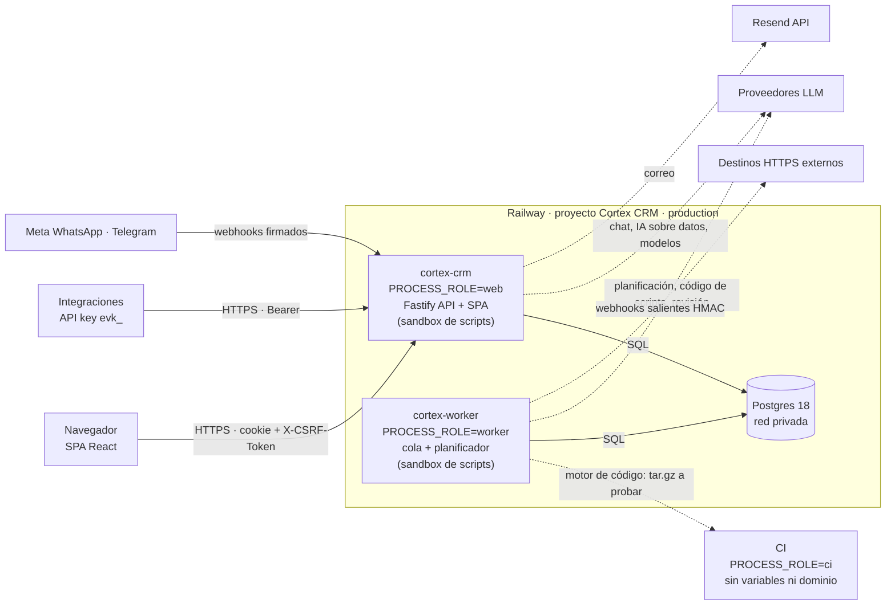
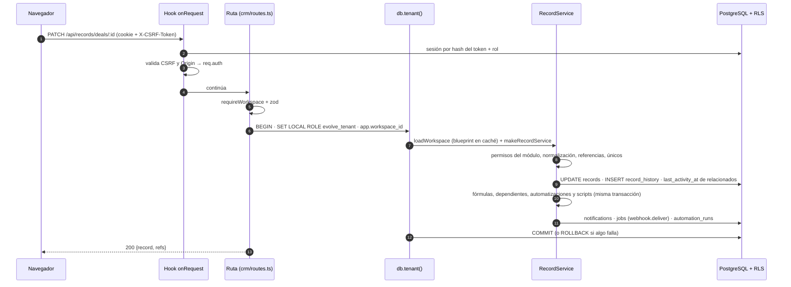

# Arquitectura de Cortex CRM

> Describe el sistema tal y como está implementado en este repositorio.
> **Nota para mantenedores:** la información estructural (stack, mapa de carpetas, convenciones, flujo de una petición) va al principio del documento —aproximadamente los primeros 20.000 caracteres— y las decisiones de arquitectura (ADR) al final. Mantén ese orden al editarlo.

## 1. Resumen

Cortex CRM es un CRM SaaS multi-organización que la IA puede hacer evolucionar de forma segura: cada organización pide cambios en lenguaje natural a EVOLVE AI ENGINE y los recibe como nuevas versiones de su propia configuración (y, si hace falta lógica a medida, de sus propios scripts), probadas y aprobadas por personas. Está escrito en **TypeScript de extremo a extremo**:

| Capa | Tecnología | Dónde |
|---|---|---|
| Servidor | Node.js 24 (imagen Docker y CI; `engines: >=22`) + Fastify 5, empaquetado con esbuild en `dist/server/index.js` (y la CLI `dist/server/cli.js`) | `server/src` |
| Cliente | SPA React 19 + Vite 8 + Tailwind CSS 4 + TanStack Query 5 + React Router 8 + lucide-react, compilada en `dist/web` | `web/src` |
| Lógica compartida | Esquemas zod 4 (blueprint, change set), fórmulas, condiciones, plantillas, validación de registros | `shared/` |
| Datos | PostgreSQL con Row Level Security (`pg`); PGlite (Postgres en WASM) en desarrollo y tests | `server/src/db` |
| IA | AI Provider Manager propio: SDK oficial de Anthropic + adaptador compatible con OpenAI | `server/src/ai` |
| Scripts por organización | Sandbox QuickJS compilado a WebAssembly (`quickjs-emscripten-core` + `@jitl/quickjs-wasmfile-release-sync`, 0.32.0) | `server/src/crm/scripts.ts` |
| Tests | Vitest 5 (264 tests en 18 archivos) sobre PGlite en memoria y un proveedor de IA simulado | `server/test` |

Un único artefacto (una sola imagen Docker) se ejecuta con dos **roles de proceso** seleccionados por `PROCESS_ROLE`: `web` (API + SPA en el mismo origen) y `worker` (cola de trabajos y planificador). En desarrollo el rol por defecto es `all` (ambos en un proceso). En Railway son los servicios `cortex-crm` (web) y `cortex-worker` (worker); en una instalación desde la plantilla, `Cortex` y `Worker`. Un tercer rol, `ci`, solo lo usa el servicio de CI del **motor de código fuente** ([CODE_ENGINE.md](CODE_ENGINE.md)): la administración de la plataforma pide cambios del código real, un agente de IA los escribe, se prueban en ese CI aislado y, con aprobación humana, se despliegan en los servicios de la propia instalación (nunca en GitHub).

## 2. Vista de sistema



- El navegador solo habla con `cortex-crm`; la base de datos nunca se expone a Internet.
- El servicio **CI** solo recibe del worker (vía la API de Railway, con un token de proyecto) el código de un cambio del motor de código fuente para construirlo y probarlo; después, con aprobación, el worker despliega ese mismo código en el worker (canario) y en el web.
- El servicio web atiende peticiones síncronas (CRUD, asistente, funciones de IA sobre los datos, aprobaciones, publicación). El worker ejecuta lo lento o periódico (pipeline de EVOLVE, incluido el desarrollador de scripts; auditorías de seguridad; webhooks salientes; automatizaciones programadas; recálculo de fórmulas; limpieza).
- Los **scripts de cada organización** se ejecutan en el proceso que dispara la automatización: en el web para los eventos de registros (alta, edición, borrado) y en el worker para las automatizaciones programadas y las pruebas del sandbox. Nunca salen de la plataforma ni se publican en un repositorio.
- Ambos procesos comparten la base de datos, que es también la cola de trabajos (tabla `jobs`).

## 3. Mapa del repositorio

```text
server/src/
  index.ts          Arranque: .env (fuera de producción) → config → BD → migraciones → dependencias → roles → apagado
  cli.ts            CLI de operación: conceder/retirar/listar administradores de plataforma (dist/server/cli.js)
  app.ts            Fastify: parsers (rawBody), helmet/CSP, rate limit, auth, manejador de errores, rutas, SPA
  worker.ts         Manejadores de trabajos (createJobHandlers) y planificador periódico (Scheduler)
  config.ts         Variables de entorno validadas con zod y valores derivados
  deps.ts           AppDeps (config, db, box, ai, mailer, fetchImpl, now) y appBaseUrl()
  db/db.ts          Interfaz Db: query / tx (privilegiado) y tenant (RLS); pg o PGlite
  db/migrations.ts  Esquema (001), Row Level Security (002) y migraciones aditivas (003…); TENANT_TABLES
  auth/plugin.ts    Hook onRequest: API keys, sesión por cookie, CSRF, origen; guards require*
  auth/routes.ts    /api/auth: registro, login, sesiones, contraseña, verificación, invitaciones
  workspace/        provision.ts (alta de organización con el CRM base) · routes.ts (ajustes, equipo,
                    invitaciones, API keys, secreto de firma de webhooks, auditoría, notificaciones, exportación)
  crm/store.ts      RecordStore: PgRecordStore (producción) y MemoryRecordStore (sandbox); SQL tipado
  crm/record-service.ts  Lógica de negocio de registros (idéntica en producción y sandbox)
  crm/automations.ts     Disparadores por evento, programados y ejecución de acciones (también run_script)
  crm/scripts.ts    Sandbox QuickJS/WebAssembly de los scripts por organización: runScript, buildScriptInput, contrato
  crm/effects.ts    SideEffects: notificaciones, webhooks (cola), ejecuciones; Pg y Memory
  crm/context.ts    loadWorkspace (caché LRU de blueprints por versión, acotada a 256 MB), ajustes, makeRecordService
  crm/refs.ts       Resolución de títulos de relaciones, usuarios y archivos para la UI
  crm/dashboards.ts Cálculo de widgets · crm/reports.ts Informes y datos para predicciones
  crm/routes.ts     /api/blueprint, /records, /files, /lookup, /search, /dashboards, /pages, /reports e IA sobre
                    los datos (/ai/query, …/classify, /files/:id/analyze; prompts y validación: crm/ai-features.ts)
  ai/manager.ts     AI PROVIDER MANAGER: credenciales, modelos, enrutado, límites, fallback, uso
  ai/providers/     anthropic.ts (SDK oficial) · openai-compatible.ts · registry.ts (catálogo)
  ai/pricing.ts · ai/memory.ts · ai/json.ts · ai/types.ts · ai/routes.ts (/api/ai)
  assistant/        routes.ts (chat contextual) · tools.ts (herramientas y propuestas)
  evolve/           pipeline.ts (incluye el desarrollador de scripts y el plan por partes) · prompts.ts ·
                    planner-context.ts (contexto del planificador: blueprint completo o índice + detalle) ·
                    simulator.ts · apply.ts · validate.ts · risk.ts · impact.ts · releases.ts · security.ts ·
                    routes.ts (/api/evolve)
  comms/            connectors.ts (WhatsApp, Telegram; Gmail/Outlook/Slack planificados) · routes.ts
  admin/routes.ts   /api/admin/* (plataforma) y rutas públicas (/api/public/forms, /api/client-errors)
  code-engine/      Motor de código fuente (/api/platform/*): agent · guards · sql-guard · paths · source ·
                    workspace · tar · diff · railway · ci · review · pipeline (code.plan) · deploy (code.deploy) ·
                    store · settings · routes
  lib/              crypto · ssrf · jobs · mailer · audit · errors · metrics
server/test/        helpers.ts + 18 archivos de tests Vitest (264 tests)
shared/             constants · blueprint · changeset · appearance · formula · conditions · templates · records ·
                    time · default-blueprint
web/src/            main.tsx (rutas) · components/ (Layout, navigation, AiPanel, AiTools, CommandPalette, ui,
                    fields, charts, WidgetBody, RecordTable, AppearancePreview, Markdown, toast) · lib/ (api,
                    session, hooks, theme, types, format, colors, icons) · pages/ (Dashboard, ModulePage,
                    RecordPage, CustomPage, Reports, auth/, evolve/, settings/)
                    · pages/platform/ (CodeEngine: motor de código fuente, solo administración de la plataforma)
.github/workflows/  ci.yml (typecheck, tests, build, npm audit): opcional, solo se ejecuta si el código se aloja en GitHub
Dockerfile · Dockerfile.ci (CI del motor de código) · railway.json · .env.example · package.json · tsconfig.json · vitest.config.ts
```

## 4. Convenciones para contribuir

1. **Validación en la frontera.** Toda entrada (`params`, `query`, `body`) se valida con zod en la ruta. Los `ZodError` se convierten en `400 validation_failed` automáticamente.
2. **Errores tipados.** Usa los helpers de `server/src/lib/errors.ts` (`badRequest`, `unauthorized`, `forbidden`, `notFound`, `conflict`, `unprocessable`, `tooMany`, `unavailable`). Formato de respuesta: `{"error": {"code", "message", "details"}}`. Los mensajes al usuario van en español.
3. **Autorización explícita.** Empieza cada ruta con `requireWorkspace(req, rolMinimo)`, `requireUserSession(req)` (acciones que no deben poder hacerse con API key, datos personales del usuario y funciones de IA) o `requirePlatformAdmin(req)`. Los permisos por módulo (`permissions.read/create/update/delete` del blueprint) los aplica `RecordService`.
4. **Datos de organización siempre en `deps.db.tenant(workspaceId, q => …)`** y, además, con filtro explícito `workspace_id = $n` en cada consulta (defensa en profundidad con RLS). `deps.db.query`/`tx` (conexión privilegiada) se reserva a tablas de plataforma (`users`, `sessions`, `auth_tokens`, `jobs`, `error_events` y, solo desde el motor de código fuente, `source_changes` y `platform_settings`) y a búsquedas inherentemente globales (token de API key, token de webhook, slug de formulario público).
5. **SQL parametrizado** siempre (`$1…$n`, `= ANY($n::uuid[])`, helper `inList`). Nunca interpolar valores. Los filtros del blueprint se traducen con `conditionsToSql`/`sortToSql` (`crm/store.ts`).
6. **Mutaciones de registros a través de `RecordService`** (validación, fórmulas, historial, automatizaciones). Solo las migraciones de datos (`backfill_field`), la restauración y el rollback escriben `records` directamente. Los scripts tampoco escriben: devuelven intenciones que aplica `RecordService`.
7. **IA solo vía `deps.ai`** (`run`, `runJson`, `runAgent`) indicando una `AiTask`. Ningún módulo llama a un proveedor directamente. La tarea decide el modelo (configurable por organización). Se llama al modelo fuera de `db.tenant()` y su salida se valida (zod + reglas deterministas como `validateBlueprint` o `toWidget`) antes de usarla; nada que genere el modelo se ejecuta como SQL, y el código de scripts que escribe solo se ejecuta en el sandbox.
8. **Trabajo en segundo plano con la cola** (`INSERT INTO jobs` o `enqueue()`), dentro de la misma transacción que el cambio que lo origina.
9. **Auditoría** de toda acción sensible con `audit(q, …)`; el campo `meta` se redacta automáticamente (`redact()`).
10. **Secretos** con `SecretBox` (AES-256-GCM) y AAD de contexto; nunca se devuelven al cliente ni se registran (solo pistas enmascaradas `••••1234`).
11. **Límites de frecuencia** en rutas costosas o abusables con `config: { rateLimit: { max, timeWindow } }`.
12. **Tests** en `server/test/*.test.ts` con `setup()` (PGlite en memoria + LLM simulado) y `Client` (gestiona cookie y CSRF); `env.drain()` ejecuta los trabajos encolados.
13. **Frontend:** estado de servidor con TanStack Query, llamadas con `web/src/lib/api.ts` (añade `X-CSRF-Token`), componentes de `components/ui.tsx`, textos en español y soporte de modo oscuro (`dark:`).
14. **Configuración centralizada en `config.ts`**: el resto del código recibe `deps.config` (únicas excepciones: `RAILWAY_GIT_COMMIT_SHA` en `app.ts`, `NODE_ENV` para el coste de scrypt en `lib/crypto.ts` y para decidir si se carga `.env` en `index.ts`/`cli.ts`). El código nuevo no debe leer `process.env`.
15. **Lógica a medida de una organización = script de su blueprint**, nunca código común. Se ejecuta solo con `runScript` (`crm/scripts.ts`, QuickJS/WebAssembly con un runtime nuevo por ejecución); el módulo `vm` de Node no se usa como aislamiento. Lo que necesite red, credenciales u OAuth es una funcionalidad de la plataforma: la escribe el equipo de desarrollo y se despliega con la imagen (`railway up`).

## 5. Backend: flujo de una petición

**Pipeline de Fastify** (`app.ts`): logger JSON (pino) con redacción de `authorization`, `cookie`, `x-csrf-token` y `set-cookie` y URLs saneadas (sin *query* y con los tokens de invitación y webhooks enmascarados) · `trustProxy` solo para el proxy inmediato y, en Railway, `req.ip` normalizado desde `X-Real-IP` (que el *edge* sobrescribe) en el propio servidor HTTP (`serverFactory` + `lib/client-ip.ts`), de modo que no se puede falsear con cabeceras · `bodyLimit` 2 MB · id de petición UUID · parser JSON propio que conserva `req.rawBody` (firmas HMAC) · parser `application/octet-stream` para subidas · `@fastify/cookie` · `@fastify/helmet` (CSP estricta, HSTS en producción) · límite general propio (600 peticiones/min por IP a `/api`, antes de autenticar) y `@fastify/rate-limit` por ruta · hook de autenticación · métricas en `onResponse` · manejador de errores · rutas bajo `/api` · estáticos de `dist/web` con *fallback* a `index.html`.

**Hook de autenticación** (`auth/plugin.ts`, solo rutas `/api/`; la ruta se evalúa ya decodificada o resuelta por el router, así que codificaciones como `/%61pi/…` no se saltan la autenticación ni el CSRF):
1. `Authorization: Bearer evk_…` → busca `sha256(token)` en `api_keys` no revocadas cuyo creador **siga siendo miembro**; el rol efectivo es el menor entre el de la clave y el actual de su creador; sin cookies ⇒ sin CSRF.
2. Cookie `evolve_session` (nombre interno que se mantiene) → busca `sha256(token)` en `sessions` + rol en `memberships`; renueva la caducidad (deslizante 14 días, máximo absoluto 90).
3. Métodos que modifican (no GET/HEAD/OPTIONS) con sesión: exige `X-CSRF-Token` igual al de la sesión (comparación en tiempo constante).
4. Métodos que modifican sin Bearer: si llega `Origin`, debe coincidir con `APP_URL` o con el host de la petición.
5. Exentos de CSRF/origen: `/api/hooks/*`, `/api/public/*`, `/api/client-errors`.



**Manejador de errores** (`app.ts`):

| Origen | HTTP | `error.code` |
|---|---|---|
| `ZodError` | 400 | `validation_failed` (`details`: hasta 20 `{path, message}`) |
| `AppError` | el suyo | el suyo (`bad_request`, `forbidden`, `conflict`, `validation_failed` 422, `busy` 503…) |
| `ProviderError` (IA) | 409 / 429 / 502 | `ai_not_configured`, `ai_limit_exceeded`, `ai_<código>` (`details`: intentos) |
| Error Fastify < 500 (413, 429 del rate limit…) | el suyo | el suyo (`rate_limited`…) |
| Cualquier otro | 500 | `internal` (+ `requestId`); se registra en `error_events` sin datos sensibles |

## 6. Núcleo metadata-driven

**Blueprint** (`shared/blueprint.ts`): definición versionada de la estructura del CRM de cada organización: módulos (campos, vistas, diseño de ficha, permisos), automatizaciones, paneles, integraciones webhook, formularios, **scripts** y su **capa visual** (apariencia, menú y páginas propias). Cada versión es una fila inmutable de `blueprint_versions`; `workspaces.blueprint_version` apunta a la vigente. `loadWorkspace()` cachea el blueprint parseado por `(organización, versión)` (hasta 500 entradas).

**Capa visual** (`appearance`, `navigation`, `pages`; constantes y utilidades sin dependencias en `shared/appearance.ts`): solo presentación, nunca datos ni permisos. `appearance` fija el color principal (la paleta 50…950 se calcula en el navegador), el acento, el nombre de la aplicación, la tipografía, los radios, la densidad, el estilo del menú lateral, el tema por defecto y un CSS personalizado que solo puede ser CSS plano (`sanitizeCustomCss`, en el servidor al validar y otra vez en el navegador antes de inyectarlo); `navigation` agrupa el menú y elige la página de inicio; `pages` son pantallas propias (`/p/:key`) hechas de bloques (títulos, textos, widgets, listas de registros, formularios, botones y separadores) con un rol mínimo. Se cambian con las operaciones `update_appearance`, `update_navigation`, `upsert_page` y `remove_page` (riesgo bajo; medio si añaden CSS personalizado) y `blueprintForRole` (`crm/visibility.ts`) quita las páginas, bloques y enlaces que el rol no puede ver; `GET /api/pages/:key/data` calcula solo los widgets legibles. Los blueprints anteriores siguen siendo válidos (los tres campos son opcionales o vacíos por defecto). Detalle en [AI_ENGINE.md](AI_ENGINE.md#51-capa-visual-apariencia-menú-y-páginas).

**Registros**: todos los módulos comparten la tabla `records` (`module_key` + `data` JSONB). Las columnas de sistema (`id`, `created_at`, `updated_at`, `last_activity_at`, `created_by`) son consultables en filtros y orden.

**`RecordService`** (`crm/record-service.ts`) es la única lógica de negocio de registros y es **idéntica en producción y en el sandbox**; solo cambian el almacén y los efectos:

| Interfaz | Producción | Sandbox (EVOLVE) |
|---|---|---|
| `RecordStore` | `PgRecordStore` (SQL parametrizado, contexto RLS) | `MemoryRecordStore` (Map en memoria) |
| `SideEffects` | `PgSideEffects` (notificaciones, cola de webhooks, `automation_runs`) | `MemorySideEffects` (captura para aserciones) |
| Reloj | `deps.now()` | reloj simulado (`advance_days`) |

`create`/`update`/`delete`: permiso del módulo según el rol (salvo actores `system`/`automation` o contexto `trusted`) → `normalizeRecordInput` (tipos, opciones, obligatorios, valores por defecto con plantillas) → comprobación de referencias (la relación existe en el módulo destino, el usuario es miembro, los archivos existen, unicidad sin distinguir mayúsculas) → fórmulas (varias pasadas; agregados `*_RELATED`) → escritura + `record_history` → `last_activity_at` de registros relacionados → recálculo de fórmulas dependientes (profundidad ≤ 2) → automatizaciones. El borrado es lógico (`deleted_at`).

**Traducción a SQL** (`conditionsToSql`): según el tipo de campo — numéricos solo si `jsonb_typeof = 'number'`; listas (`multi_select`, `file`) con `@>`/`?|`; booleanos; texto sin distinguir mayúsculas e `ILIKE` con escape; fechas por día. Un campo desconocido produce `false` (nunca SQL arbitrario). El operador `changed` solo aplica a automatizaciones.

**CRM por defecto** (`shared/default-blueprint.ts`): módulos Empresas, Contactos, Oportunidades (pipeline kanban, importe ponderado por fórmula, calendario de cierres), Tareas (estado, prioridad, vencimiento, recordatorio, tablero y calendario) y Actividades; tres automatizaciones (ganada → probabilidad 100 %, perdida → 0 %, recordatorio de tarea), el panel principal y un formulario web (no público por defecto). No incluye scripts.

## 7. Automatizaciones, scripts, fórmulas y plantillas

- **Disparadores:** `record_created`, `record_updated`, `record_deleted`, `field_changed` (opcionalmente con valor `to`) — se ejecutan en la misma transacción que el cambio — y `date_reached` (`offsetDays` −365…365, ventana de 3 días) e `inactivity` (`days` sin actividad), que evalúa el worker cada 5 minutos.
- **Acciones:** `update_field`, `create_record` (con `linkField` hacia el registro que dispara), `send_webhook` (encola `webhook.deliver`), `notify` (a un campo de usuario, a un rol mínimo o a todos) y `run_script` (ejecuta un script de la organización).
- **Seguridad de ejecución:** profundidad máxima 3 (evita bucles, también los que provocan los scripts), log por ejecución en `automation_runs` (hasta 50 líneas), deduplicación atómica de las programadas por `(automatización, registro, valor/periodo)`. Un error en una acción marca la ejecución como `failed` sin impedir que se guarde el registro que la disparó.
- **Scripts por organización** (`crm/scripts.ts`): `blueprint.scripts` (≤ 50; `key`, `name`, `description` como especificación, `code` ≤ 20.000 caracteres, `enabled`, `timeoutMs` 50–3000, defecto 1000). `function run(input)` es una función pura y síncrona que recibe `record`, `previous`, `trigger`, `related` (≤ 50 por campo de relación), `refs`, `now` y `tz`, y devuelve intenciones validadas con zod en modo estricto: `update`, `create` (≤ 10), `notify` (≤ 5) y `log` (≤ 20). Cada ejecución usa un runtime QuickJS nuevo, en un pool de 2 *worker threads* con plazo duro (`timeoutMs` + 250 ms; si vence, el hilo se termina y se sustituye), 16 MB por asignación y 32 MB de memoria WebAssembly por hilo, 192 KB de pila e interrupción por plazo; sin red, archivos, `require`/`import`, `process` ni temporizadores; `console.log` se recoge en el log de la ejecución. La plataforma aplica el resultado con `RecordService` como una automatización (validación, referencias, fórmulas, historial; profundidad máxima 3). Detalle en [AI_ENGINE.md](AI_ENGINE.md#6-scripts-por-organización).
- **Fórmulas** (`shared/formula.ts`): analizador propio sin `eval` (≤ 1000 caracteres, ≤ 500 tokens, profundidad ≤ 40). Referencias `{campo}`, aritmética, comparaciones, `AND/OR/NOT` y funciones `IF, MIN, MAX, ROUND, FLOOR, CEIL, ABS, CLAMP, COALESCE, LEN, CONCAT, UPPER, LOWER, CONTAINS, DAYS_SINCE, DAYS_UNTIL, TODAY, YEAR, MONTH, COUNT_RELATED, SUM_RELATED, AVG_RELATED`.
- **Plantillas** (`shared/templates.ts`): `{{today}}`, `{{today+3d}}`, `{{now+2h}}`, `{{week_start}}`, `{{month_start}}`, `{{year_start}}`, `{{record.id}}`, `{{record.<campo>}}` (unidades `h`, `d`, `w`, `m`=30 días), con zona horaria de la organización.

## 8. Frontend

- **Entrada** `web/src/main.tsx`: rutas con carga diferida (`lazy`). Públicas: `/login`, `/register`, `/forgot-password`, `/reset-password`, `/verify-email`, `/invite/:token`, `/f/:slug/:form`. Con sesión (dentro de `AppLayout`): `/`, `/m/:module`, `/m/:module/:id`, `/p/:page` (páginas propias), `/reports`, `/evolve`, `/evolve/requests/:id`, `/evolve/releases`, `/evolve/security`, `/settings/:tab`.
- **Sesión** (`lib/session.tsx`): `GET /api/auth/me` devuelve usuario, organización activa, rol, `csrfToken` y *features* (`emailEnabled`, `signupEnabled`); el token CSRF se guarda en memoria y `lib/api.ts` lo envía en `X-CSRF-Token`. Los errores del servidor llegan como `ApiError` (incluidos los errores por campo de `details.fields`). El parámetro `next` del login solo admite rutas internas (empieza por una única `/`, sin barras invertidas ni caracteres de control); si no, redirige a `/`.
- **Layout** (`components/Layout.tsx`): barra lateral generada a partir del blueprint (los módulos nuevos aparecen sin desplegar código; con `navigation.groups`, grupos plegables más «Otros» con lo que no esté en ningún grupo; filtro si hay más de 12 módulos; páginas, paneles y enlaces), apariencia de la organización aplicada con `lib/theme.ts` (tokens de Tailwind en `<html>`, menú lateral claro/oscuro/de marca, tema por defecto si la persona no eligió otro, CSS personalizado salvo en EVOLVE, Ajustes y Plataforma; se restablece al cambiar de organización), selector de organización, paleta de comandos (`⌘/Ctrl+K`), botón y panel **EVOLVE AI** (`⌘/Ctrl+J`), tema claro/oscuro/sistema, campana de notificaciones (sondeo cada 60 s), menú de usuario y aviso de verificación de correo. El panel de IA se abre por defecto en pantallas de 1280 px o más y solo se recuerda la elección explícita de la persona (`localStorage`, clave `evolve-ai-open`); en pantallas más estrechas es una capa que nunca se abre sola y se cierra al navegar.
- **Atajos** (`lib/hooks.ts`): `⌘K`, `⌘J`, `G D` (panel), `G E` (EVOLVE), `G R` (informes), `G S` (ajustes), `C` (crear registro en un módulo), `?` (ayuda).
- **Páginas:** inicio (`navigation.home`: una página propia o un panel; `/?panel=<clave>` abre un panel concreto), panel con widgets (personalizable por administradores mediante change sets manuales), páginas propias (`pages/CustomPage.tsx`: rejilla de 6 columnas por ancho de bloque con `WidgetBody`, `RecordTable`, `Markdown`, formularios y botones), módulo con vistas tabla/kanban (arrastrar y soltar cambia el campo de agrupación)/calendario mensual, ficha con diseño por secciones, edición, línea de tiempo (incluye las ejecuciones de automatizaciones y scripts con su log), notas, documentos (análisis con IA: `AnalyzeFileButton`), «Clasificar con IA» (`ClassifyButton`), mensajería y relacionados; informes con «Pregunta a tus datos» (`AskDataCard`; los tres en `components/AiTools.tsx`, widgets con `WidgetBody`) y predicción por IA; EVOLVE (peticiones con sondeo cada 2–3 s, detalle con pasos, plan, «Vista previa» de los cambios visuales (maqueta antes/después, menú y estructura de las páginas), impacto, tarjeta «Código de los scripts», pruebas, revisión cruzada, aprobación y publicación, y aviso informativo cuando la petición necesita una funcionalidad de la plataforma; versiones con rollback y restauración; seguridad); ajustes por pestañas (Personalización incluye la tarjeta «Scripts de la organización»; Apariencia es el editor visual con vista previa en directo, que publica un cambio manual `update_appearance`; API keys incluye los webhooks salientes y su secreto de firma).
- **Errores de cliente:** `window.onerror` y promesas rechazadas se envían a `POST /api/client-errors` (máx. 6 por carga de página).

## 9. Cola de trabajos y planificador

`lib/jobs.ts` implementa una cola sobre PostgreSQL: reclama trabajos con `FOR UPDATE SKIP LOCKED`, reintenta con *backoff* exponencial (`min(3600, 30·2^(intento−1))` s) y marca `failed` al agotar intentos (y lo registra en `error_events`). Sondea cada 1,5 s y ejecuta **4 trabajos a la vez, como mucho 2 de la misma organización**, repartiendo turnos entre organizaciones (las que tienen menos en curso y llevan más tiempo sin turno primero), así que una organización no puede acaparar la cola. Cada trabajo tiene un **plazo** (webhooks 30 s, `evolve.*` 15 min, `code.*` 45 min, el resto 5 min): al vencer se libera su hueco, se avisa al manejador con una señal de cancelación y el trabajo se reintenta o falla según `max_attempts` (un resultado tardío nunca pisa uno ya reintentado). `recoverStale()` se ejecuta al arrancar y cada 5 min y devuelve a la cola (o marca `failed` si no quedan intentos) los trabajos de procesos caídos bloqueados más de 20 min. El latido del bucle alimenta `/api/health` del worker (503 si lleva más de 5 min sin latido o la base de datos no responde en 5 s) y un *watchdog* que termina el proceso tras 10 min sin latido para que Railway lo reinicie.

| Tipo | Lo encola | Intentos | Qué hace |
|---|---|---|---|
| `evolve.plan` | `POST /api/evolve/requests[/manual]`, `refine` | 1 | Pipeline de EVOLVE AI ENGINE (incluido el desarrollador de scripts) |
| `evolve.security` | `POST /api/evolve/security-review` | 1 | Auditoría de seguridad (automática + IA) |
| `evolve.advice` | `POST /api/evolve/advice` | 1 | Propuestas de mejora del CRM |
| `webhook.deliver` | Acción `send_webhook` | 5 | POST firmado con HMAC (`X-Cortex-Signature`) y protección SSRF |
| `automations.scheduled` | Planificador (cada 5 min por organización) | 1 | `date_reached` e `inactivity` (y los scripts que ejecuten) |
| `formulas.recompute` | Planificador (cada hora) y publicaciones con migración de datos | 1/3 | Recalcula fórmulas con `DAYS_*`, `TODAY` o `*_RELATED` |
| `maintenance.cleanup` | Planificador (diario) | 1 | Purga trabajos, sesiones, tokens, avisos leídos y errores antiguos, y el contenido de los archivos borrados hace más de 7 días (`content` vacío y `size = 0`; la fila se conserva) |
| `code.plan` | `POST /api/platform/code/requests`, `refine` (y a sí mismo) | 1 por ejecución | Motor de código fuente: agente, reglas deterministas, CI en Railway, auto-corrección y revisión. Cada ejecución es una fase acotada que se vuelve a encolar; con `{probe: true}`, solo publica la configuración del worker |
| `code.deploy` | `POST /api/platform/code/requests/:id/approve`, `rollback` (y a sí mismo) | 1 por ejecución | Despliegue con canario (worker y después web), verificación de `/api/health` y rollback |

El `Scheduler` se ejecuta cada 60 s y encola con **claves de deduplicación** (`sched:<org>:<bloque de 5 min>`, `formulas:<org>:<hora>`, `cleanup:<día>`), por lo que es seguro con varias instancias del worker.

## 10. IA en la arquitectura

- `ai/manager.ts` (**AI PROVIDER MANAGER**) es el único punto de acceso a modelos: resuelve credenciales cifradas, descubre modelos por API, enruta por tarea, aplica límites, hace *fallback* entre proveedores y registra coste, latencia y errores en `llm_usage`.
- `evolve/*` (**EVOLVE AI ENGINE**): change sets sobre el blueprint de cada organización (configuración declarativa y, cuando no basta, scripts que escribe el desarrollador con la tarea `code_modification`), sandbox, revisión cruzada, aprobación y versiones. No existe ninguna integración con repositorios: lo que necesita la plataforma se registra como `platformRequest`.
- `crm/scripts.ts` ejecuta los scripts de cada organización en el sandbox QuickJS.
- `assistant/*` implementa el asistente contextual con herramientas que respetan rol y RLS; las escrituras solo se proponen.
- `code-engine/*` (**motor de código fuente**, solo administración de la plataforma): un agente (`runAgent`, tarea `code_modification`, con herramientas sobre un espacio de trabajo virtual) cambia el código de la instalación; reglas deterministas, CI aislado en Railway, revisión `code_review` y aprobación humana antes de desplegar ([CODE_ENGINE.md](CODE_ENGINE.md)).
- `crm/ai-features.ts` + `crm/routes.ts`: funciones de IA sobre los datos con su propia tarea cada una: preguntas en lenguaje natural (`sql_generation`), clasificación de registros (`customer_classification`) y análisis de documentos (`document_analysis`).
- `ai/memory.ts` guarda la memoria por organización y por usuario.

Detalle completo en [AI_ENGINE.md](AI_ENGINE.md).

## 11. Procesos, arranque y despliegue

`server/src/index.ts` ejecuta, en orden:

1. Fuera de producción (`NODE_ENV` distinto de `production`), si existe `.env` en el directorio de trabajo, lo carga con `process.loadEnvFile` (lo mismo hace `cli.ts`). Después, `loadConfig()` valida el entorno con zod; las variables vacías cuentan como no definidas. En producción exige `DATABASE_URL`, `APP_ENCRYPTION_KEY` (32 bytes en base64) y `APP_URL`, y prohíbe `LLM_ENABLE_MOCK`. En desarrollo/test sin clave usa una clave efímera determinista (nunca en producción).
2. `createDb()` abre un pool `pg` (máx. `DB_POOL_MAX`=15, `statement_timeout` 30 s) si hay `DATABASE_URL`; si no, PGlite en `PGLITE_DIR` o `.data/pglite`.
3. `runMigrations()` aplica las migraciones pendientes en **una transacción** con `pg_advisory_xact_lock(7270427)`: si web y worker arrancan a la vez, el segundo espera.
4. Construye `AppDeps`: `SecretBox`, `AiManager`, `Mailer` (Resend o consola), `fetch` y reloj.
5. Según el rol:

| Rol | Qué arranca | Health check |
|---|---|---|
| `web` (defecto en producción) | Fastify (API + SPA) en `HOST:PORT` | `GET /api/health` completo |
| `worker` | `JobRunner` (4 en paralelo, 2 por organización, plazo por trabajo, recupera bloqueos > 20 min) + `Scheduler` + servidor HTTP mínimo | `GET /api/health` (`role: "worker"`, 503 si el bucle se detiene) |
| `all` (defecto fuera de producción) | Ambos en el mismo proceso | El de `web` |
| `ci` (servicio CI del motor de código; `--role=ci` en `Dockerfile.ci`) | Solo un servidor HTTP mínimo: sin base de datos, sin migraciones y sin exigir `DATABASE_URL`, `APP_ENCRYPTION_KEY` ni `APP_URL` | `GET /api/health` (`role: "ci"`) |

6. Registra «Cortex CRM iniciado» (rol, puerto, base de datos y versión) y, con `SIGTERM`/`SIGINT`, hace un apagado ordenado: cierra servidor, worker (espera al trabajo en curso) y pool.

`/api/health` responde `200 {status:"ok", role, db:"ok", version:{sha, name:"cortex-crm", version, sourceVersion}, time}` o `503` si falla `SELECT 1`. `version.sha` sale de `RAILWAY_GIT_COMMIT_SHA` si el entorno la define o, si no, del archivo `.build-sha` que el `Dockerfile` escribe en el build con la variable `BUILD_SHA`. `version.sourceVersion` (`{id, base, createdAt}` o `null`) es el `source-version.json` de la versión que desplegó el motor de código fuente; con él se verifica cada despliegue. La imagen guarda además su código fuente exacto en `/app/source` (de solo lectura), del que parte el motor.

**Despliegue de la plataforma**: la misma imagen se publica en los dos servicios de Railway con `railway up --service cortex-crm` y `railway up --service cortex-worker` ([RAILWAY_DEPLOYMENT.md](RAILWAY_DEPLOYMENT.md)). `.github/workflows/ci.yml` (typecheck, tests, build y `npm audit`) solo se ejecuta si alguien aloja el código en GitHub; no participa en el despliegue ni en los cambios de las organizaciones, que nunca van a un repositorio. Una instalación también puede cambiar su propio código con el **motor de código fuente**: sube el árbol (base + cambio) a su servicio CI y, tras la aprobación, a `Worker` y `Cortex` con el mismo protocolo que `railway up` ([CODE_ENGINE.md](CODE_ENGINE.md)).

## 12. Configuración

Las variables se validan en `server/src/config.ts` y están documentadas en `.env.example` (que aún conserva unas líneas `GITHUB_TOKEN`, `GITHUB_REPO` y `GITHUB_BASE_BRANCH` del motor de código eliminado: el código no las lee y se ignoran).

| Variable | Defecto | Uso |
|---|---|---|
| `NODE_ENV` | `development` (`production` en Railway) | `production` activa cookies `Secure`, HSTS y exigencias de configuración y desactiva la carga de `.env` (el Dockerfile lo fija) |
| `PROCESS_ROLE` | `web` en producción, `all` fuera | Rol del proceso. También se puede indicar en el comando de arranque con `--role=web\|worker\|all\|ci` (la plantilla de Railway lo hace en el worker; `ci` solo lo usa `Dockerfile.ci`); la variable tiene prioridad |
| `PORT` / `HOST` | `3000` / `0.0.0.0` | Escucha HTTP |
| `LOG_LEVEL` | `info` (`silent` en test) | Nivel de log |
| `DATABASE_URL` | — | PostgreSQL; si falta (solo desarrollo) se usa PGlite |
| `PGLITE_DIR` | `.data/pglite` | Directorio de PGlite |
| `DB_POOL_MAX` | `15` | Tamaño del pool |
| `APP_ENCRYPTION_KEY` | — (obligatoria en producción) | 32 bytes en base64 o un secreto aleatorio de ≥ 32 caracteres (se deriva con SHA-256; la plantilla usa `${{secret(64, …)}}`): cifra los secretos guardados y deriva otros sin guardarlos (firma de webhooks salientes, *secret token* de Telegram); cambiarla invalida los guardados y cambia los derivados |
| `APP_URL` | En Railway, `https://` + `RAILWAY_PUBLIC_DOMAIN` | Obligatoria en producción salvo en un servicio con dominio de Railway (el worker la necesita siempre). URL pública: enlaces de correo, origen esperado (CSRF), URLs de los webhooks de canales y cabecera `HTTP-Referer` de OpenRouter. Fuera de producción, si falta, se usa el `Host` de la petición (con el servidor de Vite no hace falta: su *proxy* conserva el `Host`) |
| `ALLOW_SIGNUP` | `true` | Registro público de organizaciones |
| `PLATFORM_ADMIN_SETUP_TOKEN` | — | Token de instalación (≥ 32 caracteres): permite reclamar la administración de la plataforma desde *Ajustes › Mi cuenta* mientras no haya ninguna |
| `CLIENT_IP_HEADER` | `x-real-ip` en Railway | Cabecera con la IP real del cliente que fija el proxy de entrada (`none` = solo el salto inmediato). En Railway se usa `X-Real-IP` automáticamente |
| `RESEND_API_KEY` / `EMAIL_FROM` | — | Correo transaccional (ambas necesarias) |
| `ALLOW_PLATFORM_LLM_KEYS` + `ANTHROPIC_API_KEY`, `OPENAI_API_KEY`, `DEEPSEEK_API_KEY`, `OPENROUTER_API_KEY`, `GEMINI_API_KEY`, `MISTRAL_API_KEY`, `GROQ_API_KEY` | `false` | Claves LLM de plataforma como alternativa a las de cada organización |
| `AI_MAX_REQUESTS_PER_HOUR` | `60` | Límite por defecto de peticiones de IA por organización |
| `MAX_UPLOAD_MB` | `10` | Tamaño máximo por archivo |
| `LLM_ENABLE_MOCK` | `false` | Proveedor simulado (solo tests; prohibido en producción) |
| `BUILD_SHA` (build) / `RAILWAY_GIT_COMMIT_SHA` | — | Versión desplegada expuesta en `/api/health` |
| `RAILWAY_PROJECT_ID` / `RAILWAY_SERVICE_ID` | Las define Railway | Motor de código fuente: proyecto y servicio del propio proceso (con `RAILWAY_ENVIRONMENT_ID`) |
| `CORTEX_SERVICE_ID` / `CI_SERVICE_ID` | — | Solo en el worker, por referencia (`${{Cortex.RAILWAY_SERVICE_ID}}`, `${{CI.RAILWAY_SERVICE_ID}}`): servicios web y de CI del motor de código fuente. Se validan al usarlos, nunca impiden arrancar |

Fuera de producción, `index.ts` y `cli.ts` cargan el `.env` del directorio de trabajo con `process.loadEnvFile` (no se usa `dotenv`); en producción solo cuenta el entorno del proceso. `loadConfig()` trata las variables vacías como no definidas, así que una copia de `.env.example` sin cambios es válida (ver el README para desarrollo local).

## 13. Observabilidad

- **Logs estructurados JSON**: Fastify (pino) en el servicio web y `console.log(JSON.stringify(...))` en el arranque y el worker. Cabeceras sensibles redactadas y URLs saneadas (tokens enmascarados, sin *query*).
- **`error_events`**: errores 500 de la API (`source='api'`), trabajos fallidos definitivamente (`worker`) y errores del navegador (`web`); retención 90 días.
- **Ejecuciones de automatizaciones y scripts** por registro en `automation_runs` (estado y log), visibles en la línea de tiempo de cada ficha.
- **Métricas de proceso** en memoria (por instancia): peticiones por clase de estado, latencias p50/p95/p99, memoria y rutas más usadas → `GET /api/admin/metrics`.
- **Panel de plataforma**: `GET /api/admin/overview` (organizaciones, usuarios, trabajos 7 días, errores 24 h, uso LLM 24 h, configuración sin secretos), `/api/admin/errors`, `/api/admin/jobs`.
- **Uso de IA por organización** en `llm_usage` → `GET /api/ai/usage` (coste, latencias p50/p95, errores, por modelo, tarea y día).
- **Auditoría** por organización en `audit_log` → `GET /api/workspace/audit`.

## 14. Decisiones de arquitectura (ADR)

Formato: contexto → decisión → alternativas consideradas → consecuencias. Estado de todas: **aceptada**.

### ADR-001 · TypeScript de extremo a extremo (Node 24 + Fastify 5, React 19 + Vite 8)

**Contexto.** El MASTER PROMPT sugería Python/FastAPI para el backend y Next.js para el frontend. El producto, sin embargo, gira en torno a un blueprint y unos change sets que deben significar exactamente lo mismo en producción, en el sandbox del motor evolutivo y en la interfaz.

**Decisión.** Un único lenguaje: TypeScript estricto en servidor (Node.js 24 + Fastify 5), cliente (SPA React 19 + Vite 8) y lógica compartida (`shared/`, esquemas zod). La SPA la sirve el mismo servicio que la API.

**Alternativas consideradas.**
- *Python/FastAPI + Next.js*: obligaba a duplicar esquemas y validaciones (Pydantic y zod) y la lógica de fórmulas/condiciones, con riesgo de divergencia entre lo que prueba el sandbox y lo que ejecuta producción.
- *Next.js con SSR*: un panel SaaS autenticado no gana nada indexable con SSR y añade un segundo servidor, más superficie y más configuración de cookies/CORS.

**Consecuencias.**
- (+) Los mismos `BlueprintSchema`, `ChangeSetSchema`, `normalizeRecordInput`, `evaluateConditions` y `computeFormula` se ejecutan en producción y en el sandbox; el navegador reutiliza los tipos del blueprint y del change set, las constantes (roles, tipos de campo, iconos, tareas de IA), `recordTitle` y el analizador de fórmulas (validación en el editor de personalización).
- (+) Los scripts de las organizaciones se escriben en JavaScript y se ejecutan en un intérprete aislado (QuickJS) en hilos del mismo proceso Node (*worker threads*), sin otro lenguaje ni otro servicio, y sin bloquear el hilo principal.
- (+) Mismo origen: cookies `httpOnly` + CSRF sin CORS; un único despliegue (imagen) para web y worker.
- (−) El ecosistema de IA/datos de Python no está disponible de forma nativa (no se necesita: los modelos se consumen por API).
- (−) El rendimiento de CPU intensiva es menor que en lenguajes compilados (la carga es de E/S).

### ADR-002 · CRM metadata-driven (blueprint versionado + tabla `records` JSONB)

**Contexto.** La IA debe poder crear módulos, campos, vistas, automatizaciones y paneles por organización, en tiempo de ejecución, de forma segura y reversible.

**Decisión.** La estructura de cada organización es un blueprint JSON versionado (`blueprint_versions`); los datos de todos los módulos viven en una tabla compartida `records` (`workspace_id`, `module_key`, `data` JSONB) con índice parcial `(workspace_id, module_key, created_at DESC)` e índice GIN `jsonb_path_ops` sobre `data`. Las consultas se generan desde el blueprint con traducción SQL tipada y parametrizada.

**Alternativas consideradas.**
- *DDL por organización* (tablas o columnas reales por módulo): migraciones por tenant, bloqueos, rollback complejo y un motor de IA capaz de emitir DDL (riesgo inaceptable).
- *Esquema por organización*: aislamiento fuerte pero miles de esquemas, migraciones N veces y conexiones más caras.
- *EAV (entidad-atributo-valor)*: consultas mucho más lentas y complejas.

**Consecuencias.**
- (+) Un cambio de estructura es un cambio de datos (nueva fila de `blueprint_versions`): transaccional, auditable, versionado y reversible sin DDL; archivar en lugar de borrar conserva los datos.
- (+) El sandbox puede aplicar el blueprint en memoria y probarlo con la misma lógica.
- (−) Las consultas sobre JSONB son más lentas que sobre columnas tipadas y no hay integridad referencial de base de datos entre registros (la valida `RecordService`).
- (−) Mitigación actual: el índice compuesto parcial acota cada consulta a una organización y un módulo, y la traducción tipada evita *casts* erróneos. El índice GIN acelera consultas de contención `data @> …`, pero los filtros actuales usan expresiones `data->>'campo'` que no lo aprovechan; con volúmenes grandes habrá que añadir índices de expresión para los campos más consultados.

### ADR-003 · Evolución por organización: configuración declarativa + scripts en sandbox, sin repositorios

**Contexto.** El flujo pedido (interpretar, analizar, planificar, desarrollar en aislamiento, probar, presentar, autorizar, desplegar, verificar, recuperar) debe funcionar en Railway, que no ofrece Docker-in-Docker. La mayoría de peticiones de negocio no requieren código, pero algunas necesitan lógica a medida (puntuaciones, reparto, reglas complejas). Requisito del producto: los cambios que pide cada organización **no se publican en ningún repositorio**; viven y se ejecutan dentro de la plataforma, en Railway, y solo afectan a esa organización.

**Decisión.**
- **Configuración declarativa**: la IA produce un *change set* tipado sobre el blueprint → simulación en un sandbox en memoria con el mismo `RecordService` y reloj simulado → suites de pruebas → aprobación humana según riesgo → publicación como versión → verificación posterior con rollback automático.
- **Scripts por organización**: cuando la configuración no basta, el planificador especifica un script y el desarrollador (tarea `code_modification`) escribe su código; el script forma parte del blueprint de la organización (mismo versionado, pruebas, aprobación y rollback), se ejecuta en QuickJS compilado a WebAssembly con un runtime nuevo por ejecución, límites de memoria, pila y tiempo y sin red, archivos ni proceso, y devuelve intenciones que la plataforma valida y aplica. Todo script es de riesgo alto (lo aprueba un propietario).
- **Funcionalidades de plataforma** (OAuth, SDK, pantallas nuevas): no se construyen por organización; el change set lo indica con `requiresPlatformChange` + `platformRequest` y solo se registra.

**Alternativas consideradas.**
- *Motor de código con rama + Pull Request + CI en GitHub* (la versión anterior de este sistema, eliminada): publicaba en un repositorio común lo que pedía una organización, lo que afectaba a todas, dependía de tokens de GitHub y de un flujo de despliegue externo, y era lento para cambios de una sola organización.
- *Ejecutar el código generado directamente en el proceso de producción* o *con el módulo `vm` de Node*: inseguro; `vm` no es una barrera de seguridad.
- *Contenedores efímeros por cambio*: no disponibles en Railway sin infraestructura adicional.

**Consecuencias.**
- (+) Los cambios de negocio, también los que llevan código, se aplican en segundos, sin build ni despliegue, aislados por organización y reversibles.
- (+) No hay credenciales de repositorios ni código de una organización en el código común; el aislamiento del script no depende de la buena fe del código generado.
- (−) Un script no puede llamar a servicios externos ni usar credenciales: esas necesidades requieren una funcionalidad de la plataforma, y por ahora solo quedan registradas en la petición.
- (−) QuickJS es un intérprete con límites estrictos (16 MB por asignación, ~27 MB en total, ≤ 3 s por ejecución): sirve para lógica de negocio corta sobre el registro y sus relacionados, no para procesos pesados.

### ADR-004 · Cola de trabajos en PostgreSQL + servicio worker independiente

**Contexto.** Hay trabajo largo (pipeline de IA con planificación, desarrollo de scripts y revisión; auditorías) y trabajo periódico (automatizaciones programadas, fórmulas, limpieza), además de webhooks salientes con reintentos.

**Decisión.** Tabla `jobs` consumida con `FOR UPDATE SKIP LOCKED` por un servicio `cortex-worker` (misma imagen, `PROCESS_ROLE=worker`). Encolado transaccional (el trabajo se inserta en la misma transacción que el cambio que lo origina), claves de deduplicación únicas, reintentos con *backoff* exponencial y recuperación de bloqueos caducados.

**Alternativas consideradas.** Redis + BullMQ (infraestructura nueva y sin transaccionalidad con los datos); colas gestionadas externas; ejecutar todo en el proceso web (bloquearía peticiones y escalaría mal).

**Consecuencias.**
- (+) Sin infraestructura adicional; un webhook o un recálculo solo existe si la transacción que lo originó hizo `COMMIT` (patrón *outbox*).
- (+) Varias instancias del worker pueden consumir en paralelo sin duplicar trabajo; el planificador es idempotente.
- (−) Sondeo cada 1,5 s (latencia mínima de arranque) y carga adicional sobre PostgreSQL.
- (−) Redis queda como opción futura para un almacén compartido de *rate limiting* y pub/sub cuando haya varias réplicas web.

### ADR-005 · Máquina de estados propia para el pipeline (sin LangGraph)

**Contexto.** El pipeline debe ser determinista, auditable, reanudable para el usuario (ver qué paso falló) e independiente del proveedor de IA.

**Decisión.** Una máquina de estados explícita en `evolve/pipeline.ts` que persiste el progreso de cada paso en `evolution_requests.progress` y el estado en `status`. El bucle de herramientas independiente del proveedor (`runAgent`) y la generación de JSON validado con reparación (`runJson`) viven en el AI Provider Manager.

**Alternativas consideradas.** LangGraph u otros *frameworks* de agentes (dependencia pesada, abstracciones que ocultan los pasos y dificultan la auditoría); Anthropic Managed Agents (descartado porque el producto no debe depender de un único proveedor de IA).

**Consecuencias.**
- (+) Cada paso es una función TypeScript probada; el resultado es reproducible con un proveedor simulado (tests).
- (+) Funciona igual con Claude, OpenAI, DeepSeek u OpenRouter.
- (−) Las capacidades avanzadas de los *frameworks* (grafos dinámicos, *checkpointing* genérico) hay que implementarlas a mano si se necesitan.

### ADR-006 · Aislamiento multi-tenant: filtros de aplicación + Row Level Security

**Contexto.** El aislamiento entre organizaciones debe ser estricto y verificable, incluso ante un error de programación en una consulta.

**Decisión.** Defensa en profundidad: cada consulta filtra por `workspace_id` y, además, las tablas de organización tienen RLS. `db.tenant()` abre una transacción con `SET LOCAL ROLE evolve_tenant` (rol `NOLOGIN NOSUPERUSER NOBYPASSRLS`) y `set_config('app.workspace_id', …, true)`; la política `tenant_isolation` exige `workspace_id = app_current_workspace()` en `USING` y `WITH CHECK`. Las tablas de plataforma solo se usan desde la conexión privilegiada.

**Alternativas consideradas.** Solo filtros de aplicación (un olvido filtra datos); base de datos o esquema por organización (coste operativo); RLS sin rol dedicado (el propietario de las tablas la ignora).

**Consecuencias.**
- (+) Una consulta sin filtro dentro de `db.tenant()` sigue sin ver otras organizaciones; las escrituras cruzadas fallan por `WITH CHECK` (cubierto por tests).
- (+) El rol de organización no puede leer columnas sensibles de `users` (`password_hash`).
- (−) Hay que elegir conscientemente entre `db.tenant` y `db.query`; el usuario de base de datos debe poder hacer `SET ROLE evolve_tenant` (superusuario o miembro del rol; en Railway la aplicación usa el usuario `postgres`, que es superusuario, y un rol de conexión dedicado sin superusuario sería más robusto).

### ADR-007 · Archivos en PostgreSQL (bytea) en la v1

**Contexto.** La v1 necesita adjuntos (contratos, documentos) con aislamiento por organización y copias de seguridad sencillas.

**Decisión.** Tabla `files` con el contenido en `bytea`, máximo 10 MB por archivo (`MAX_UPLOAD_MB`) y cuota de 1 GB por organización, bajo RLS.

**Alternativas consideradas.** Railway Buckets / S3 (mejor para volumen, pero añade credenciales, URLs firmadas y otra copia de seguridad que coordinar); disco del contenedor (efímero en Railway).

**Consecuencias.**
- (+) Un único sistema de copias de seguridad y el mismo aislamiento RLS que el resto de datos.
- (−) La base de datos crece con los adjuntos y cada descarga se carga entera en memoria.
- (−) Migración prevista a Railway Buckets/S3 cuando el volumen lo justifique.

### ADR-008 · Correo transaccional con la API HTTP de Resend

**Contexto.** Recuperación de contraseña, verificación de email e invitaciones necesitan correo; Railway restringe el SMTP saliente en algunos planes.

**Decisión.** `lib/mailer.ts` envía por HTTPS a la API de Resend cuando existen `RESEND_API_KEY` y `EMAIL_FROM` (asuntos «Verifica tu correo — Cortex CRM», «Restablecer contraseña — Cortex CRM» e «Invitación a <organización> — Cortex CRM»). Sin configuración, en desarrollo el correo se escribe en el log; en producción las funciones lo indican (`emailEnabled: false`), las invitaciones devuelven el enlace para compartirlo y los propietarios pueden generar enlaces de restablecimiento manualmente.

**Alternativas consideradas.** SMTP (bloqueado o poco fiable en Railway); otros proveedores HTTP (equivalentes; el cambio solo afecta a `mailer.ts`).

**Consecuencias.**
- (+) Sin dependencia de puertos SMTP; plantilla HTML con escapado.
- (−) Dependencia de un tercero para el correo; sin él, la verificación de email no se puede completar y el rol de administrador de plataforma (que se concede al verificar) solo puede asignarse con la CLI.

### ADR-009 · Motor de código fuente por instalación: CI aislado en Railway, sin GitHub

**Contexto.** Hay peticiones que ninguna organización puede resolver con EVOLVE (integraciones con OAuth, pantallas nuevas, rediseños): necesitan cambiar el código común. Cada instalación es un proyecto de Railway independiente desplegado desde la plantilla y su administración quiere evolucionarla sin un equipo de desarrollo ni un repositorio, sin que ningún cambio llegue a GitHub ni a otras instalaciones, y sin que el código generado por la IA se ejecute en producción antes de que una persona lo apruebe. Railway no ofrece Docker-in-Docker ni contenedores efímeros dentro de un proceso.

**Decisión.** Cada imagen guarda su propio código fuente (`/app/source`, con `source-version.json`). Un agente de IA (`runAgent`, tarea `code_modification`) edita un **espacio de trabajo virtual** (texto en memoria, sin disco ni ejecución); unas **reglas deterministas** protegen el núcleo (autenticación, cifrado, RLS, CSP, el propio motor, las pruebas de seguridad, las dependencias y el CI), imponen migraciones aditivas y prohíben patrones peligrosos; el árbol resultante se sube como tar.gz, con el protocolo de `railway up` y un **token de proyecto**, a un **servicio CI** de la propia instalación **sin variables, secretos ni dominio**, cuyo `Dockerfile.ci` (protegido) ejecuta tipos, pruebas y build; los errores del log vuelven al agente (auto-corrección); una revisión de seguridad con otro modelo y los avisos deterministas acompañan al **diff** que revisa una persona, que aprueba escribiendo `DESPLEGAR`; el mismo árbol se despliega primero en el **worker (canario)** y después en el **web**, se verifica `/api/health` y, si algo falla, se revierte con `deploymentRollback`. El estado es una máquina de estados en `source_changes` procesada por trabajos acotados con lease y latido, porque el propio worker se sustituye durante el despliegue.

**Alternativas consideradas.**
- *Rama + Pull Request + CI en GitHub* (el antiguo motor, eliminado): publicaba el código fuera de la instalación, dependía de tokens de GitHub y de un flujo de despliegue externo, y mezclaba las instalaciones en un repositorio común.
- *Compilar y probar dentro del worker o del web*: ejecutaría código no aprobado en un proceso con `DATABASE_URL`, `APP_ENCRYPTION_KEY` y las claves de IA.
- *Aplicar el parche en caliente o con hot reload*: sin tipos, pruebas ni rollback de imagen, y con el código generado corriendo en producción.
- *Tokens de cuenta de Railway*: permitirían actuar sobre cualquier proyecto; el token de proyecto queda limitado a un proyecto y entorno y a despliegues.

**Consecuencias.**
- (+) Cada instalación evoluciona por su cuenta, con el mismo rigor que un CI tradicional (tipos, pruebas, build) y revisión humana del diff; nada sale a GitHub.
- (+) El código no aprobado solo se ejecuta en el CI, sin secretos; el rollback usa las imágenes anteriores de Railway.
- (−) La seguridad frente a un cambio de lógica malicioso que respete las reglas depende de la revisión humana (con la de IA como ayuda); una vez desplegado, el código es la plataforma.
- (−) El contenedor del CI comparte la red privada del proyecto durante unos minutos; las migraciones no se deshacen al revertir; un despliegue desde el repositorio de la plantilla sustituiría el código modificado.
- (−) Cada cambio cuesta minutos de CI y bastantes llamadas a la IA (límites por organización).
