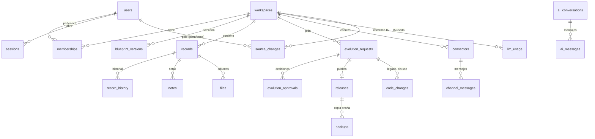

# Esquema de base de datos

> Fuente de verdad: `server/src/db/migrations.ts` (tablas, índices y RLS) y `shared/*.ts` (estructuras JSON).
> Motor: PostgreSQL (en producción, Postgres 18 de Railway mediante `pg`). En desarrollo sin `DATABASE_URL` y en los tests se usa **PGlite** (PostgreSQL compilado a WASM), con la misma semántica, incluida Row Level Security.

## 1. Migraciones

| Id | Contenido |
|---|---|
| `001_core_schema` | Función `app_current_workspace()` y todas las tablas e índices |
| `002_row_level_security` | Rol `evolve_tenant`, permisos y políticas RLS |
| `003_invite_delivery` | Columna `auth_tokens.delivered` (la invitación se entregó por correo) |
| `004_jobs_workspace_ready_idx` | Índice `jobs_ws_ready_idx (workspace_id, run_at) WHERE status = 'queued'` para repartir los trabajos entre organizaciones |
| `005_source_code_engine` | Tablas de plataforma del motor de código fuente: `platform_settings` y `source_changes` (sin RLS y sin permisos para `evolve_tenant`), con dos índices únicos parciales que permiten como mucho un cambio en preparación o despliegue y como mucho un despliegue o rollback a la vez |

- Se ejecutan **al arrancar** cualquier proceso (`runMigrations`) dentro de **una única transacción** con `pg_advisory_xact_lock(7270427)`: si web y worker arrancan a la vez, el segundo espera y luego ve las migraciones aplicadas. El DDL de PostgreSQL es transaccional: o se aplica todo o nada.
- Las aplicadas se registran en `schema_migrations (id text PK, applied_at timestamptz)`.
- Son **aditivas** (`CREATE TABLE IF NOT EXISTS`, `CREATE INDEX IF NOT EXISTS`, políticas recreadas): un despliegue anterior del código sigue funcionando con el esquema nuevo, lo que permite el rollback de despliegues en Railway.
- Para añadir una migración se agrega ``{ id: '006_…', sql: () => `…` },`` al final del array `MIGRATIONS` (siempre aditiva). Las migraciones forman parte del código de la plataforma: las escribe el equipo de desarrollo o el **motor de código fuente** de la instalación (con aprobación de un administrador de la plataforma, [CODE_ENGINE.md](CODE_ENGINE.md)); nada de lo que pide una organización con EVOLVE (ni sus scripts) genera DDL.
- **Regla del motor de código** (`server/src/code-engine/sql-guard.ts`, determinista): el archivo debe quedar idéntico salvo por entradas nuevas al final de `MIGRATIONS`, con id mayor que el último y SQL estático; solo `CREATE TABLE IF NOT EXISTS` (tablas nuevas, nunca `AS SELECT`), `CREATE INDEX`, `ALTER TABLE … ADD COLUMN` (con `DEFAULT` si es `NOT NULL`) y, para las tablas nuevas con `workspace_id`, obligatoriamente `ENABLE ROW LEVEL SECURITY` + `CREATE POLICY tenant_isolation …` + `GRANT … TO evolve_tenant` en la misma migración. Nunca `DROP`, `TRUNCATE`, `DELETE`, `UPDATE`, `INSERT`, `RENAME`, roles, funciones, `DO`, políticas o permisos sobre tablas existentes, ni funciones fuera de una lista corta (un `DEFAULT` se evalúa como superusuario al migrar). `TENANT_TABLES` no cambia: una tabla de organización nueva lleva su RLS en su propia migración.
- Requisitos del usuario de base de datos: poder `CREATE ROLE` (la migración 002 crea `evolve_tenant`) y poder hacer `SET ROLE evolve_tenant` (superusuario o miembro del rol). El usuario `postgres` de Railway es superusuario.

## 2. Mapa de tablas



Las relaciones `records → record_history/notes/files/channel_messages` son lógicas (columna `record_id` sin clave foránea); el resto de flechas son claves foráneas reales, casi todas con `ON DELETE CASCADE` desde `workspaces`.

### Clasificación

| Tipo | Tablas | Acceso |
|---|---|---|
| **Plataforma** (sin acceso desde el rol de organización) | `sessions`, `auth_tokens`, `error_events`, `schema_migrations`, `platform_settings`, `source_changes` | Solo conexión privilegiada (las dos últimas, solo desde las rutas de administración de la plataforma y los trabajos `code.*`) |
| **Plataforma con acceso acotado** (RLS + permisos mínimos) | `users` (SELECT de `id, name, email` de miembros), `workspaces` (SELECT/UPDATE de la propia), `memberships` (SELECT de la propia), `jobs` (solo INSERT de trabajos propios) | Privilegiada + `evolve_tenant` limitado |
| **Organización** (RLS obligatoria, `TENANT_TABLES`) | `blueprint_versions`, `records`, `record_history`, `notes`, `files`, `evolution_requests`, `evolution_approvals`, `releases`, `backups`, `automation_runs`, `notifications`, `api_keys`, `audit_log`, `ai_providers`, `ai_settings`, `llm_usage`, `ai_conversations`, `ai_messages`, `ai_memory`, `connectors`, `channel_messages`, `code_changes` (legado: ningún código la usa, ver sección 5) | `db.tenant()` (y privilegiada cuando es imprescindible) |

En total, RLS está activa en **26 tablas**: las 22 de `TENANT_TABLES` más `workspaces`, `memberships`, `jobs` y `users`.

## 3. Row Level Security

```sql
CREATE FUNCTION app_current_workspace() RETURNS uuid LANGUAGE sql STABLE
  AS $$ SELECT NULLIF(current_setting('app.workspace_id', true), '')::uuid $$;

CREATE ROLE evolve_tenant NOLOGIN NOSUPERUSER NOBYPASSRLS;   -- si no existe
-- Para cada tabla de organización:
GRANT SELECT, INSERT, UPDATE, DELETE ON <tabla> TO evolve_tenant;
ALTER TABLE <tabla> ENABLE ROW LEVEL SECURITY;
CREATE POLICY tenant_isolation ON <tabla>
  USING (workspace_id = app_current_workspace())
  WITH CHECK (workspace_id = app_current_workspace());
```

Políticas específicas:

| Tabla | Permisos de `evolve_tenant` | Política |
|---|---|---|
| `workspaces` | SELECT, UPDATE | `id = app_current_workspace()` |
| `memberships` | SELECT | `workspace_id = app_current_workspace()` |
| `jobs` | INSERT | `tenant_enqueue`: `FOR INSERT … WITH CHECK (workspace_id = app_current_workspace())` |
| `users` | SELECT de `id, name, email` | `tenant_members`: solo usuarios con membresía en la organización actual |

**Cómo se entra en el contexto de organización** (`server/src/db/db.ts`, `db.tenant(workspaceId, fn)`):

1. Valida que `workspaceId` es un UUID.
2. `BEGIN` → `SET LOCAL ROLE evolve_tenant` → `SELECT set_config('app.workspace_id', $1, true)`.
3. Ejecuta `fn(q)` y hace `COMMIT` (o `ROLLBACK` ante cualquier error). `SET LOCAL` y `set_config(..., true)` solo duran la transacción, así que la conexión vuelve limpia al pool.

La conexión privilegiada (`db.query`, `db.tx`) es la propietaria de las tablas y no está sujeta a RLS (no se usa `FORCE ROW LEVEL SECURITY`). Además de RLS, **todas** las consultas de la aplicación filtran por `workspace_id` explícitamente. En Railway la aplicación se conecta con el usuario `postgres` (superusuario): el aislamiento por RLS depende de que cada `db.tenant()` haga `SET LOCAL ROLE evolve_tenant`; un rol de conexión dedicado sin superusuario sería una defensa más fuerte (pendiente, ver [SECURITY.md](SECURITY.md#4-endurecimiento-pendiente-y-observaciones)).

Verificado por `server/test/tenant-isolation.test.ts`: en el contexto de B un `SELECT id FROM records` sin filtro no devuelve filas de A, `files` aparece vacío, `audit_log` solo muestra filas de B, un `INSERT` con el `workspace_id` de A falla por `row-level security`, `users` solo devuelve miembros de B y `SELECT password_hash FROM users` falla con `permission denied`.

## 4. Tablas de plataforma

### `users`
| Columna | Tipo | Notas |
|---|---|---|
| `id` | uuid PK | |
| `email` | text | Índice único `users_email_uq` sobre `lower(email)` |
| `name` | text | |
| `password_hash` | text | `scrypt$N$r$p$sal$clave` (base64) |
| `email_verified_at` | timestamptz | Se rellena al verificar el email o al crear la cuenta aceptando una invitación que se entregó por correo (`auth_tokens.delivered`) |
| `is_platform_admin` | boolean | Administrador de plataforma: en producción solo se concede con `dist/server/cli.js` (nunca desde la web); fuera de producción, al primer usuario |
| `failed_logins` | int | Contador para el bloqueo (10 fallos) |
| `locked_until` | timestamptz | Bloqueo temporal de 15 minutos |
| `created_at`, `last_login_at` | timestamptz | |

### `workspaces` (organizaciones)
| Columna | Tipo | Notas |
|---|---|---|
| `id` | uuid PK | |
| `name` | text | |
| `slug` | text UNIQUE | `slugify(nombre)-<6 primeros caracteres del id>`; se usa en formularios públicos |
| `plan` | text | Por defecto `trial` (sin lógica de facturación todavía) |
| `blueprint_version` | int | Versión vigente del blueprint |
| `settings` | jsonb | `{timezone, currency, locale, industry?, description?, approval: {requireDistinctApprover}}`; por defecto `Europe/Madrid`, `EUR`, `es-ES`, `false` |
| `created_at` | timestamptz | |

### `memberships`
| Columna | Tipo | Notas |
|---|---|---|
| `workspace_id` | uuid FK → workspaces (cascade) | PK compuesta `(workspace_id, user_id)` |
| `user_id` | uuid FK → users (cascade) | Índice `memberships_user_idx` |
| `role` | text | CHECK `owner`, `admin`, `builder`, `member`, `viewer` |
| `created_at` | timestamptz | |

### `sessions`
| Columna | Tipo | Notas |
|---|---|---|
| `id` | text PK | `sha256` hexadecimal del token de la cookie (el token nunca se guarda) |
| `user_id` | uuid FK → users (cascade) | Índice `sessions_user_idx` |
| `workspace_id` | uuid FK → workspaces (set null) | Organización activa de la sesión |
| `csrf_token` | text | Token CSRF de la sesión |
| `ip`, `user_agent` | text | `user_agent` truncado a 300 caracteres |
| `created_at`, `last_seen_at`, `expires_at` | timestamptz | Caducidad deslizante 14 días, máximo 90 |

### `auth_tokens`
| Columna | Tipo | Notas |
|---|---|---|
| `id` | uuid PK | |
| `kind` | text | CHECK `password_reset` (1 h), `email_verification` (48 h), `invite` (7 días) |
| `token_hash` | text UNIQUE | `sha256` del token; un solo uso (`used_at`) |
| `user_id`, `workspace_id`, `created_by` | uuid FK | |
| `email`, `role` | text | Para invitaciones |
| `delivered` | boolean | Migración 003: la invitación se envió por correo; solo entonces la cuenta creada al aceptarla nace con el email verificado |
| `expires_at`, `used_at`, `created_at` | timestamptz | |

### `jobs` (cola de trabajos)
| Columna | Tipo | Notas |
|---|---|---|
| `id` | uuid PK | |
| `workspace_id` | uuid FK (cascade), nullable | `null` en trabajos de plataforma (`maintenance.cleanup`, `code.plan`, `code.deploy`) |
| `type` | text | `evolve.plan`, `evolve.security`, `evolve.advice`, `webhook.deliver`, `automations.scheduled`, `formulas.recompute`, `maintenance.cleanup`, `code.plan`, `code.deploy` (motor de código fuente; `payload {changeId}` o `{probe: true}`) |
| `payload` | jsonb | |
| `status` | text | `queued` → `running` → `done` / `failed` (o vuelve a `queued` con *backoff*) |
| `attempts`, `max_attempts` | int | `max_attempts` por defecto 3 |
| `run_at`, `locked_at`, `finished_at`, `created_at` | timestamptz | |
| `locked_by` | text | `hostname-pid` del worker |
| `last_error` | text | Truncado a 2000 caracteres |
| `dedupe_key` | text UNIQUE | Deduplicación del planificador |

Índices `jobs_ready_idx (run_at) WHERE status = 'queued'` y `jobs_ws_ready_idx (workspace_id, run_at) WHERE status = 'queued'` (migración `004`).

### `error_events`
| Columna | Tipo | Notas |
|---|---|---|
| `id` | uuid PK | |
| `workspace_id`, `user_id` | uuid | Sin claves foráneas (contexto) |
| `source` | text | `api` (500), `worker` (trabajo fallido definitivamente), `web` (navegador) |
| `message`, `stack` | text | Truncados (2000 / 8000) |
| `context` | jsonb | Redactado (`method`, `url`, `requestId`, `jobId`…) |
| `created_at` | timestamptz | Retención 90 días |

### `platform_settings` (motor de código fuente)

Ajustes de la instalación (no de una organización). Sin RLS y **sin ningún permiso** para `evolve_tenant`: una consulta dentro de `db.tenant()` no puede leerla.

| Columna | Tipo | Notas |
|---|---|---|
| `key` | text PK | `railway.token` (token de proyecto de Railway) o `railway.worker` (lo que ve el worker) |
| `value` | jsonb | `railway.token`: `{projectId, environmentId, validatedAt}` del token validado. `railway.worker`: `{role, projectId, environmentId, serviceId, webServiceId, ciServiceId, sourceVersion, treeHash, reportedAt}` que publica el worker en cada trabajo `code.*` |
| `secret_ciphertext` | text | Token cifrado con `SecretBox` (AES-256-GCM) y AAD `platform:railway-token`; nunca se devuelve ni se registra |
| `secret_hint` | text | `••••abcd` (últimos 4 caracteres) |
| `updated_by` | uuid FK → users (set null) | |
| `updated_at` | timestamptz | |

### `source_changes` (motor de código fuente)

Cada cambio del código fuente de la instalación ([CODE_ENGINE.md](CODE_ENGINE.md)). Sin RLS y sin permisos para `evolve_tenant`.

| Columna | Tipo | Notas |
|---|---|---|
| `id` | uuid PK | |
| `ai_workspace_id` | uuid FK → workspaces (set null) | Organización cuya configuración de IA se usa (la activa de quien pidió el cambio, que debe administrarla) |
| `requested_by` | uuid FK → users (set null) | Administrador de la plataforma que lo pidió |
| `origin` | jsonb | `{type: 'evolve', workspaceId, workspaceName, requestId}` si viene de una petición de plataforma de una organización |
| `prompt`, `title`, `summary` | text | Petición y resumen del agente |
| `status` | text | `queued` → `planning` → `testing` (→ `planning` en la auto-corrección) → `ready_for_review` / `needs_input` / `failed`; `deploying` → `deployed` / `rolling_back` → `failed`; `deployed` → `rolling_back` → `rolled_back`; `cancelled` |
| `base_version`, `base_tree_hash` | text | Versión (id de `source-version.json` o `inicial-<huella>`) y huella exacta del código sobre el que se preparó: aprobar y desplegar exigen que la instalación siga en ella |
| `patch` | jsonb | `{files: [{path, action: add\|modify\|delete, before, after}], testsAdded}` (contenido completo antes y después) |
| `stats`, `guards`, `flags` | jsonb | Estadísticas, resultado de las reglas deterministas (`{ok, violations, at}`) y avisos para quien aprueba |
| `problems` | jsonb | Errores del CI o infracciones que recibe el agente en la siguiente ronda |
| `ci` | jsonb | `{attempts: [{n, deploymentId, status, railwayStatus, treeHash, sourceVersion, files, bytes, summary, errors, failedTests, excerpt, removed}], roundStart, agentRuns, transientErrors}` |
| `review` | jsonb | Revisión de seguridad con IA `{status, verdict, summary, concerns, provider, model, sameProvider}` |
| `risk` | text | Siempre `high` |
| `approvals` | jsonb | `[{userId, name, at, comment, confirmation: 'DESPLEGAR', attempt, treeHash}]` |
| `deploy` | jsonb | `{phase, attempt, sourceVersion, previous: {worker, web}, worker, web, workerReadyAt, continuedBy, verification, rollback}` con los ids de los despliegues de Railway |
| `conversation`, `progress`, `llm` | jsonb | Petición y refinados; línea de tiempo `{step, status, detail, at}`; modelos usados |
| `lease_token`, `lease_until`, `heartbeat_at` | text / timestamptz | Lease con latido del trabajo que lo procesa (evita ejecuciones dobles y detecta despliegues detenidos) |
| `error` | text | |
| `created_at`, `updated_at`, `deployed_at`, `rolled_back_at` | timestamptz | |

Índices: `source_changes_created_idx (created_at DESC)`; `source_changes_single_active_uq ((true)) WHERE status IN ('queued','planning','testing','deploying')` y `source_changes_single_release_uq ((true)) WHERE status IN ('deploying','rolling_back')` (índices únicos sobre una constante: como mucho una fila en esos estados).

## 5. Tablas de organización (RLS)

Todas tienen `workspace_id uuid NOT NULL REFERENCES workspaces(id) ON DELETE CASCADE` (salvo `audit_log`, donde es nullable).

### Configuración y datos del CRM

**`blueprint_versions`** — PK `(workspace_id, version)`.
| Columna | Tipo | Notas |
|---|---|---|
| `version` | int | Monótona; cada publicación, rollback o restauración crea una nueva |
| `definition` | jsonb | Blueprint completo (sección 7) |
| `release_id` | uuid | Release que la creó |
| `created_by`, `created_at` | | |

**`records`** — registros de todos los módulos.
| Columna | Tipo | Notas |
|---|---|---|
| `id` | uuid PK | |
| `module_key` | text | Clave del módulo en el blueprint |
| `data` | jsonb | Valores por clave de campo, ya normalizados (sección 7.3) |
| `created_by`, `updated_by`, `deleted_by` | uuid FK → users (set null) | `null` si el actor es API, automatización o sistema |
| `created_at`, `updated_at` | timestamptz | |
| `last_activity_at` | timestamptz | Se actualiza con ediciones, notas, archivos, mensajes y cambios en registros relacionados; base del disparador `inactivity` |
| `deleted_at` | timestamptz | Borrado lógico (restaurable por administradores) |

Índices: `records_list_idx (workspace_id, module_key, created_at DESC) WHERE deleted_at IS NULL` y `records_data_gin USING gin (data jsonb_path_ops)`. El índice GIN sirve a consultas de contención (`data @> …`); los filtros que genera hoy `conditionsToSql` usan expresiones `data->>'campo'`, que se apoyan en el índice compuesto (organización + módulo) pero no en el GIN.

**`record_history`** — índice `(record_id, created_at DESC)`.
| Columna | Notas |
|---|---|
| `record_id`, `module_key` | |
| `action` | `create`, `update`, `delete`, `restore` |
| `changes` jsonb | `{snapshot}` en alta/baja; `{campo: {from, to}}` en edición |
| `actor_id`, `actor_type` | `user`, `api`, `automation`, `system`, `ai` |

**`notes`** — índice `(record_id, created_at DESC)`. `body` (hasta 10.000 caracteres), `created_by`, `updated_at`, `deleted_at` (borrado lógico).

**`files`** — índice `files_record_idx (record_id) WHERE deleted_at IS NULL`. Un archivo borrado conserva su tamaño (y cuenta para la cuota) hasta que `maintenance.cleanup` purga su contenido a los 7 días: entonces `content` queda vacío y `size = 0`.
| Columna | Notas |
|---|---|
| `record_id`, `module_key`, `field_key` | Vínculo opcional con un registro/campo |
| `name`, `mime`, `size`, `sha256` | El MIME lo decide el servidor por la extensión |
| `content` bytea | Contenido (máx. `MAX_UPLOAD_MB`; cuota 1 GB por organización) |
| `uploaded_by`, `created_at`, `deleted_at` | |

**`automation_runs`** — índices `(workspace_id, created_at DESC)` y único `(workspace_id, dedupe_key) WHERE dedupe_key IS NOT NULL`.
| Columna | Notas |
|---|---|
| `automation_key`, `record_id`, `trigger` | |
| `status` | `running`, `success`, `failed` (el motivo queda en `log`, p. ej. el error de un script), `skipped` (profundidad máxima) |
| `dedupe_key` | `<automatización>:<registro>:<valor o periodo>` en las programadas |
| `log` jsonb | Hasta 50 líneas. Las acciones `run_script` añaden `Script "<clave>" ejecutado en N ms`, las trazas del script con el prefijo `[script]` (su `console.log` y su `log`) y lo que hizo la plataforma con su resultado |

**`notifications`** — índice `(workspace_id, user_id, created_at DESC)`. `user_id` (cascade), `kind` (`automation`, `evolve`, `message`; por defecto `info`), `title` (≤ 200), `body` (≤ 1000), `link`, `read_at`.

### Evolución, versiones y copias

**`evolution_requests`** — índice `(workspace_id, created_at DESC)`.
| Columna | Tipo | Notas |
|---|---|---|
| `requested_by` | uuid | |
| `kind` | text | Sin restricción `CHECK`. Las peticiones de evolución se crean como `config` y, al terminar el pipeline, se reclasifican: `script` (el plan incluye `upsert_script`), `platform` (`requiresPlatformChange` sin operaciones) o `config`. `security` y `advice` para auditorías y propuestas de mejora |
| `source` | text | `ai` o `manual` |
| `prompt` | text | Petición en lenguaje natural (o título del cambio manual) |
| `status` | text | `queued`, `planning`, `testing`, `needs_input`, `ready_for_review`, `approved`, `rejected`, `deploying` (definido en las constantes, pero ningún código lo asigna), `applied`, `failed`, `rolled_back`, `cancelled` |
| `base_version` | int | Versión del blueprint sobre la que se planificó |
| `change_set` | jsonb | Change set (sección 8) |
| `validation` | jsonb | `Issue[]` (`{level, path, message}`) |
| `test_report` | jsonb | `{passed, total, failed, warnings, suites[], ranAt, durationMs}` |
| `impact` | jsonb | Informe de impacto + `destructive` + `dataEgress`; en `security`/`advice` guarda el informe resultante |
| `cross_review` | jsonb | `{verdict, summary, concerns[], provider, model}` |
| `risk` | text | `low`, `medium`, `high` |
| `llm` | jsonb | Registro de llamadas: `{phase, provider, model, costUsd, latencyMs, rounds, at}`; `phase` es `plan`, `self_heal_<n>`, `code_<clave del script>` (desarrollador de scripts) o `cross_review` |
| `conversation` | jsonb | Indicaciones de refinado `{role:'feedback', content, by, at}` |
| `progress` | jsonb | Pasos `{step, status, detail, at}` |
| `error`, `release_id`, `created_at`, `updated_at` | | |

**`evolution_approvals`**: `request_id` (FK cascade), `user_id`, `decision` CHECK `approve`/`reject`, `comment`. Una aprobación caduca a los 7 días: si se intenta publicar después, se borra y la petición vuelve a revisión. Refinar una petición también borra sus aprobaciones.

**`releases`** — índice `(workspace_id, created_at DESC)`.
| Columna | Notas |
|---|---|
| `request_id` | FK → evolution_requests (set null) |
| `kind` | `initial` (alta de la organización), `apply`, `rollback`, `restore` |
| `status` | `applied`, `verified`, `failed`, `rolled_back` |
| `from_version`, `to_version`, `title`, `summary` | |
| `artifacts` jsonb | Rutas lógicas afectadas (`blueprint/modules/<clave>.json`, `blueprint/automations/<clave>.json`, `blueprint/scripts/<clave>.js`…); no son archivos reales, todo vive en `blueprint_versions` |
| `tests` jsonb | Resumen por suite |
| `validation` jsonb | `apply`: `{issues, errors, rebased, backupId}` (`rebased` es siempre `false`: solo se publica sobre la versión en la que se probó); `rollback`: `{revertedRecords, skippedRecords}` |
| `data_changes` jsonb | Migraciones aplicadas: `[{module, field, value, records: [{id, before}]}]` (permite revertirlas) |
| `verification` jsonb | `{ok, checks[], at}` |
| `approved_by`, `applied_by`, `rolled_back_by`, `rolled_back_at`, `created_at` | |

**`backups`**: `release_id`, `reason`, `size`, `content` bytea (JSON comprimido con gzip: `{createdAt, modules, records}`, máximo 25 MB), `created_by`.

**`code_changes`** (**legado, sin uso**): la tabla sigue definida en la migración `001_core_schema` y en `TENANT_TABLES` (con RLS), pero ningún código la lee ni la escribe desde que se eliminó el antiguo motor de código basado en GitHub. Sus columnas (`request_id`, `status`, `branch`, `base_sha`, `head_sha`, `pr_number`, `pr_url`, `files`, `summary`, `test_plan`, `scan`, `review`, `checks`, `merged_sha`, `merged_by`, `deploy`, `revert_pr_number`, `created_by`, `created_at`, `updated_at`) no tienen significado en la versión actual. Se conserva porque las migraciones son aditivas (nunca se borran tablas). El código a medida de cada organización vive ahora en `blueprint.scripts` (sección 7.4), dentro de `blueprint_versions`.

### IA

**`ai_providers`** — PK `(workspace_id, provider)`.
| Columna | Notas |
|---|---|
| `provider` | `anthropic`, `openai`, `deepseek`, `openrouter`, `gemini`, `mistral`, `groq` |
| `enabled` | |
| `api_key_ciphertext` | `v1.<iv>.<tag>.<cifrado>` (AES-256-GCM, AAD `ai:<organización>:<proveedor>`) |
| `api_key_hint` | Pista enmascarada `••••1234` |
| `base_url` | Reservada; no se usa (la URL sale del catálogo de proveedores) |
| `default_model` | |
| `models_cache`, `models_cached_at` | Catálogo descubierto por API (caché de 6 h) |
| `last_test_at`, `last_test_ok`, `last_error` | |

**`ai_settings`** — PK `workspace_id`.
| Columna | Contenido |
|---|---|
| `default_provider`, `default_model` | |
| `routing` jsonb | `{<tarea>: [{provider, model}, …]}` (hasta 5 destinos por tarea) |
| `limits` jsonb | `{monthlyBudgetUsd, maxRequestsPerHour, maxOutputTokens, disabledTasks[]}` |
| `pricing` jsonb | `{"<proveedor>:<modelo>": {inputPerM, outputPerM}}` (USD por millón de tokens) |
| `updated_by`, `updated_at` | |

**`llm_usage`** — índice `(workspace_id, created_at DESC)`: `user_id`, `task`, `provider`, `model`, `input_tokens`, `output_tokens`, `cost_usd numeric(14,6)` (null si no hay precio), `latency_ms`, `ok`, `error_code`, `error_message`, `is_fallback`, `ref` (id de la petición, conversación, registro clasificado o archivo analizado, o una etiqueta como `ai_query`, `predictions`, `advisor`, `security_review`, `compare` o `provider_test`).

**`ai_conversations`** — índice `(workspace_id, user_id, updated_at DESC)`: `user_id` (cascade), `title`.

**`ai_messages`** — índice `(conversation_id, created_at)`: `conversation_id` (cascade), `role` (`user`/`assistant`), `content`, `context` jsonb (contexto de pantalla o acciones propuestas; cada acción puede llevar `state` `done`/`dismissed` y `ref` con el registro o la petición resultante, ver `POST /api/assistant/messages/:id/actions/:index`), `tool_calls` jsonb, `provider`, `model`.

**`ai_memory`** — índice `(workspace_id, created_at DESC)`.
| Columna | Notas |
|---|---|
| `scope` | CHECK `org` o `user` |
| `user_id` | Solo en `scope = 'user'` |
| `kind` | `decision`, `preference`, `fact`, `instruction` |
| `content` | Hasta 2000 caracteres |
| `source`, `source_ref` | `manual`, `assistant`, `release`, `rollback` y el id de origen |
| `archived_at` | Borrado lógico |

### Seguridad, integraciones y comunicaciones

**`api_keys`**: `name`, `prefix` (8 caracteres), `key_hash` UNIQUE (`sha256` de `evk_<prefijo>_<aleatorio>`), `role` (`admin`, `builder`, `member`, `viewer`; por defecto `member`), `created_by`, `last_used_at` (se actualiza como mucho cada 5 minutos), `revoked_at`. Una clave solo autentica mientras su creador sea miembro de la organización, con el menor rol entre el de la clave y el del creador; al quitar a un miembro se revocan sus claves.

**`audit_log`** — índice `(workspace_id, created_at DESC)`: `workspace_id` (nullable para eventos sin organización, p. ej. intentos de login fallidos y bloqueos de cuenta; la auditoría de seguridad de EVOLVE los cuenta por `actor_id` de los miembros de la organización, con la conexión privilegiada), `actor_id`, `actor_type` (`user`, `api`, `system`, `automation`, `ai`), `action` (p. ej. `auth.login`, `record.deleted`, `evolve.deployed`, `ai.provider_key_set`, `integration.signing_secret_viewed`), `target_type`, `target_id`, `meta` jsonb (redactado), `ip`.

**`connectors`**: `type` (`whatsapp`, `telegram`), `name`, `status` (`active` al crearse; columna con defecto `pending`), `config` jsonb (datos no secretos: `phoneNumberId`, `displayPhone`, `botUsername`…), `secret_ciphertext` (credenciales cifradas con AAD `connector:<organización>:<id>`), `webhook_token` UNIQUE (aleatorio, forma parte de la URL del webhook), `last_error`, `last_event_at`, `created_by`.

**`channel_messages`** — índice `(record_id, created_at DESC)`: `connector_id` (set null), `channel`, `direction` CHECK `inbound`/`outbound`, `external_id` (deduplicación), `from_address`, `to_address`, `body`, `payload` jsonb (`chatId`, `waId`…), `record_id` (contacto vinculado), `status` (`received` por defecto, `sent`).

## 6. Ciclo de vida de los datos

| Mecanismo | Detalle |
|---|---|
| Borrado lógico | `records`, `notes`, `files`, `ai_memory` (`archived_at`); los registros se restauran con `POST /api/records/:module/:id/restore` (administradores) |
| Archivado de estructura | Módulos y campos se archivan (`archived: true`), nunca se borran sus datos |
| Copias previas a publicar | `backups` cuando el cambio es destructivo o migra datos |
| Migraciones de datos reversibles | `releases.data_changes` guarda el valor anterior de cada registro tocado |
| Exportación | `GET /api/workspace/export` (blueprint, registros y notas en JSON) |
| Limpieza diaria (`maintenance.cleanup`) | Trabajos `done` > 7 días, sesiones caducadas, tokens caducados > 7 días, notificaciones leídas > 180 días, `error_events` > 90 días |

## 7. Estructura JSON del blueprint (`shared/blueprint.ts`)

### 7.1 Raíz y límites

```ts
Blueprint {
  modules: Module[]            // ≤ 2000
  automations: Automation[]    // ≤ 5000
  dashboards: Dashboard[]      // ≤ 500
  integrations: Integration[]  // ≤ 500 (webhooks)
  forms: Form[]                // ≤ 1000
  scripts: Script[]            // ≤ 1000 (código a medida de ESTA organización; por defecto [])
  appearance?: Appearance      // capa visual: colores, tipografía, menú lateral… (sección 7.5)
  navigation?: Navigation      // menú agrupado y página de inicio (sección 7.5)
  pages: Page[]                // ≤ 500 páginas propias (sección 7.5; por defecto [])
}
```

Estos topes (`BLUEPRINT_LIMITS` en `shared/blueprint.ts`) protegen contra el abuso, pero no limitan el uso normal: un CRM puede tener cientos de módulos con cientos de campos. Por módulo: ≤ 1000 campos, ≤ 100 vistas, ≤ 100 secciones de ficha (≤ 1000 campos cada una), ≤ 300 columnas por vista y ≤ 2000 opciones por campo de selección; ≤ 200 widgets por panel y ≤ 300 campos por formulario. **El único tope global es el tamaño**: un blueprint de más de 25 MB (JSON) no pasa la validación (`validateBlueprint`). Las fórmulas tienen sus propios topes, porque se evalúan en cada lectura: ≤ 300 campos calculados por módulo y ≤ 2.000.000 de caracteres de fórmulas en total.

Las claves (`key`) siguen `^[a-z][a-z0-9_]{0,39}$` y son inmutables. Claves reservadas para campos: `id`, `created_at`, `updated_at`, `created_by`, `updated_by`, `deleted_at`, `workspace_id`, `module_key`, `last_activity_at`. Campos de sistema consultables en vistas, filtros y paneles: `id`, `created_at`, `updated_at`, `last_activity_at`, `created_by`.

### 7.2 Módulos, campos, vistas y permisos

| Objeto | Propiedades |
|---|---|
| `Module` | `key`, `label`, `labelPlural`, `icon` (lista cerrada, p. ej. `building`, `users`, `file-signature`), `color` (18 colores Tailwind), `description`, `system`, `archived`, `primaryField`, `fields` (1–120), `views` (1–20), `layout` (≤ 12 secciones), `permissions` |
| `permissions` | `read` (defecto `viewer`), `create`, `update`, `delete` (defecto `member`) |
| `Field` | `key`, `label`, `type`, `required`, `unique`, `helpText`, `hidden`, `archived`, `system`, `options` (≤ 2000: `{value, label, color}`), `relation: {module}`, `currency` (ISO 4217), `min`, `max`, `decimals` (0–6), `maxFiles` (1–20), `formula: {expression, resultType}`, `defaultValue` (admite plantillas) |
| `View` | `key`, `label`, `type` (`table`, `kanban`, `calendar`), `columns` (≤ 300), `groupBy`, `cardFields` (≤ 8), `dateField`, `colorBy`, `sort: {field, direction}`, `filters` (≤ 10) |
| `LayoutSection` | `title`, `fields` (≤ 1000), `columns` (1 o 2) |

Reglas de coherencia (zod + `evolve/validate.ts`): `select`/`multi_select` con al menos una opción y sin duplicados; `relation` con módulo destino existente; una fórmula no puede ser obligatoria ni única, no puede referenciarse a sí misma ni formar ciclos; `kanban` agrupa por un campo `select`; `calendar` usa un campo de fecha; el campo principal debe ser de texto, email, teléfono, URL, número, selección o fecha.

### 7.3 Tipos de campo y almacenamiento en `records.data`

| Tipo | Valor guardado |
|---|---|
| `text` | Cadena recortada (≤ 2000) |
| `long_text` | Cadena (≤ 50.000) |
| `number`, `currency`, `percent` | Número redondeado a `decimals` (6 para número, 2 para moneda/porcentaje); respeta `min`/`max`; admite coma decimal |
| `rating` | Entero 1–5 |
| `date` | `YYYY-MM-DD` |
| `datetime` | ISO 8601 en UTC |
| `boolean` | `true`/`false` |
| `email` | Minúsculas, validado |
| `phone` | `^\+?[0-9 ()\-.]{6,25}$` |
| `url` | URL `http(s)` normalizada (añade `https://` si falta el esquema) |
| `select` | `value` de la opción (acepta también la etiqueta) |
| `multi_select` | Lista de `value` sin duplicados |
| `relation`, `user` | UUID en minúsculas (registro del módulo destino / miembro de la organización) |
| `file` | Lista de UUID de `files` (máx. `maxFiles`, por defecto 10) |
| `formula` | Calculado por el servidor; no editable |

### 7.4 Automatizaciones, scripts, paneles, integraciones y formularios

| Objeto | Propiedades |
|---|---|
| `Automation` | `key`, `name`, `description`, `enabled` (defecto `true`), `trigger`, `conditions` (≤ 15), `actions` (1–10) |
| `Trigger` | `record_created` · `record_updated` · `record_deleted` · `field_changed {field, to?}` · `date_reached {field, offsetDays −365…365}` · `inactivity {days 1…365}` (todos con `module`) |
| `Action` | `update_field {field, value}` · `create_record {module, values, linkField?}` · `send_webhook {integration}` · `notify {to: user_field{field} \| role{role} \| all, title, body?}` · `run_script {script}` (ejecuta un script de la organización sobre el registro que dispara) |
| `Script` | `key`, `name`, `description` (especificación funcional, ≤ 2000; a partir de ella se escribe el código), `code` (JavaScript, ≤ 20.000 caracteres, por defecto vacío), `enabled` (defecto `true`), `timeoutMs` (50–3000, defecto 1000). Se ejecuta en el sandbox QuickJS/WebAssembly de la plataforma ([AI_ENGINE.md](AI_ENGINE.md#6-scripts-por-organización)); se versiona con el resto del blueprint de su organización y nunca se comparte con otras |
| `Condition` | `{field, operator, value?}` con `eq`, `neq`, `gt`, `gte`, `lt`, `lte`, `contains`, `not_contains`, `is_empty`, `is_not_empty`, `in`, `changed`; `value` admite plantillas |
| `Dashboard` | `key`, `label`, `widgets` (≤ 200) |
| `Widget` | `key`, `title`, `type` (`metric`, `bar`, `donut`, `line`, `list`), `module`, `aggregate` (`count`, `sum`, `avg`), `field`, `groupBy`, `dateField`, `interval` (`day`, `week`, `month`), `filters`, `limit` (1–50), `size` (`sm`…`xl`) |
| `Integration` | `key`, `name`, `type: 'webhook'`, `url` (HTTPS, sin credenciales), `description`, `includeFields`, `enabled` |
| `Form` | `key`, `name`, `module`, `fields` (1–300), `public` (defecto `false`), `submitLabel`, `successMessage`, `defaults` |

Reglas de coherencia de los scripts (`evolve/validate.ts`): claves únicas; un script sin código, sin `function run(` o que intente `require(…)`/`import` es un **error**; un script que ninguna automatización usa es un aviso. Una acción `run_script` hacia un script inexistente es un error; hacia uno desactivado, un aviso; y en un disparador `record_updated`, un aviso por posible encadenamiento (el motor corta en profundidad 3).

### 7.5 Capa visual: apariencia, menú y páginas

Solo presentación: no cambia datos ni permisos. Se versiona, se prueba, se aprueba y se revierte como el resto del blueprint ([AI_ENGINE.md](AI_ENGINE.md#51-capa-visual-apariencia-menú-y-páginas)). Los blueprints anteriores, sin estas claves, siguen siendo válidos.

| Objeto | Propiedades |
|---|---|
| `Appearance` | `brandColor` (`#rrggbb`, defecto `#6938ef`: botones, enlaces y selección), `accentColor?`, `appName?` (1–40: nombre en el menú lateral y en la pestaña), `font` (`inter`, `system`, `serif`, `mono`, `rounded`; defecto `inter`), `radius` (`none`, `sm`, `md`, `lg`, `xl`; defecto `md`), `density` (`compact`, `comfortable`, `spacious`; defecto `comfortable`), `sidebar` (`light`, `dark`, `brand`; defecto `light`), `defaultTheme` (`system`, `light`, `dark`: tema inicial de quien no ha elegido uno; defecto `system`), `customCss?` (≤ 20.000 caracteres; debe ser CSS plano según `sanitizeCustomCss`: sin `@import`, `url()`, `expression()`, `javascript:`, `behavior`, `-moz-binding` ni `</style>`; nunca se aplica en EVOLVE, Ajustes ni Plataforma) |
| `Navigation` | `groups` (≤ 100: `{key, label, items (≤ 2000)}`) y `home?` (`{type: 'dashboard' \| 'page', key}`: lo que se muestra en `/`; por defecto, el primer panel). Sin grupos, el menú es la lista de módulos de siempre |
| `NavItem` | `module {key, label?}` · `dashboard {key, label?}` · `page {key, label?}` · `link {href, label}` (`href`: ruta interna de la aplicación, p. ej. `/m/deals`, o URL `https`) |
| `Page` | `key`, `label`, `icon` (defecto `layers`), `description?` (≤ 500), `minRole` (rol mínimo para verla; defecto `viewer`), `blocks` (≤ 200). Se muestra en `/p/<key>`; cada rol solo ve los bloques de los módulos que puede leer |
| `Block` | `heading {text (≤ 200), level 1–3}` · `text {markdown (≤ 10.000)}` · `widget {widget}` (un `Widget` como los de los paneles) · `records {module, view?, title?, filters (≤ 10), limit 1–100 (defecto 10), columns?}` · `form {form}` · `buttons {items (1–12): {label, to: {type: module \| page \| dashboard \| new_record, key}, style?: primary \| secondary \| ghost}}` · `divider`. Todos con `width` (`full`, `half`, `third`, `two_thirds`; defecto `full`) |

## 8. Estructura JSON del change set (`shared/changeset.ts`)

```ts
ChangeSet {
  title: string          // 3–140
  summary: string        // 1–3000
  operations: Operation[]  // ≤ 5000
  tests: TestCase[]        // ≤ 300, cada uno { name, steps (1–40) }
  outline?: OutlinePart[]  // ≤ 60: plan por partes de una petición grande ({key, title (≤ 140), description (≤ 4000)});
                           // el planificador lo devuelve con operations: [] y EVOLVE genera y une cada parte
  requiresPlatformChange: boolean  // la petición necesita una funcionalidad nueva de la plataforma (defecto false)
  platformRequest?: string         // qué haría falta en la plataforma (≤ 6000); solo se registra
  questions: string[]      // ≤ 6: dudas que bloquean
  assumptions: string[]    // ≤ 10: supuestos asumidos
}
```

**Operaciones** (unión discriminada por `op`): `create_module`, `update_module` (`label`, `labelPlural`, `icon`, `color`, `description`, `primaryField`, `layout`, `permissions`), `archive_module`, `restore_module`, `add_field` (con `after?`), `update_field` (cualquier propiedad salvo `key`, `system`, `archived`), `archive_field`, `restore_field`, `add_select_options`, `upsert_view`, `remove_view`, `upsert_automation`, `remove_automation`, `upsert_dashboard`, `remove_dashboard`, `upsert_integration`, `remove_integration`, `upsert_form`, `remove_form`, `upsert_script` (un `Script` completo; si `code` llega vacío en una petición a la IA, lo escribe el paso de desarrollo antes de probarlo), `remove_script` (clave; falla si el script no existe y la validación rechaza que quede una automatización con `run_script` hacia él), `backfill_field` (`value`, `onlyEmpty` por defecto `true`, `where`) y, para la capa visual (sección 7.5), `update_appearance` (`changes`: solo las propiedades que cambian; `null` en `accentColor`, `appName` o `customCss` las quita), `update_navigation` (`navigation`: sustituye el menú entero; `null` vuelve al menú por defecto), `upsert_page` (una `Page` completa) y `remove_page` (clave).

Cambios de tipo permitidos por `update_field` (preservan los datos; el resto se rechaza y hay que crear un campo nuevo y migrar):

| Desde | Hacia |
|---|---|
| `text` | `long_text`, `email`, `phone`, `url`, `select` |
| `long_text`, `email`, `phone`, `url` | `text` |
| `number` | `currency`, `percent`, `rating` |
| `currency` | `number`, `percent` |
| `percent` | `number`, `currency` |
| `rating` | `number` |
| `select` | `multi_select`, `text` |
| `date` ↔ `datetime` | |

Los campos de sistema no cambian de tipo y ni ellos ni el campo principal se pueden archivar.

**Pasos de prueba** (`TestStep`, unión por `action`): `create {module, values, as?}`, `update {ref, values}`, `delete {ref}`, `expect_field {ref, field, equals?, notEmpty?}`, `expect_invalid {module, values}`, `expect_count {module, equals, where}`, `expect_notification {min}`, `expect_webhook {integration, min}`, `advance_days {days 1–400}`, `run_scheduler`. En los valores, `"@<ref>"` enlaza un registro creado antes y `"@member"` usa el miembro del sandbox.

El detalle de cómo se validan, prueban y publican está en [AI_ENGINE.md](AI_ENGINE.md).
