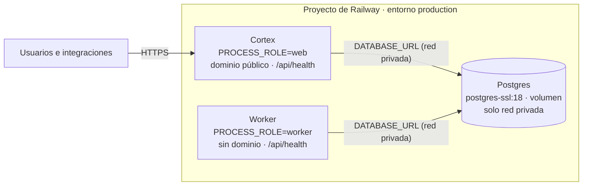

# Despliegue en Railway

> **Forma recomendada: la plantilla de Railway** ([RAILWAY_TEMPLATE.md](RAILWAY_TEMPLATE.md)). Crea los tres servicios, genera los secretos y conecta las variables en un solo paso. Esta guía describe la topología, la configuración y la operación de cualquier instalación, y cómo desplegar a mano con la CLI.

## 1. Topología



| Servicio | Origen | Rol | Red | Health check |
|---|---|---|---|---|
| `Postgres` | Imagen `ghcr.io/railwayapp-templates/postgres-ssl:18` con volumen | Base de datos | Solo red privada, sin URL pública ni TCP proxy | — |
| `Cortex` | Repositorio de la plataforma (`Dockerfile`), o `railway up` en un despliegue manual | `PROCESS_ROLE=web`: API + SPA | Dominio público | `GET /api/health` |
| `Worker` | El mismo código | `PROCESS_ROLE=worker`: cola + planificador | Sin dominio público | `GET /api/health` (servidor HTTP mínimo) |

Ambos servicios de aplicación ejecutan el mismo artefacto; el rol lo decide la variable `PROCESS_ROLE` (en producción, si falta, el rol es `web`). Los nombres de servicio son libres, pero las referencias entre servicios los usan (`${{Cortex.…}}`, `${{Postgres.…}}`): esta guía usa los de la plantilla.

**Dónde viven los cambios de cada organización.** Lo que publica EVOLVE AI ENGINE para una organización (su configuración y sus scripts) son versiones de su blueprint guardadas en `Postgres` y se ejecutan dentro de estos servicios: no se construye ninguna imagen nueva, no se despliega nada y nunca se publica en un repositorio. Desplegar solo hace falta para actualizar el código común de la plataforma.

## 2. Construcción

**`Dockerfile`** (multi-etapa):
1. `build` (`node:24-alpine`): `npm ci`, copia del código, escritura de `.build-sha` con `RAILWAY_GIT_COMMIT_SHA` (despliegues desde el repositorio) o, si no, con `BUILD_SHA` (la variable que se usa con `railway up`; `unknown` si no hay ninguna), `npm run build` (Vite → `dist/web`, esbuild → `dist/server/index.js` y la CLI de operación `dist/server/cli.js`) y `npm prune --omit=dev`.
2. `runtime` (`node:24-alpine`): `NODE_ENV=production`, `tini` como init, solo `package.json`, `node_modules` de producción, `dist` y `.build-sha`; se ejecuta como el usuario no root `node`: `node --enable-source-maps dist/server/index.js`.

esbuild deja las dependencias como externas (`--packages=external`), así que el servidor las carga desde `node_modules` en tiempo de ejecución; entre ellas está el sandbox de scripts (`quickjs-emscripten-core` y `@jitl/quickjs-wasmfile-release-sync`, que incluye el binario WebAssembly de QuickJS).

El proceso escucha en `PORT` (Railway la inyecta; por defecto 3000) y `0.0.0.0`. `.dockerignore` excluye `node_modules`, `dist`, `.data`, `.git`, `.github`, `docs`, `server/test` y cualquier `.env*`.

**`railway.json`** (lo leen los dos servicios):

```json
{
  "build": { "builder": "DOCKERFILE", "dockerfilePath": "Dockerfile" },
  "deploy": { "healthcheckPath": "/api/health", "healthcheckTimeout": 120,
              "restartPolicyType": "ON_FAILURE", "restartPolicyMaxRetries": 5 }
}
```

**Migraciones**: se aplican automáticamente al arrancar cada proceso, en una transacción con *advisory lock*; si web y worker arrancan a la vez, el segundo espera. Son aditivas, así que el código anterior sigue funcionando con el esquema nuevo.

**Sin cortes**: Railway solo cambia el tráfico al nuevo despliegue cuando `/api/health` responde `200` (hasta 120 s); si no llega a responder, el despliegue falla y sigue sirviendo el anterior. Al recibir `SIGTERM`, la aplicación cierra el servidor, espera al trabajo en curso del worker, termina los hilos del sandbox de scripts y cierra el pool.

## 3. Variables de entorno

### `Cortex` (web)

| Variable | Valor | Notas |
|---|---|---|
| `DATABASE_URL` | `${{Postgres.DATABASE_URL}}` | Variable de referencia (red privada) |
| `NODE_ENV` | `production` | El Dockerfile ya la fija y en Railway es el valor por defecto aunque falte; se declara por claridad |
| `PROCESS_ROLE` | `web` | |
| `APP_ENCRYPTION_KEY` | Secreto aleatorio | **Obligatoria.** 32 bytes en base64 o cualquier secreto aleatorio de 32 caracteres o más (la plantilla usa `${{secret(64, …)}}`); nunca se guarda en el código |
| `APP_URL` | `https://<dominio>` | Opcional en Railway: si falta, se usa `https://` + `RAILWAY_PUBLIC_DOMAIN`. Obligatoria con un dominio propio. Enlaces de correo, origen esperado (CSRF), URLs de los webhooks de WhatsApp y Telegram y cabecera `HTTP-Referer` de OpenRouter |
| `PLATFORM_ADMIN_SETUP_TOKEN` | Secreto aleatorio (≥ 32 caracteres) | Opcional. Token de instalación: permite reclamar la administración de la plataforma desde *Ajustes › Mi cuenta* mientras no haya ninguna |
| `ALLOW_SIGNUP` | `true` o `false` | Registro público de organizaciones |
| `RESEND_API_KEY`, `EMAIL_FROM` | Opcionales | Correo transaccional (p. ej. `Cortex CRM <no-reply@tudominio.com>`) |
| `CLIENT_IP_HEADER` | Opcional | Cabecera con la IP real del cliente. En Railway se usa `x-real-ip` automáticamente; `none` la desactiva |
| `BUILD_SHA` | Opcional | Identificador de la versión desplegada con `railway up` (se muestra en `/api/health`) |

Opcionales adicionales: `LOG_LEVEL`, `DB_POOL_MAX` (15), `MAX_UPLOAD_MB` (10), `AI_MAX_REQUESTS_PER_HOUR` (60) y claves LLM de plataforma (`ALLOW_PLATFORM_LLM_KEYS=true` + `ANTHROPIC_API_KEY`, `OPENAI_API_KEY`, `DEEPSEEK_API_KEY`, `OPENROUTER_API_KEY`, `GEMINI_API_KEY`, `MISTRAL_API_KEY`, `GROQ_API_KEY`). `LLM_ENABLE_MOCK` está prohibida en producción (la aplicación no arranca). No hay variables de GitHub: el código no lee ninguna.

### `Worker`

| Variable | Valor | Notas |
|---|---|---|
| `DATABASE_URL` | `${{Postgres.DATABASE_URL}}` | |
| `NODE_ENV` | `production` | |
| `PROCESS_ROLE` | `worker` | Imprescindible salvo que el comando de arranque lleve `--role=worker` (como en la plantilla); si falta, arrancaría como `web` |
| `APP_ENCRYPTION_KEY` | `${{Cortex.APP_ENCRYPTION_KEY}}` | Variable de referencia: **debe ser idéntica** a la del web (el worker descifra las claves de IA y firma los webhooks salientes) |
| `APP_URL` | `https://${{Cortex.RAILWAY_PUBLIC_DOMAIN}}` (o el dominio propio) | Obligatoria: el worker no tiene dominio público del que deducirla |

Si se usan, el worker también necesita las claves LLM de plataforma con `ALLOW_PLATFORM_LLM_KEYS` y el mismo `AI_MAX_REQUESTS_PER_HOUR` que el web (el pipeline de EVOLVE, incluido el desarrollador de scripts, se ejecuta en el worker).

### Comandos (despliegue manual)

Los nombres de servicio en las referencias distinguen mayúsculas. Usa comillas simples para que la shell no interprete `${{…}}`. Indica **siempre** `--service`: el servicio enlazado por defecto puede ser `Postgres`.

```bash
railway link --project <id-del-proyecto> --environment production --service Cortex

# Clave de cifrado: se genera y se envía por stdin (no queda en el historial ni en archivos del proyecto)
node -e "process.stdout.write(require('crypto').randomBytes(32).toString('base64'))" \
  | railway variable set APP_ENCRYPTION_KEY --stdin --service Cortex --skip-deploys
node -e "process.stdout.write(require('crypto').randomBytes(36).toString('base64url'))" \
  | railway variable set PLATFORM_ADMIN_SETUP_TOKEN --stdin --service Cortex --skip-deploys

# Web
railway variable set 'DATABASE_URL=${{Postgres.DATABASE_URL}}' --service Cortex --skip-deploys
railway variable set NODE_ENV=production --service Cortex --skip-deploys
railway variable set PROCESS_ROLE=web --service Cortex --skip-deploys
railway variable set ALLOW_SIGNUP=true --service Cortex --skip-deploys

# Worker
railway variable set 'DATABASE_URL=${{Postgres.DATABASE_URL}}' --service Worker --skip-deploys
railway variable set NODE_ENV=production --service Worker --skip-deploys
railway variable set PROCESS_ROLE=worker --service Worker --skip-deploys
railway variable set 'APP_ENCRYPTION_KEY=${{Cortex.APP_ENCRYPTION_KEY}}' --service Worker --skip-deploys
railway variable set 'APP_URL=https://${{Cortex.RAILWAY_PUBLIC_DOMAIN}}' --service Worker --skip-deploys
```

`--skip-deploys` evita un redespliegue por cada variable; el despliegue se lanza después. Railway permite **sellar** variables (solo escritura): si se sella `APP_ENCRYPTION_KEY`, comprobad que la referencia del worker sigue resolviéndose.

> **Importante:** cambiar `APP_ENCRYPTION_KEY` invalida las API keys de IA y las credenciales de canales guardadas (habría que volver a introducirlas) y cambia los secretos derivados de ella: el de firma de cada webhook saliente (los receptores tendrían que actualizarlo) y el *secret token* de cada bot de Telegram. Guárdala también en un gestor de secretos: sin ella, una copia de la base de datos no permite recuperar esos secretos.

## 4. Primer despliegue manual (`railway up` desde el directorio local)

1. Crear `Postgres` (`railway add --database postgres`) y los servicios vacíos `Cortex` y `Worker`.
2. Configurar las variables (sección 3).
3. Generar el dominio público del web: `railway domain --service Cortex`.
4. Desplegar los dos servicios desde la raíz del proyecto (se construye el `Dockerfile`):
   ```bash
   railway up --service Cortex --ci -m "Cortex CRM: despliegue"
   railway up --service Worker --ci -m "Cortex CRM: despliegue"
   ```
   `--ci` muestra el log de build y espera al veredicto. Con `--detach` el comando vuelve tras subir el código: en ese caso hay que comprobar el estado con `railway deployment list --service Cortex` (y `--service Worker`) hasta ver `SUCCESS`.
5. Verificar (sección 5).

## 5. Verificación tras desplegar

```bash
curl -s https://<dominio>/api/health
# Respuesta esperada (formato): {"status":"ok","role":"web","db":"ok","version":{"sha":"…","name":"cortex-crm","version":"0.1.0"},"time":"…"}

railway logs --service Cortex --lines 100   # buscar "Cortex CRM iniciado" (role, db: pg, version)
railway logs --service Worker --lines 100   # mismo mensaje con role: worker; sin "Error del planificador"
```

Después, en la aplicación:
1. Registrar la cuenta del responsable y obtener el rol de **administrador de plataforma**: en *Ajustes › Mi cuenta*, con el token de instalación (`PLATFORM_ADMIN_SETUP_TOKEN`, solo mientras no haya ninguno), o con la CLI incluida en la imagen (también para revocar o listar):
   ```bash
   railway ssh --service Cortex --environment production -- "cd /app && node dist/server/cli.js grant-platform-admin <email>"
   railway ssh --service Cortex --environment production -- "cd /app && node dist/server/cli.js list-platform-admins"
   ```
2. Como administrador de plataforma, revisar `GET /api/admin/overview` (o la pestaña Plataforma de Ajustes): entorno, rol, `appUrl`, correo, registro abierto, claves LLM de plataforma y base de datos `pg`.
3. Configurar al menos un proveedor de IA en **Ajustes › Proveedores de IA** y probarlo.
4. Lanzar la **auditoría de seguridad** desde EVOLVE y revisar los hallazgos.

## 6. Desplegar actualizaciones de la plataforma

- **Instalación desde la plantilla**: los servicios se construyen desde el repositorio; un nuevo despliegue de `Cortex` y de `Worker` recoge la versión nueva.
- **Despliegue manual**: repetir el paso 4 para **ambos servicios** (comparten código). Para que `/api/health` muestre la versión, antes:
  ```bash
  railway variable set BUILD_SHA=<identificador-de-la-version> --service Cortex --skip-deploys
  railway variable set BUILD_SHA=<identificador-de-la-version> --service Worker --skip-deploys
  ```
  (si trabajas con Git en local, sirve `$(git rev-parse HEAD)`).
- El orden entre web y worker no importa: las migraciones son aditivas y van protegidas por el *advisory lock*.

## 7. Rollback

- **Despliegue de la plataforma** — panel de Railway: servicio → *Deployments* → despliegue anterior correcto → menú ⋮ → **Rollback**. Hacerlo en `Cortex` y en `Worker` para que ejecuten la misma versión. Desde la CLI, `railway redeploy --service <servicio>` vuelve a desplegar el **último** despliegue (no es un rollback).
- **Base de datos**: no hace falta revertir el esquema; las migraciones son aditivas y el código anterior las tolera.
- **Configuración y scripts de una organización** (blueprint): no son un despliegue de Railway; se revierten desde EVOLVE › Versiones (rollback de la última versión o restaurar cualquier versión anterior).

## 8. CI (GitHub Actions)

`.github/workflows/ci.yml` ejecuta `npm ci`, `npm run typecheck`, `npm test`, `npm run build` y `npm audit --omit=dev --audit-level=high` en cada *pull request* y en cada *push* a `main` del repositorio de la plataforma. No es un sandbox de EVOLVE: los cambios que piden las organizaciones nunca pasan por un repositorio. Sin GitHub, las mismas comprobaciones se ejecutan en local antes de desplegar:

```bash
npm run typecheck && npm test && npm run build
```

## 9. Base de datos: copias de seguridad y PITR

Recomendado activar en el servicio `Postgres` (CLI de Railway 5.33 o superior; la disponibilidad depende de la plantilla de la base de datos, compruébala primero):

```bash
railway postgres pitr status --service Postgres            # elegibilidad y cobertura
railway postgres pitr enable --service Postgres            # recuperación a un instante (PITR)
railway postgres pitr schedule set --daily --weekly --service Postgres
railway postgres pitr backup create --service Postgres --name antes-de-cambio-grande
railway postgres pitr backup list --service Postgres
```

Restauración:
- **A un instante, en un servicio nuevo** (no toca el actual): `railway postgres pitr restore --service Postgres --at 2026-11-23T10:00:00Z --new-service-name postgres-restored`; verificar los datos y, solo entonces, cambiar `DATABASE_URL` de ambos servicios.
- **Desde una copia, sobre la base actual** (`railway postgres pitr backup restore <id>`): **sobrescribe** los datos; usar con cuidado.
- También se pueden gestionar desde la pestaña *Backups* del servicio en el panel.

Copias a nivel de aplicación (complementarias): versiones (con los scripts de cada organización) y copias previas a cada publicación de EVOLVE, por organización, y exportación JSON (`GET /api/workspace/export`).

## 10. Logs y monitorización

| Fuente | Cómo consultarla |
|---|---|
| Logs JSON estructurados (Fastify/pino en web; `console` JSON en arranque y worker) | `railway logs --service Cortex --lines 200` (y `--service Worker`), `--build` para el log de construcción; también en el panel |
| Métricas de la plataforma Railway (CPU, memoria, HTTP) | `railway metrics --service Cortex --since 1h` o el panel |
| Estado de la aplicación | `GET /api/health` (web y worker; el del worker responde `503` si el bucle de trabajos se detiene) |
| Panel de plataforma (administradores de plataforma) | `GET /api/admin/overview`, `/api/admin/metrics` (por instancia), `/api/admin/errors`, `/api/admin/jobs` |
| Errores persistidos | Tabla `error_events` (API, worker y navegador; 90 días) |
| Ejecuciones de automatizaciones y scripts | Tabla `automation_runs` (estado y log) y línea de tiempo de cada ficha |
| Uso y coste de IA por organización | `GET /api/ai/usage` / tabla `llm_usage` |
| Auditoría por organización | `GET /api/workspace/audit` / tabla `audit_log` |

Railway usa el health check para validar cada despliegue; ante caídas, la política `ON_FAILURE` reinicia el contenedor (hasta 5 veces). Se recomienda un monitor externo de disponibilidad sobre `https://<dominio>/api/health`.

## 11. Seguridad operativa

- La base de datos **nunca** se expone públicamente: sin TCP proxy; los servicios la usan por la red privada. Para mantenimiento, `railway connect Postgres` (túnel cuando no hay proxy público).
- Los secretos (`APP_ENCRYPTION_KEY`, `PLATFORM_ADMIN_SETUP_TOKEN`, `RESEND_API_KEY`, claves LLM de plataforma) viven solo en variables de Railway; `.env` y derivados están en `.gitignore` y `.dockerignore`.
- HTTPS lo termina Railway; la aplicación añade HSTS y cookies `Secure` en producción.
- En producción la URL pública es obligatoria (`APP_URL` o el dominio de Railway): los enlaces de correo nunca se construyen con cabeceras de la petición.
- El rol de administrador de plataforma nunca se concede al registrarse ni al verificar un email: solo con el token de instalación (mientras no haya ninguno) o con la CLI desde el contenedor.
- `ALLOW_SIGNUP=false` si las altas deben ser solo por invitación.
- La IP del cliente se toma de `X-Real-IP`, que el *edge* de Railway sobrescribe en cada petición pública (no se puede falsear para eludir el *rate limiting*); se activa sola al detectar Railway (`RAILWAY_ENVIRONMENT_ID`) y se puede cambiar con `CLIENT_IP_HEADER` (`none` la desactiva). Si se pone un CDN delante (p. ej. Cloudflare con proxy), hay que revisar qué IP llega en esa cabecera antes de confiar en los límites por IP.
- El usuario de `DATABASE_URL` debe poder crear el rol `evolve_tenant` y hacer `SET ROLE` (el usuario `postgres` de Railway puede). La aplicación se conecta como ese superusuario; el aislamiento por RLS depende de `SET LOCAL ROLE evolve_tenant` (un rol de conexión dedicado sin superusuario sería más robusto: ver [SECURITY.md](SECURITY.md#4-endurecimiento-pendiente-y-observaciones)).
- Los scripts de las organizaciones se ejecutan dentro de estos servicios, en el sandbox QuickJS (en *worker threads*): sin red ni acceso a variables de entorno, archivos o al proceso.

## 12. Escalado

- **Worker**: se puede escalar a varias réplicas sin cambios (`FOR UPDATE SKIP LOCKED`, claves de deduplicación y reserva atómica de ejecuciones de automatizaciones). Los topes de concurrencia (4 trabajos, 2 por organización) son por réplica.
- **Web**: sin estado (sesiones en PostgreSQL), pero el *rate limiting* y las métricas de `/api/admin/metrics` son por instancia; con varias réplicas conviene un almacén compartido (Redis).
- **Conexiones**: cada instancia abre hasta `DB_POOL_MAX` (15) conexiones; vigilar el `max_connections` de Postgres al añadir réplicas.
- **Scripts**: se ejecutan en un pool de 2 hilos por proceso, con plazo duro (`timeoutMs` + 250 ms, ≤ 3,25 s) y hasta 32 MB de memoria WebAssembly por hilo; no bloquean el hilo principal.

## 13. Resolución de problemas

| Síntoma | Causa probable | Solución |
|---|---|---|
| El proceso no arranca: «Faltan variables obligatorias en producción» | Falta `DATABASE_URL`, `APP_ENCRYPTION_KEY` o la URL pública (`APP_URL`, o `RAILWAY_PUBLIC_DOMAIN` en el web) | Definirlas en el servicio; en el worker, `APP_URL=https://${{Cortex.RAILWAY_PUBLIC_DOMAIN}}` |
| Un comando de Railway actúa sobre el servicio equivocado | Se lanzó sin `--service` y el servicio enlazado por defecto es otro (p. ej. `Postgres`) | Repetirlo con `--service Cortex` o `--service Worker` |
| Nadie tiene acceso al panel de plataforma | El rol no se concede al registrarse | Token de instalación en *Ajustes › Mi cuenta*, o `node dist/server/cli.js grant-platform-admin <email>` dentro del contenedor (sección 5) |
| «APP_ENCRYPTION_KEY debe ser 32 bytes en base64 o un secreto aleatorio de al menos 32 caracteres» | Clave demasiado corta o poco aleatoria | Regenerarla con el comando de la sección 3 (solo si no hay secretos guardados) |
| Health check falla o `503 degraded` | La base de datos no responde (o, en el worker, el bucle de trabajos está parado) | Revisar la referencia `${{Postgres.DATABASE_URL}}`, el estado de `Postgres` y los logs del worker |
| Error al aplicar migraciones (`CREATE ROLE`, `SET ROLE`) | Usuario de BD sin privilegios | Usar el usuario `postgres` o conceder el rol `evolve_tenant` |
| `403 Origen no permitido` al guardar | La URL pública no coincide con el dominio real (p. ej. tras añadir un dominio propio) | Definir `APP_URL` con el dominio real en ambos servicios |
| El worker arranca como web | Falta `PROCESS_ROLE=worker` | Definirla |
| Las peticiones de EVOLVE se quedan en `queued` | Worker caído o sin desplegar | `railway logs --service Worker` |
| Errores de descifrado de claves de IA en el worker | `APP_ENCRYPTION_KEY` distinta en el worker | Usar la referencia `${{Cortex.APP_ENCRYPTION_KEY}}` |
| `503 busy` («Servidor ocupado») en login o registro | 4 cálculos de contraseña en curso y 200 en cola en esa instancia (ráfaga de intentos) | Reintentar en unos segundos; si se repite, revisar en la auditoría los intentos fallidos (posible fuerza bruta) |
| No llegan correos | Falta `RESEND_API_KEY`/`EMAIL_FROM` o dominio no verificado en Resend | Configurar Resend; mientras tanto, los propietarios pueden generar enlaces de restablecimiento |
| No se puede crear el conector de Telegram | La aplicación no tiene URL HTTPS | Revisar la URL pública (`APP_URL`) |
