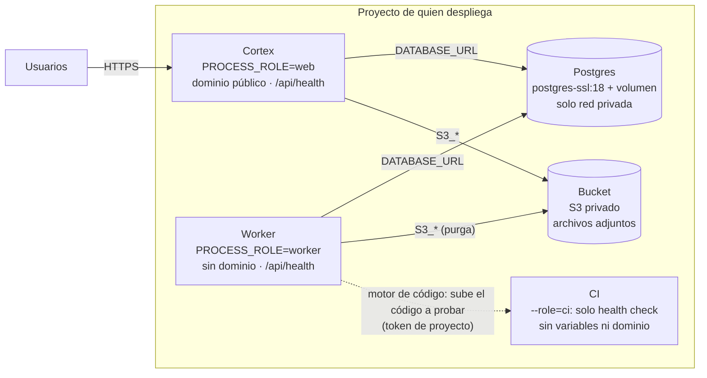

# Plantilla de Railway

> Plantilla (publicada en el marketplace): **https://railway.com/deploy/cortex-crm** · código fuente: **https://github.com/carbollo/cortex-crm** (rama `main`).

Cortex CRM se instala en cualquier proyecto de Railway con una plantilla de cuatro servicios y un bucket para los archivos. Cada instalación es independiente: su propia base de datos, sus propias claves (generadas por Railway al desplegar) y sus propias organizaciones. Lo que cada organización cambia con EVOLVE AI ENGINE se guarda en la base de datos de esa instalación, y lo que la administración de la plataforma cambia en el código con el **motor de código fuente** ([CODE_ENGINE.md](CODE_ENGINE.md)) se despliega en los servicios de esa misma instalación: nada vuelve al repositorio de la plantilla.



## 1. Servicios

| Servicio | Origen | Red | Configuración |
|---|---|---|---|
| `Postgres` | Imagen `ghcr.io/railwayapp-templates/postgres-ssl:18` (la plantilla oficial de Railway) con volumen en `/var/lib/postgresql/data` | Solo red privada (sin TCP proxy) | La de la plantilla oficial: contraseña generada con `${{secret(32, …)}}` |
| `Cortex` | Repositorio de la plataforma, rama `main` | Dominio público de Railway (`*.up.railway.app`) | `Dockerfile` (Railway lo detecta en la raíz) y health check `/api/health` en la configuración del servicio (Railway no aplica el `railway.json` del repositorio: `configFile: null`) |
| `Worker` | El mismo repositorio y rama | Sin dominio público | Igual que `Cortex`, con el comando de arranque `node --enable-source-maps dist/server/index.js --role=worker` |
| `CI` | El mismo repositorio y rama | Sin dominio público | **Sin variables**. Comando de arranque `node --enable-source-maps dist/server/index.js --role=ci`: un servidor de salud, sin base de datos ni secretos. Solo lo usa el motor de código fuente, que le sube el código a probar (`Dockerfile.ci`) y retira cada prueba al terminar. Railway no admite servicios vacíos en una plantilla («Service CI does not have a source that can be used to generate a template»), por eso nace del repositorio |

Además, un **Bucket** de Railway (almacenamiento compatible con S3, privado) para los archivos adjuntos: `Cortex` sube y sirve los archivos (siempre a través de la aplicación, con permisos) y `Worker` borra los objetos de los archivos eliminados al purgarlos. Sin bucket, la aplicación guarda los archivos en PostgreSQL.

Los nombres `Cortex`, `Worker` y `CI` no llevan espacios ni guiones porque las referencias entre servicios los usan (`${{Cortex.…}}`); si quien despliega renombra un servicio, Railway actualiza las referencias.

## 2. Variables

Al generar una plantilla desde un proyecto, Railway **conserva las referencias** (`${{Servicio.VARIABLE}}`) y las **funciones** (`${{secret(…)}}`), pero **vacía los valores literales** para no filtrar secretos. Por eso `Cortex` y `Worker` no usan ningún literal: la aplicación arranca en modo producción al detectar Railway (`RAILWAY_ENVIRONMENT_ID`) aunque falte `NODE_ENV` (además, la imagen la fija), el web es el rol por defecto en producción y el worker recibe su rol en el comando de arranque (`--role=worker`), que es un ajuste del servicio y no una variable. `ALLOW_SIGNUP` vale `true` por defecto.

### `Cortex` (web)

| Variable | Valor en la plantilla | Notas |
|---|---|---|
| `DATABASE_URL` | `${{Postgres.DATABASE_URL}}` | Red privada |
| `APP_ENCRYPTION_KEY` | `${{secret(64, "abcdefghijklmnopqrstuvwxyzABCDEFGHIJKLMNOPQRSTUVWXYZ0123456789")}}` | Se genera en cada despliegue. La aplicación deriva de ella la clave AES de 32 bytes (`parseEncryptionKey`); una clave de 32 bytes en base64 también sirve |
| `PLATFORM_ADMIN_SETUP_TOKEN` | `${{secret(48, "abcdefghijklmnopqrstuvwxyzABCDEFGHIJKLMNOPQRSTUVWXYZ0123456789")}}` | Token de instalación: la primera persona que lo pega en *Ajustes › Mi cuenta* pasa a ser administradora de la plataforma (solo mientras no haya ninguna) |
| `S3_ENDPOINT` | `${{Bucket.ENDPOINT}}` | Bucket de archivos (las cinco `S3_*` son referencias al Bucket de la plantilla) |
| `S3_BUCKET` | `${{Bucket.BUCKET}}` | |
| `S3_ACCESS_KEY_ID` | `${{Bucket.ACCESS_KEY_ID}}` | |
| `S3_SECRET_ACCESS_KEY` | `${{Bucket.SECRET_ACCESS_KEY}}` | |
| `S3_REGION` | `${{Bucket.REGION}}` | `auto` en Railway |

Opcionales, que quien despliega añade después si las necesita: `ALLOW_SIGNUP=false` (cerrar las altas públicas cuando ya exista su organización), `RESEND_API_KEY` y `EMAIL_FROM` (correo transaccional) y `APP_URL` (dominio propio).

`APP_URL` no hace falta: si no se define, la aplicación usa `https://` + `RAILWAY_PUBLIC_DOMAIN`, que Railway inyecta en el servicio con dominio público. Si se añade un dominio propio, hay que definir `APP_URL` con él (en los dos servicios).

### `Worker`

| Variable | Valor en la plantilla | Notas |
|---|---|---|
| `DATABASE_URL` | `${{Postgres.DATABASE_URL}}` | |
| `APP_ENCRYPTION_KEY` | `${{Cortex.APP_ENCRYPTION_KEY}}` | **Debe ser la misma** que la del web: el worker descifra las claves de IA y firma los webhooks |
| `APP_URL` | `https://${{Cortex.RAILWAY_PUBLIC_DOMAIN}}` | El worker no tiene dominio propio |
| `CORTEX_SERVICE_ID` | `${{Cortex.RAILWAY_SERVICE_ID}}` | Motor de código fuente: servicio web al que se despliega |
| `CI_SERVICE_ID` | `${{CI.RAILWAY_SERVICE_ID}}` | Motor de código fuente: servicio en el que se prueba cada cambio |
| `S3_ENDPOINT`, `S3_BUCKET`, `S3_ACCESS_KEY_ID`, `S3_SECRET_ACCESS_KEY`, `S3_REGION` | `${{Bucket.…}}` (las mismas que `Cortex`) | El worker borra del bucket los archivos eliminados al purgarlos |

El rol de worker va en el comando de arranque (`--role=worker`); `PROCESS_ROLE`, si se define, tiene prioridad. Las dos últimas variables son referencias, así que la plantilla las conserva; el worker usa además `RAILWAY_PROJECT_ID`, `RAILWAY_ENVIRONMENT_ID` y `RAILWAY_SERVICE_ID` (el suyo), que define Railway.

### `CI`

Ninguna, a propósito: el código que se prueba ahí todavía no lo ha aprobado nadie, así que el servicio no recibe secretos (ni `DATABASE_URL`, ni `APP_ENCRYPTION_KEY`, ni claves de IA). El código que se prueba solo se ejecuta durante el build de `Dockerfile.ci` (sin red privada ni secretos); el contenedor que queda en marcha es un servidor de salud mínimo escrito en el propio `Dockerfile.ci` como `dist/server/index.js`, que no carga ese código ni exige ninguna variable. Así el mismo comando de arranque sirve con las dos imágenes: con la imagen normal (el primer despliegue desde el repositorio) arranca el rol `ci` de la aplicación y con la de pruebas, ese servidor fijo.

### `Postgres`

Los de la plantilla oficial de Railway, salvo que **ninguno es un literal**: Railway vaciaría los literales al generar la plantilla y quien la desplegara tendría que rellenarlos. Se expresan con funciones de plantilla, que se conservan y dan el mismo resultado en cada instalación:

| Variable | Valor en la plantilla | Resultado |
|---|---|---|
| `POSTGRES_USER` | `${{secret(12, "abcdefghijklmnopqrstuvwxyz")}}` | Usuario aleatorio de 12 letras minúsculas (en lugar de `postgres`; la imagen `postgres-ssl` admite usuarios propios) |
| `POSTGRES_DB` | `${{POSTGRES_USER}}` | Base de datos con el nombre del usuario (lo mismo que hace PostgreSQL por defecto) |
| `PGPORT` | `${{randomInt(5432, 5432)}}` | `5432` (la imagen escucha siempre en ese puerto) |
| `RAILWAY_DEPLOYMENT_DRAINING_SECONDS` | `${{randomInt(60, 60)}}` | `60` |
| `SSL_CERT_DAYS` | `${{randomInt(820, 820)}}` | `820` |

`PGDATA` es una referencia (`${{RAILWAY_VOLUME_MOUNT_PATH}}/pgdata`), la contraseña una función (`${{ secret(32, …) }}`) y `DATABASE_URL`, `PGUSER`, `PGDATABASE`, `PGHOST` y `PGPASSWORD` referencias a las anteriores, así que la plantilla no necesita ningún retoque en el editor.

Railway define además en ambos servicios `RAILWAY_ENVIRONMENT_ID`, con la que la aplicación detecta que está detrás del *edge* de Railway y toma la IP real del cliente de `X-Real-IP` (límites por IP y auditoría; ver [SECURITY.md](SECURITY.md)).

## 3. Qué hace quien despliega la plantilla

1. Pulsar **Deploy** y esperar a que los cuatro servicios (`Postgres`, `Cortex`, `Worker` y `CI`) estén en verde (las migraciones de la base de datos se aplican solas al arrancar).
2. Abrir el dominio público del servicio `Cortex` y **registrarse**: se crea su organización con el CRM base.
3. En **Ajustes › Mi cuenta › Administración de la plataforma**, pegar el valor de `PLATFORM_ADMIN_SETUP_TOKEN` (Railway › servicio `Cortex` › *Variables*). Da acceso al panel de plataforma (salud, errores, trabajos y métricas de toda la instalación). Funciona una sola vez; para añadir a más personas: `railway ssh --service Cortex -- "cd /app && node dist/server/cli.js grant-platform-admin <email>"`.
4. Configurar un proveedor de IA en **Ajustes › Proveedores de IA** (cada organización usa sus propias claves, cifradas).
5. Opcional: correo con Resend (`RESEND_API_KEY` y `EMAIL_FROM` en `Cortex`), `ALLOW_SIGNUP=false` y copias de seguridad de Postgres (ver [RAILWAY_DEPLOYMENT.md](RAILWAY_DEPLOYMENT.md#9-base-de-datos-copias-de-seguridad-y-pitr)).
6. Opcional: activar el motor de código fuente (sección 4).

**Actualizaciones de la plataforma**: los servicios `Cortex` y `Worker` se construyen desde el repositorio de la plantilla; un nuevo despliegue de ambos recoge la versión nueva. Las migraciones son aditivas, así que los datos y la configuración de cada organización se conservan. Si la instalación ya ha cambiado su código con el motor de código fuente, un despliegue desde el repositorio **sustituiría** ese código: por eso el motor no despliega mientras `Cortex` o `Worker` sigan conectados a un repositorio, y para usarlo hay que desconectarlos (Railway › servicio › *Settings* › *Source* › *Disconnect*) y dejar que la instalación evolucione solo con el motor. Conviene desconectar también `CI`: si un *push* al repositorio lo redespliega mientras prueba un cambio, el motor repite la prueba (como mucho dos veces) y después se para y pide desconectarlo.

## 4. Motor de código fuente: servicio CI y token

El motor ([CODE_ENGINE.md](CODE_ENGINE.md)) prueba cada cambio en el servicio `CI` y lo despliega en `Worker` y `Cortex` con un **token de proyecto** de Railway. En una instalación desde la plantilla actual el servicio `CI` y las variables del Worker ya existen: basta con desconectar `Cortex`, `Worker` y `CI` del repositorio (ver «Actualizaciones de la plataforma») y seguir desde el paso 3. En una instalación anterior:

1. Crear el servicio vacío (sin repositorio, sin variables y sin dominio):
   ```bash
   railway add --service CI
   ```
2. Añadir al `Worker` las referencias (y redesplegarlo para que las vea):
   ```bash
   railway variables --service Worker --set 'CORTEX_SERVICE_ID=${{Cortex.RAILWAY_SERVICE_ID}}' --set 'CI_SERVICE_ID=${{CI.RAILWAY_SERVICE_ID}}'
   ```
3. Crear un **token de proyecto** para el entorno de la instalación (Railway › proyecto › *Settings* › *Tokens*). Es un token limitado a ese proyecto y entorno y a acciones de despliegue; no se admiten tokens de cuenta.
4. En Cortex, como administrador de la plataforma: **Código fuente › Configuración**, pegar el token. Se valida con `projectToken { projectId environmentId }` (debe ser de este mismo proyecto y entorno), se guarda cifrado y nunca se vuelve a mostrar (solo `••••abcd`). El worker publica entonces los servicios que ve y la pantalla dice si falta algo (`CORTEX_SERVICE_ID`, `CI_SERVICE_ID`, servicios repetidos, otro proyecto…).
5. Subir a 150 o más las «Peticiones por hora» de la organización cuya IA se va a usar (Ajustes › Proveedores de IA › Límites y control de gasto; por defecto 60): un cambio de código hace muchas llamadas y el motor no acepta peticiones con menos.

**Comprobaciones de seguridad**: el servicio `CI` no debe tener variables (ni compartidas del proyecto) ni dominio público; `CI_SERVICE_ID` nunca puede ser el web ni el worker (el motor lo rechaza); el token se puede revocar en Railway en cualquier momento (y borrar en la pantalla).

## 5. Crear o actualizar la plantilla (mantenimiento)

> **Nunca** se genera la plantilla desde un proyecto con datos reales: `railway templates create` copia las variables del proyecto, y la plantilla repartiría su `APP_ENCRYPTION_KEY` (todas las instalaciones compartirían la misma clave). Se usa un proyecto de origen dedicado, sin datos.

1. Proyecto de origen vacío con `Postgres` (`railway add --database postgres`, con sus literales sustituidos por las funciones de la sección 2), el servicio `CI` (sin variables, con el comando de arranque `--role=ci` fijado **antes** de conectarlo al repositorio, para que su primer despliegue no arranque como web sin secretos) y los servicios `Cortex` y `Worker` conectados al repositorio de la plataforma, con las variables de la sección 2 (también `CORTEX_SERVICE_ID` y `CI_SERVICE_ID` en el Worker), el health check `/api/health` como ajuste de servicio en `Cortex` y `Worker` (`serviceInstanceUpdate` con `healthcheckPath`; Railway no aplica el `railway.json`, pero la plantilla sí conserva este ajuste) y el comando de arranque del worker (`railway environment edit --service-config Worker deploy.startCommand "node --enable-source-maps dist/server/index.js --role=worker"`). Los secretos se crean con la función de plantilla: `railway add … --variables 'APP_ENCRYPTION_KEY=${{secret(64, "…")}}'`. Railway la ejecuta en el proyecto (la variable recibe un valor concreto), pero recuerda la función y el borrador de la plantilla la conserva, de modo que cada instalación genera la suya. Después se puede sustituir el valor del proyecto de origen por uno no válido (p. ej. `EDITAR-EN-LA-PLANTILLA`), así ningún secreto real llega a la plantilla y, si algo fallara, el arranque lo rechaza en lugar de compartir una clave.
2. Generar el borrador: `railway templates create --project <proyecto-de-origen> --environment production --json`. La plantilla es una copia independiente: lo que se cambie después en el proyecto de origen no le afecta.
   - El nombre de la plantilla es el del proyecto de origen: se renombra a «Cortex CRM» antes de generarla y se le devuelve después su nombre («Cortex CRM (origen de plantilla)»).
   - **Después de generarla**, los servicios `Cortex`, `Worker` y `CI` del proyecto de origen no deben quedar desplegándose: con los secretos no válidos no arrancan y cada *push* a `main` los relanzaría (y Railway avisaría de cada caída). Se apunta su disparador a una rama sin uso y se retiran sus despliegues:
     ```bash
     railway api 'mutation($id: String!) { deploymentTriggerUpdate(id: $id, input: { branch: "railway-template-source" }) { branch } }' --variables '{"id":"<id-del-disparador>"}'
     railway api 'mutation($id: String!) { deploymentRemove(id: $id) }' --variables '{"id":"<id-del-despliegue>"}'
     ```
     (los ids salen de `project(id) { deploymentTriggers … services { deployments … } }`).
   - **Antes de volver a generarla**, se devuelve el disparador a `main`.
3. **Revisar** que ningún secreto real ha quedado dentro y que no queda ningún valor vacío:
   ```bash
   railway api 'query($id: String!) { template(id: $id) { serializedConfig } }' --variables '{"id":"<id-de-la-plantilla>"}'
   ```
   `APP_ENCRYPTION_KEY`, `PLATFORM_ADMIN_SETUP_TOKEN` y la contraseña de Postgres deben aparecer como `${{secret(…)}}`, y `DATABASE_URL`, `APP_URL`, la clave del worker, `CORTEX_SERVICE_ID` y `CI_SERVICE_ID` como referencias. Las variables de `Postgres`, como funciones y referencias (sección 2). El servicio `CI` debe aparecer con el repositorio como origen, sin variables y con el comando de arranque `--role=ci`.
4. Probar un despliegue completo desde la plantilla en un proyecto nuevo (registro, token de instalación, una petición de EVOLVE) y borrar ese proyecto de prueba.
5. Publicar en el marketplace. La descripción (25–75 caracteres), la categoría, el resumen y el icono solo se guardan al publicar; los textos están en [railway/template-overview.md](../railway/template-overview.md) y [railway/template-variables.md](../railway/template-variables.md):
   ```bash
   railway templates publish <id-de-la-plantilla> --category "AI/ML" \
     --description "Open-source, self-hosted AI CRM that builds the modules you ask for" \
     --readme-file railway/template-overview.md \
     --image "https://cdn.jsdelivr.net/gh/carbollo/cortex-crm@<commit>/web/public/favicon.svg" --json
   ```
   - Al publicar, Railway cambia el código generado por uno legible (`cortex-crm`) y **el código anterior deja de funcionar** (`404`): hay que actualizar los enlaces (botón del README).
   - Las descripciones de las variables (obligatorias para el marketplace) no se pueden editar con el API público ni con la CLI: se escriben en el editor de la plantilla (servicio › *Variables* › *Description*). Los textos están en `railway/template-variables.md`.
   - Posicionamiento en el buscador de Railway (comprobado con `templateSearch`): pesa sobre todo el **nombre** y después la descripción; los despliegues y la salud de la plantilla también suben el puesto. El nombre y los iconos de los servicios solo se cambian en el editor de la plantilla.
   - Generar la plantilla de nuevo crea otro borrador independiente y la publicada no cambia. No hace falta para actualizar el código: sus servicios siguen la rama `main` del repositorio.
   - Para cambiar la configuración de la publicada (servicios, bucket, variables) hay que sustituirla: se genera el borrador nuevo, se prueba en un proyecto desechable, se borra la publicada (`railway templates delete`) y se publica el nuevo, que recupera el código `cortex-crm` (así se añadió el Bucket el 2026-11-27). El nombre largo y las descripciones de variables se vuelven a poner en el editor.
   - El Bucket del proyecto de origen se crea como hace `railway bucket create`: `bucketCreate` (a nivel de proyecto) y después `environmentPatchCommit` con `{ "buckets": { "<id>": { "region": "ams", "isCreated": true } } }` para desplegarlo en el entorno. Las variables `S3_*` de `Cortex` y `Worker` son referencias `${{Bucket.…}}`, y los iconos de los servicios se ponen en el proyecto de origen (`serviceUpdate` con `icon`), porque la plantilla los copia de ahí.

## 6. Actualizar la plantilla sin rehacerla

Casi ningún cambio exige generar la plantilla de nuevo. Según lo que cambie:

| Qué cambia | Cómo se publica | ¿Rehacer la plantilla? |
|---|---|---|
| **Código** (funciones, arreglos, interfaz, migraciones aditivas) | Publicar en la rama `main` del repositorio público (commit *squash*, sección 5). Las instalaciones nuevas lo reciben directamente y Railway avisa a quien ya la desplegó de que hay una actualización, que aplica cuando quiere ([Template Updates](https://docs.railway.com/templates/updates)) | No |
| **Ficha** (descripción, resumen, categoría, icono) | `railway templates update <id-de-la-plantilla> --category … --description … --readme-file railway/template-overview.md --image …` sobre la misma plantilla: conserva el código `cortex-crm`, el nombre y las descripciones de variables | No |
| **Nombre, descripciones de variables, iconos de servicio** | Editor de la plantilla en el panel de Railway (los cambios se preparan y se revisan con un diff antes de aplicarse; quedan en *Activity*) | No |
| **Infraestructura** (un servicio, volumen o bucket nuevo, una variable obligatoria nueva) | Preferiblemente en el mismo editor de la plantilla (edita la publicada sin cambiar su dirección). Solo en cambios grandes: regenerar y sustituir (sección 5) | Solo si el editor no basta |

Para que la infraestructura casi nunca cambie, las funciones nuevas se diseñan así: la configuración vive en la base de datos (Ajustes de la organización o de la plataforma) y no en variables de entorno; las variables nuevas son opcionales y tienen un valor por defecto seguro, o la aplicación las deduce de las que Railway ya define (`RAILWAY_*`); y las migraciones son aditivas y se aplican solas al arrancar.

Quien despliega solo deja de recibir estas actualizaciones si desconecta sus servicios del repositorio (*Eject* o desconexión de la fuente), que es lo que se recomienda al usar el motor de código fuente para no perder sus propios cambios. Cada versión se resume en [CHANGELOG.md](../CHANGELOG.md), que es lo que conviene revisar antes de actualizar.
