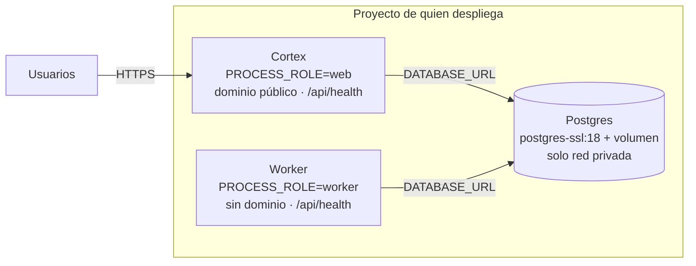

# Plantilla de Railway

Cortex CRM se instala en cualquier proyecto de Railway con una plantilla de tres servicios. Cada instalación es independiente: su propia base de datos, sus propias claves (generadas por Railway al desplegar) y sus propias organizaciones. Lo que cada organización cambia con EVOLVE AI ENGINE se guarda en la base de datos de esa instalación; nunca vuelve al repositorio de la plantilla.



## 1. Servicios

| Servicio | Origen | Red | Configuración |
|---|---|---|---|
| `Postgres` | Imagen `ghcr.io/railwayapp-templates/postgres-ssl:18` (la plantilla oficial de Railway) con volumen en `/var/lib/postgresql/data` | Solo red privada (sin TCP proxy) | La de la plantilla oficial: contraseña generada con `${{secret(32, …)}}` |
| `Cortex` | Repositorio de la plataforma, rama `main` | Dominio público de Railway (`*.up.railway.app`) | `Dockerfile` y health check `/api/health` desde `railway.json` |
| `Worker` | El mismo repositorio y rama | Sin dominio público | Igual que `Cortex`; el rol lo decide `PROCESS_ROLE` |

Los nombres `Cortex` y `Worker` no llevan espacios ni guiones porque las referencias entre servicios los usan (`${{Cortex.…}}`); si quien despliega renombra un servicio, Railway actualiza las referencias.

## 2. Variables

### `Cortex` (web)

| Variable | Valor en la plantilla | Notas |
|---|---|---|
| `DATABASE_URL` | `${{Postgres.DATABASE_URL}}` | Red privada |
| `NODE_ENV` | `production` | |
| `PROCESS_ROLE` | `web` | |
| `APP_ENCRYPTION_KEY` | `${{secret(64, "abcdefghijklmnopqrstuvwxyzABCDEFGHIJKLMNOPQRSTUVWXYZ0123456789")}}` | Se genera en cada despliegue. La aplicación deriva de ella la clave AES de 32 bytes (`parseEncryptionKey`); una clave de 32 bytes en base64 también sirve |
| `PLATFORM_ADMIN_SETUP_TOKEN` | `${{secret(48, "abcdefghijklmnopqrstuvwxyzABCDEFGHIJKLMNOPQRSTUVWXYZ0123456789")}}` | Token de instalación: la primera persona que lo pega en *Ajustes › Mi cuenta* pasa a ser administradora de la plataforma (solo mientras no haya ninguna) |
| `ALLOW_SIGNUP` | `true` (opcional) | Ponerla a `false` cuando ya exista la organización propia, si no se quieren altas públicas |
| `RESEND_API_KEY`, `EMAIL_FROM` | vacías (opcionales) | Correo transaccional (verificación, recuperación de contraseña, invitaciones) |

`APP_URL` no hace falta: si no se define, la aplicación usa `https://` + `RAILWAY_PUBLIC_DOMAIN`, que Railway inyecta en el servicio con dominio público. Si se añade un dominio propio, hay que definir `APP_URL` con él (en los dos servicios).

### `Worker`

| Variable | Valor en la plantilla | Notas |
|---|---|---|
| `DATABASE_URL` | `${{Postgres.DATABASE_URL}}` | |
| `NODE_ENV` | `production` | |
| `PROCESS_ROLE` | `worker` | Imprescindible (sin ella arrancaría como web) |
| `APP_ENCRYPTION_KEY` | `${{Cortex.APP_ENCRYPTION_KEY}}` | **Debe ser la misma** que la del web: el worker descifra las claves de IA y firma los webhooks |
| `APP_URL` | `https://${{Cortex.RAILWAY_PUBLIC_DOMAIN}}` | El worker no tiene dominio propio |

Railway define además en ambos servicios `RAILWAY_ENVIRONMENT_ID`, con la que la aplicación detecta que está detrás del *edge* de Railway y toma la IP real del cliente de `X-Real-IP` (límites por IP y auditoría; ver [SECURITY.md](SECURITY.md)).

## 3. Qué hace quien despliega la plantilla

1. Pulsar **Deploy** y esperar a que los tres servicios estén en verde (las migraciones de la base de datos se aplican solas al arrancar).
2. Abrir el dominio público del servicio `Cortex` y **registrarse**: se crea su organización con el CRM base.
3. En **Ajustes › Mi cuenta › Administración de la plataforma**, pegar el valor de `PLATFORM_ADMIN_SETUP_TOKEN` (Railway › servicio `Cortex` › *Variables*). Da acceso al panel de plataforma (salud, errores, trabajos y métricas de toda la instalación). Funciona una sola vez; para añadir a más personas: `railway ssh --service Cortex -- "cd /app && node dist/server/cli.js grant-platform-admin <email>"`.
4. Configurar un proveedor de IA en **Ajustes › Proveedores de IA** (cada organización usa sus propias claves, cifradas).
5. Opcional: correo con Resend (`RESEND_API_KEY` y `EMAIL_FROM` en `Cortex`), `ALLOW_SIGNUP=false` y copias de seguridad de Postgres (ver [RAILWAY_DEPLOYMENT.md](RAILWAY_DEPLOYMENT.md#9-base-de-datos-copias-de-seguridad-y-pitr)).

**Actualizaciones de la plataforma**: los servicios `Cortex` y `Worker` se construyen desde el repositorio de la plantilla; un nuevo despliegue de ambos recoge la versión nueva. Las migraciones son aditivas, así que los datos y la configuración de cada organización se conservan.

## 4. Crear o actualizar la plantilla (mantenimiento)

> **Nunca** se genera la plantilla desde un proyecto con datos reales: `railway templates create` copia las variables del proyecto, y la plantilla repartiría su `APP_ENCRYPTION_KEY` (todas las instalaciones compartirían la misma clave). Se usa un proyecto de origen dedicado, sin datos.

1. Proyecto de origen vacío con `Postgres` (`railway add --database postgres`) y los servicios `Cortex` y `Worker` conectados al repositorio de la plataforma, con las variables de la sección 2. Para los secretos se escribe la función de plantilla `${{secret(…)}}`, que Railway ejecuta en cada despliegue de la plantilla; en el paso 3 se comprueba que el borrador la conserva (si no, se corrige en el editor de plantillas del panel antes de publicar).
2. Generar el borrador: `railway templates create --project <proyecto-de-origen> --environment production --json`.
3. **Revisar** que ningún secreto real ha quedado dentro antes de publicar:
   ```bash
   railway api 'query($id: String!) { template(id: $id) { serializedConfig } }' --variables '{"id":"<id-de-la-plantilla>"}'
   ```
   `APP_ENCRYPTION_KEY`, `PLATFORM_ADMIN_SETUP_TOKEN` y la contraseña de Postgres deben aparecer como `${{secret(…)}}`, y `DATABASE_URL`, `APP_URL` y la clave del worker como referencias.
4. Probar un despliegue completo desde la plantilla en un proyecto nuevo (registro, token de instalación, una petición de EVOLVE) y borrar ese proyecto de prueba.
5. Publicar en el marketplace (opcional; también se puede compartir el enlace de la plantilla):
   ```bash
   railway templates publish <id-de-la-plantilla> --category Other \
     --description "CRM multi-organización que evoluciona con lenguaje natural" \
     --readme-file railway/template-overview.md --json
   ```
