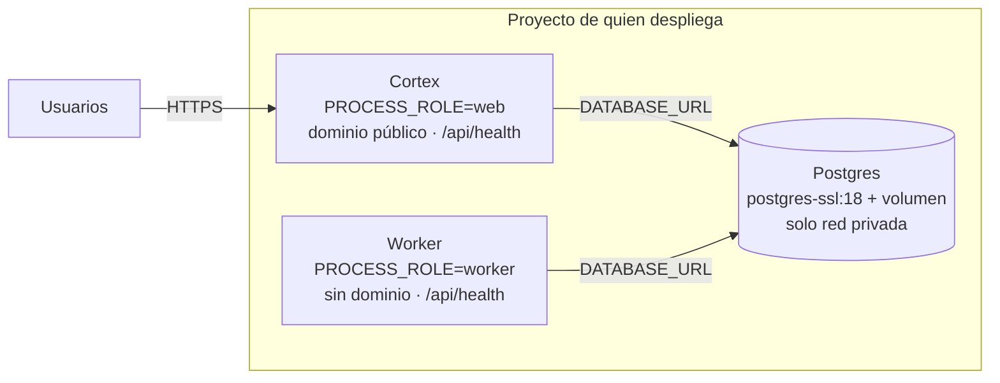

# Plantilla de Railway

> Plantilla: **https://railway.com/new/template/TK1L4n** · código fuente: **https://github.com/carbollo/cortex-crm** (rama `main`).

Cortex CRM se instala en cualquier proyecto de Railway con una plantilla de tres servicios. Cada instalación es independiente: su propia base de datos, sus propias claves (generadas por Railway al desplegar) y sus propias organizaciones. Lo que cada organización cambia con EVOLVE AI ENGINE se guarda en la base de datos de esa instalación; nunca vuelve al repositorio de la plantilla.



## 1. Servicios

| Servicio | Origen | Red | Configuración |
|---|---|---|---|
| `Postgres` | Imagen `ghcr.io/railwayapp-templates/postgres-ssl:18` (la plantilla oficial de Railway) con volumen en `/var/lib/postgresql/data` | Solo red privada (sin TCP proxy) | La de la plantilla oficial: contraseña generada con `${{secret(32, …)}}` |
| `Cortex` | Repositorio de la plataforma, rama `main` | Dominio público de Railway (`*.up.railway.app`) | `Dockerfile` y health check `/api/health` desde `railway.json` |
| `Worker` | El mismo repositorio y rama | Sin dominio público | Igual que `Cortex`, con el comando de arranque `node --enable-source-maps dist/server/index.js --role=worker` |

Los nombres `Cortex` y `Worker` no llevan espacios ni guiones porque las referencias entre servicios los usan (`${{Cortex.…}}`); si quien despliega renombra un servicio, Railway actualiza las referencias.

## 2. Variables

Al generar una plantilla desde un proyecto, Railway **conserva las referencias** (`${{Servicio.VARIABLE}}`) y las **funciones** (`${{secret(…)}}`), pero **vacía los valores literales** para no filtrar secretos. Por eso `Cortex` y `Worker` no usan ningún literal: la aplicación arranca en modo producción al detectar Railway (`RAILWAY_ENVIRONMENT_ID`) aunque falte `NODE_ENV` (además, la imagen la fija), el web es el rol por defecto en producción y el worker recibe su rol en el comando de arranque (`--role=worker`), que es un ajuste del servicio y no una variable. `ALLOW_SIGNUP` vale `true` por defecto.

### `Cortex` (web)

| Variable | Valor en la plantilla | Notas |
|---|---|---|
| `DATABASE_URL` | `${{Postgres.DATABASE_URL}}` | Red privada |
| `APP_ENCRYPTION_KEY` | `${{secret(64, "abcdefghijklmnopqrstuvwxyzABCDEFGHIJKLMNOPQRSTUVWXYZ0123456789")}}` | Se genera en cada despliegue. La aplicación deriva de ella la clave AES de 32 bytes (`parseEncryptionKey`); una clave de 32 bytes en base64 también sirve |
| `PLATFORM_ADMIN_SETUP_TOKEN` | `${{secret(48, "abcdefghijklmnopqrstuvwxyzABCDEFGHIJKLMNOPQRSTUVWXYZ0123456789")}}` | Token de instalación: la primera persona que lo pega en *Ajustes › Mi cuenta* pasa a ser administradora de la plataforma (solo mientras no haya ninguna) |

Opcionales, que quien despliega añade después si las necesita: `ALLOW_SIGNUP=false` (cerrar las altas públicas cuando ya exista su organización), `RESEND_API_KEY` y `EMAIL_FROM` (correo transaccional) y `APP_URL` (dominio propio).

`APP_URL` no hace falta: si no se define, la aplicación usa `https://` + `RAILWAY_PUBLIC_DOMAIN`, que Railway inyecta en el servicio con dominio público. Si se añade un dominio propio, hay que definir `APP_URL` con él (en los dos servicios).

### `Worker`

| Variable | Valor en la plantilla | Notas |
|---|---|---|
| `DATABASE_URL` | `${{Postgres.DATABASE_URL}}` | |
| `APP_ENCRYPTION_KEY` | `${{Cortex.APP_ENCRYPTION_KEY}}` | **Debe ser la misma** que la del web: el worker descifra las claves de IA y firma los webhooks |
| `APP_URL` | `https://${{Cortex.RAILWAY_PUBLIC_DOMAIN}}` | El worker no tiene dominio propio |

El rol de worker va en el comando de arranque (`--role=worker`); `PROCESS_ROLE`, si se define, tiene prioridad.

### `Postgres`

Los de la plantilla oficial de Railway. Como son literales, el borrador generado los deja vacíos y **hay que restaurarlos una vez en el editor de la plantilla** antes de compartirla: `POSTGRES_USER=postgres`, `POSTGRES_DB=railway`, `PGPORT=5432`, `RAILWAY_DEPLOYMENT_DRAINING_SECONDS=60` y `SSL_CERT_DAYS=820` (opcional). `PGDATA` se define como referencia (`${{RAILWAY_VOLUME_MOUNT_PATH}}/pgdata`) y la contraseña como función (`${{ secret(32, …) }}`), así que se conservan solas.

Railway define además en ambos servicios `RAILWAY_ENVIRONMENT_ID`, con la que la aplicación detecta que está detrás del *edge* de Railway y toma la IP real del cliente de `X-Real-IP` (límites por IP y auditoría; ver [SECURITY.md](SECURITY.md)).

## 3. Qué hace quien despliega la plantilla

1. Pulsar **Deploy** y esperar a que los tres servicios estén en verde (las migraciones de la base de datos se aplican solas al arrancar).
2. Abrir el dominio público del servicio `Cortex` y **registrarse**: se crea su organización con el CRM base.
3. En **Ajustes › Mi cuenta › Administración de la plataforma**, pegar el valor de `PLATFORM_ADMIN_SETUP_TOKEN` (Railway › servicio `Cortex` › *Variables*). Da acceso al panel de plataforma (salud, errores, trabajos y métricas de toda la instalación). Funciona una sola vez; para añadir a más personas: `railway ssh --service Cortex -- "cd /app && node dist/server/cli.js grant-platform-admin <email>"`.
4. Configurar un proveedor de IA en **Ajustes › Proveedores de IA** (cada organización usa sus propias claves, cifradas).
5. Opcional: correo con Resend (`RESEND_API_KEY` y `EMAIL_FROM` en `Cortex`), `ALLOW_SIGNUP=false` y copias de seguridad de Postgres (ver [RAILWAY_DEPLOYMENT.md](RAILWAY_DEPLOYMENT.md#9-base-de-datos-copias-de-seguridad-y-pitr)).

**Actualizaciones de la plataforma**: los servicios `Cortex` y `Worker` se construyen desde el repositorio de la plantilla; un nuevo despliegue de ambos recoge la versión nueva. Las migraciones son aditivas, así que los datos y la configuración de cada organización se conservan.

## 4. Crear o actualizar la plantilla (mantenimiento)

> **Nunca** se genera la plantilla desde un proyecto con datos reales: `railway templates create` copia las variables del proyecto, y la plantilla repartiría su `APP_ENCRYPTION_KEY` (todas las instalaciones compartirían la misma clave). Se usa un proyecto de origen dedicado, sin datos.

1. Proyecto de origen vacío con `Postgres` (`railway add --database postgres`) y los servicios `Cortex` y `Worker` conectados al repositorio de la plataforma, con las variables de la sección 2 y el comando de arranque del worker (`railway environment edit --service-config Worker deploy.startCommand "node --enable-source-maps dist/server/index.js --role=worker"`). Los secretos se crean con la función de plantilla: `railway add … --variables 'APP_ENCRYPTION_KEY=${{secret(64, "…")}}'`. Railway la ejecuta en el proyecto (la variable recibe un valor concreto), pero recuerda la función y el borrador de la plantilla la conserva, de modo que cada instalación genera la suya. Después se puede sustituir el valor del proyecto de origen por uno no válido (p. ej. `EDITAR-EN-LA-PLANTILLA`), así ningún secreto real llega a la plantilla y, si algo fallara, el arranque lo rechaza en lugar de compartir una clave.
2. Generar el borrador: `railway templates create --project <proyecto-de-origen> --environment production --json`. La plantilla es una copia independiente: lo que se cambie después en el proyecto de origen no le afecta.
   - **Después de generarla**, los servicios `Cortex` y `Worker` del proyecto de origen no deben quedar desplegándose: con los secretos no válidos no arrancan y cada *push* a `main` los relanzaría (y Railway avisaría de cada caída). Se apunta su disparador a una rama sin uso y se retiran sus despliegues:
     ```bash
     railway api 'mutation($id: String!) { deploymentTriggerUpdate(id: $id, input: { branch: "railway-template-source" }) { branch } }' --variables '{"id":"<id-del-disparador>"}'
     railway api 'mutation($id: String!) { deploymentRemove(id: $id) }' --variables '{"id":"<id-del-despliegue>"}'
     ```
     (los ids salen de `project(id) { deploymentTriggers … services { deployments … } }`).
   - **Antes de volver a generarla**, se devuelve el disparador a `main`.
3. **Revisar** que ningún secreto real ha quedado dentro y restaurar en el editor los literales de `Postgres` (sección 2):
   ```bash
   railway api 'query($id: String!) { template(id: $id) { serializedConfig } }' --variables '{"id":"<id-de-la-plantilla>"}'
   ```
   `APP_ENCRYPTION_KEY`, `PLATFORM_ADMIN_SETUP_TOKEN` y la contraseña de Postgres deben aparecer como `${{secret(…)}}`, y `DATABASE_URL`, `APP_URL` y la clave del worker como referencias.
4. Probar un despliegue completo desde la plantilla en un proyecto nuevo (registro, token de instalación, una petición de EVOLVE) y borrar ese proyecto de prueba.
5. Publicar en el marketplace (opcional; también se puede compartir el enlace de la plantilla):
   ```bash
   railway templates publish <id-de-la-plantilla> --category Other \
     --description "CRM multi-organización que evoluciona con lenguaje natural" \
     --readme-file railway/template-overview.md --json
   ```
