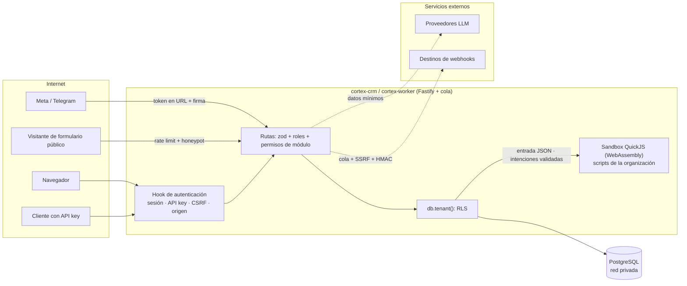

# Seguridad

> Documenta los controles **implementados** en el código (con su ubicación) y las tareas de endurecimiento pendientes. Para el aislamiento a nivel de base de datos ver también [DATABASE_SCHEMA.md](DATABASE_SCHEMA.md#3-row-level-security); para las salvaguardas de la IA, [AI_ENGINE.md](AI_ENGINE.md#8-salvaguardas-que-ninguna-instrucción-puede-desactivar).

## 1. Modelo de amenazas

### 1.1 Activos

| Activo | Dónde vive | Por qué importa |
|---|---|---|
| Datos de clientes de cada organización | `records`, `notes`, `files`, `channel_messages` | Datos personales (RGPD) y comerciales |
| Credenciales de usuario y sesiones | `users.password_hash`, `sessions`, `auth_tokens` | Suplantación |
| API keys de proveedores de IA y credenciales de canales | `ai_providers`, `connectors` (cifradas) | Coste económico y acceso a terceros |
| API keys de organización | `api_keys` (hash) | Acceso programático al CRM |
| Configuración del CRM y su historial | `blueprint_versions`, `releases`, `backups` | Integridad del producto de cada cliente |
| Scripts de cada organización | `blueprint.scripts` dentro de `blueprint_versions` | Código a medida que modifica registros automáticamente |
| Código común de la plataforma y su despliegue | Proyecto local y servicios de Railway (`railway up`) | Afecta a todas las organizaciones |
| `APP_ENCRYPTION_KEY`, `DATABASE_URL`, `RESEND_API_KEY`, claves LLM de plataforma | Variables de Railway | Compromiso total si se filtran |

### 1.2 Actores de amenaza

| Actor | Ejemplos de ataque considerados |
|---|---|
| Anónimo en Internet | Fuerza bruta de login, enumeración de cuentas, CSRF, abuso de formularios públicos y webhooks, subida de archivos maliciosos |
| Usuario legítimo de otra organización | Acceso cruzado cambiando ids en la URL, enlazar registros o usuarios ajenos, cambiar de organización |
| Usuario con rol bajo en su organización | Escalada de privilegios (aprobar cambios, gestionar miembros, leer módulos restringidos) |
| API key filtrada | Uso fuera de su organización o para acciones de usuario |
| Contenido malicioso dentro del CRM | Inyección de instrucciones a la IA a través de notas, mensajes entrantes o datos de registros |
| Salida no fiable del modelo de IA | JSON malformado, operaciones peligrosas, scripts que intentan salir del sandbox, agotar memoria o tiempo, o alterar datos de forma no pedida; enlaces maliciosos |
| Destino de webhook controlado por un atacante | SSRF hacia la red interna o metadatos del proveedor |
| Operador/administrador de plataforma | Cambios del código común que afectan a todas las organizaciones (EVOLVE no tiene ningún camino para modificarlo: lo cambia el equipo de desarrollo y se despliega con `railway up`) |

### 1.3 Fronteras de confianza



## 2. Controles implementados

### 2.1 Autenticación (`server/src/auth/routes.ts`, `server/src/lib/crypto.ts`)

- **Contraseñas con scrypt** (N = 2¹⁵, r = 8, p = 1, clave de 64 bytes, sal aleatoria de 16 bytes, normalización NFKC) y comparación en tiempo constante. En tests se reduce el coste para acelerar la suite. Como cada cálculo usa ~32 MB y un hilo, se limitan a 4 simultáneos con una cola de 200 para que una ráfaga de logins no agote el servidor: cuando un cálculo termina, su hueco pasa directamente al siguiente de la cola (nunca hay más de 4 a la vez) y, con la cola llena, la petición se rechaza con `503 busy` («Servidor ocupado, inténtalo en unos segundos»), un error controlado que no se registra como fallo interno.
- **Política**: 10–200 caracteres combinando letras con números o símbolos.
- **Sin enumeración de cuentas**: mismo error para email inexistente y contraseña incorrecta, con un cálculo scrypt ficticio para igualar tiempos; `password/forgot` responde igual exista o no la cuenta.
- **Bloqueo de cuenta** tras 10 intentos fallidos durante 15 minutos (`429`), con contador incrementado de forma atómica (intentos en paralelo no lo eluden) y auditado (`auth.login_failed`, `auth.account_locked`, sin organización porque aún no hay sesión). La auditoría de seguridad de EVOLVE cuenta esos eventos para las cuentas que son miembros de la organización y avisa de los bloqueos de las últimas 24 h («Cuentas bloqueadas por intentos fallidos») o, si no los hay, de más de 20 fallos en ese plazo.
- **Recuperación de contraseña** con token aleatorio de un solo uso (guardado como hash) que caduca en 1 hora; pedir un enlace nuevo invalida los anteriores. Al restablecer se cierran **todas** las sesiones, se invalidan los demás enlaces, se **revocan las API keys creadas por esa cuenta** (la respuesta indica cuántas, `apiKeysRevoked`) y se avisa por correo. Cambiar la contraseña exige la actual (cuenta para el bloqueo: al décimo fallo se bloquea la cuenta y se cierran todas sus sesiones) y cierra las demás sesiones.
- **Enlaces de restablecimiento generados por un propietario** (`POST /api/workspace/members/:id/reset-link`, 5/min): caducan en **30 minutos** y se vuelven a comprobar al usarlos (quien lo generó sigue siendo propietario, la cuenta sigue siendo un miembro no propietario que solo pertenece a esa organización y no es administradora de plataforma); si algo cambió, el enlace se rechaza y se audita (`auth.owner_reset_link_refused`).
- **Verificación de email** con token de 48 horas (reenvío limitado a 5/min). En la web exige pulsar un botón (abrir el enlace, o que lo abra un escáner de correo, no la completa). Verificar **nunca concede privilegios**: solo marca el email (`auth.email_verified`).
- **Invitaciones** con token de 7 días; si el email ya tiene cuenta, solo la puede aceptar esa cuenta con sesión iniciada y, con el correo configurado, con el email verificado; el rol nunca puede ser `owner`. Al aceptar se comprueba que quien invitó **sigue pudiendo conceder ese rol** (una invitación de administrador exige que su creador siga siendo propietario; las demás, que siga siendo administrador o propietario) y el token se consume antes de crear la cuenta (dos aceptaciones simultáneas no crean dos cuentas). Si alguien pierde el rol que le permitía invitar, sus invitaciones pendientes que ya no podría crear se eliminan. Máximo 100 invitaciones por organización y día; el asunto del correo es fijo y los nombres que aparecen en él se sanean (sin URLs, dominios ni caracteres de control o bidireccionales), para que no se pueda usar el correo de invitación para *phishing*. Si el correo se entrega, el enlace solo viaja al buzón invitado (la API responde `{link: null, emailSent: true}`) y la entrega queda registrada en esa invitación (`auth_tokens.delivered`, migración `003_invite_delivery`); solo entonces la cuenta creada al aceptarla nace con el email verificado. Sin correo, o si el envío falla, el enlace se devuelve a quien invita para compartirlo y el email queda pendiente de verificar.
- **Registro** desactivable (`ALLOW_SIGNUP=false`); máximo 10 organizaciones propias por usuario.
- **Administradores de plataforma**: en producción el rol **nunca** se concede al registrarse ni al verificar un email. Hay dos vías, ambas auditadas: la CLI dentro del contenedor (`node dist/server/cli.js grant-platform-admin <email>`, también `revoke-platform-admin` y `list-platform-admins`) y, en instalaciones nuevas, el **token de instalación** `PLATFORM_ADMIN_SETUP_TOKEN` (la plantilla de Railway lo genera con `${{secret(48, …)}}`; solo lo ve quien accede a las variables del despliegue). `POST /api/auth/platform-admin/claim` exige sesión de usuario, admite 5 intentos por minuto, compara el token en tiempo constante, registra los fallos (`platform.admin_claim_failed`) y solo concede el rol **mientras no haya ningún administrador** (dentro de una transacción con *advisory lock*, así que dos reclamaciones simultáneas no dan dos administradores; `platform.admin_granted_by_setup_token`). Después la vía queda cerrada. La variable `PLATFORM_ADMIN_EMAILS` se eliminó. Fuera de producción el primer usuario lo es.

### 2.2 Sesiones (`server/src/auth/plugin.ts`)

- Token opaco de 32 bytes aleatorios en la cookie `evolve_session`; en la base de datos solo se guarda su `sha256`.
- Cookie `httpOnly`, `SameSite=Lax`, `Path=/` y `Secure` en producción.
- Caducidad deslizante de 14 días con máximo absoluto de 90 días desde la creación.
- Gestión por el usuario: listar sesiones activas (IP, agente, fechas), revocar una, cerrar todas las demás (`/api/auth/sessions`, `/logout-all`).
- Al quitar a un miembro de una organización, sus sesiones se desvinculan de ella.

### 2.3 CSRF y comprobación de origen

- **Token CSRF por sesión** (24 bytes) entregado en `/api/auth/me` y exigido en la cabecera `X-CSRF-Token` en toda petición que modifica (no GET/HEAD/OPTIONS) con cookie de sesión; comparación en tiempo constante.
- **Comprobación de `Origin`** en peticiones que modifican sin Bearer: debe coincidir con `APP_URL` o con el host de la petición (también protege el login frente a *login CSRF*).
- `SameSite=Lax` añade una tercera barrera. La SPA se sirve en el mismo origen: no hay CORS habilitado.
- Exentos (no usan cookies o tienen su propia firma): `/api/hooks/*`, `/api/public/*`, `/api/client-errors`. Las peticiones con API key no usan cookies y no necesitan CSRF.
- La ruta se evalúa decodificada (o la resuelta por el router), de modo que codificaciones como `/%61pi/...` no esquivan la autenticación ni el CSRF.
- Cubierto por test: sin token → 403; con `Origin` ajeno → 403.

### 2.4 Cabeceras HTTP y XSS (`server/src/app.ts`)

`@fastify/helmet` con CSP propia:

```text
default-src 'self'; script-src 'self'; style-src 'self' 'unsafe-inline';
img-src 'self' data: blob:; font-src 'self' data:; connect-src 'self'; frame-src 'self';
frame-ancestors 'none'; object-src 'none'; base-uri 'self'; form-action 'self';
upgrade-insecure-requests (solo producción)
```

Además: HSTS de 1 año con subdominios (producción), `Referrer-Policy: strict-origin-when-cross-origin`, `X-Content-Type-Options: nosniff` y el resto de cabeceras por defecto de helmet. Contra XSS: React escapa todo el contenido; el cliente no usa `innerHTML`/`dangerouslySetInnerHTML`; el renderizador Markdown de las respuestas de IA construye elementos React y solo enlaza URLs `http(s)` con `rel="noopener noreferrer"`; los campos URL solo admiten `http(s)`; no se aceptan subidas HTML/SVG/JS. El parámetro `next` del login (`web/src/pages/auth/Login.tsx`) solo admite rutas internas: debe empezar por una única `/` (se rechaza `//…`) y no puede contener barras invertidas, que los navegadores tratan como `/`, ni caracteres de control; si no cumple, se redirige a `/`. Así se evitan redirecciones abiertas.

### 2.5 Limitación de frecuencia (`@fastify/rate-limit` + límite general propio)

General: **600 peticiones/minuto por IP** a la API (los archivos estáticos de la web no cuentan; 3.000 en `/api/hooks/*`, que llegan desde pocas IPs de Telegram/Meta compartidas por todas las organizaciones). Se aplica **antes de autenticar**, así que también cuentan las peticiones rechazadas (401/403) y las rutas inexistentes, y nadie puede forzar consultas a la base de datos sin límite. Es un contador propio (`server/src/lib/request-limit.ts`) y no el del plugin a propósito: el plugin marca la petición como ya limitada tras su primer limitador y, si aplicara también el general, se saltaría los límites estrictos de cada ruta (lo comprueba un test). Las IPv6 se agrupan por su prefijo `/64` (un cliente no obtiene contadores infinitos rotando direcciones de su bloque). Por ruta (por IP y minuto; los webhooks entrantes, por conector):

| Límite | Rutas |
|---|---|
| 3 | `GET /api/workspace/export` |
| 4 | `POST /api/evolve/security-review`, `POST /api/evolve/advice` |
| 5 | `POST /api/auth/password/forgot`, `POST /api/auth/verify-email/resend`, `POST /api/public/forms/:slug/:form` |
| 6 | `POST /api/reports/predictions`, `POST /api/ai/compare`, `POST /api/files/:id/analyze` |
| 10 | `POST /api/auth/register`, `/login`, `/workspaces`, `/password/reset`, `/password/change`, `/verify-email`, `/invite/accept`; `POST /api/evolve/requests`, `/refine`; `POST /api/ai/providers/:id/test`; `POST /api/ai/query`; `POST /api/records/:module/:id/classify`; `POST /api/comms/connectors`; `POST /api/client-errors` |
| 20 | `POST /api/assistant/chat`, `PUT /api/ai/providers/:id`, `GET /api/ai/providers/:id/models`, `POST /api/workspace/invites` |
| 30 | `POST /api/files`, `POST /api/comms/send` |
| 60 | `GET /api/public/forms/:slug/:form` |
| 240 | Webhooks entrantes `/api/hooks/*` (contador por token de conector) |

Respuesta: `429 {"error": {"code": "rate_limited", "message": "Demasiadas peticiones. Reintenta en N s."}}`. **IP del cliente**: en Railway se toma de `X-Real-IP`, que el *edge* de Railway **sobrescribe** en cada petición pública (un cliente no puede falsearla) y que el servidor HTTP normaliza antes de enrutar, registrar o auditar (`server/src/lib/client-ip.ts`; se activa sola cuando existe `RAILWAY_ENVIRONMENT_ID` o con `CLIENT_IP_HEADER`). Hasta la auditoría de noviembre de 2026 se confiaba solo en el salto inmediato, pero entre el *edge* y el contenedor hay un número variable de saltos: `req.ip` era la IP de un nodo del proxy (`152.233.29.x`), compartida por muchos usuarios, y el límite del login no llegaba a saltar (verificado en producción antes y después del arreglo). Si la cabecera falta o no es una IP (tráfico interno, que no pasa por el *edge*), se usa el salto inmediato, que tampoco se puede falsear con `X-Forwarded-For`. Ningún otro servicio del proyecto llama al servicio web por la red privada. Los contadores viven **en memoria de cada instancia**. La IA tiene además sus propios límites por organización (peticiones por hora y presupuesto mensual).

### 2.6 Autorización

**Roles por organización** (`shared/constants.ts`): Propietario (`owner`) > Administrador (`admin`) > Constructor (`builder`) > Miembro (`member`) > Lector (`viewer`). Cada ruta declara su rol mínimo (`requireWorkspace`) y las acciones que no deben poder hacerse con API key exigen sesión de usuario (`requireUserSession`).

| Capacidad | Rol mínimo |
|---|---|
| Ver módulos, registros, paneles, informes, versiones; usar el asistente; preguntas en lenguaje natural sobre los datos | Lector (según `permissions.read` de cada módulo) |
| Crear/editar/borrar registros | Según `permissions.create/update/delete` del módulo (por defecto Miembro) |
| Notas, archivos, análisis de documentos con IA, bandeja y envío de mensajes, memoria personal, predicciones | Miembro |
| Clasificación de registros con IA | Miembro y, además, permiso de edición del módulo |
| Pedir y refinar evoluciones, asesor de mejoras | Constructor |
| Ajustes, equipo, invitaciones, API keys, secreto de firma de webhooks salientes, auditoría, proveedores de IA, canales, memoria de organización, cambios manuales (incluido activar o desactivar un script), aprobar/publicar/revertir riesgo bajo o medio, rechazar, restaurar registros borrados, auditoría de seguridad, exportación | Administrador |
| Aprobar, publicar y revertir riesgo alto (incluido cualquier script nuevo o modificado), restaurar versiones, copias de seguridad, política de aprobación, gestionar propietarios, nombrar o invitar administradores, API keys de rol administrador, enlaces de restablecimiento | Propietario |
| Panel `/api/admin/*` | Administrador de plataforma (con sesión) |

Reglas adicionales: un administrador no puede modificar a otro administrador; los cambios de rol y las bajas bloquean las filas de propietarios (`SELECT … FOR UPDATE`) dentro de una transacción, para que dos cambios simultáneos no dejen la organización sin propietario; la organización siempre conserva al menos un propietario; al quitar a un miembro se desvinculan sus sesiones y se revocan sus API keys; los enlaces de restablecimiento solo se generan para miembros que no son propietarios ni administradores de plataforma, que no pertenecen a otras organizaciones y que no son uno mismo; solo se puede eliminar una nota o un archivo propio (o siendo administrador); los permisos de cada módulo los aplica `RecordService` también para el asistente; los informes exigen permiso de lectura sobre todos los módulos que agregan y las referencias a registros de módulos no legibles se muestran como «Registro restringido», también en los gráficos agrupados por una relación (paneles, herramienta `aggregate` del asistente y preguntas a los datos: `computeWidget` recibe el permiso de lectura del usuario); `GET /api/evolve/versions/:v`, como `GET /api/blueprint`, solo devuelve los módulos que el rol puede leer (`blueprintForRole`, `server/src/crm/visibility.ts`): también los paneles y formularios de esos módulos; por debajo de Constructor no ve automatizaciones, integraciones ni scripts; un Constructor ve las automatizaciones cuyos módulos puede leer y los scripts que usan, y las URL de las integraciones aparecen enmascaradas (solo el origen) salvo para administración. Las preguntas en lenguaje natural solo le muestran a la IA esos mismos módulos.

Más reglas de la auditoría de noviembre de 2026:

- **Relaciones**: un usuario o API key solo puede enlazar registros de módulos que puede leer (si no, «El registro relacionado no existe», igual que si no existiera).
- **Archivos en campos**: solo se acepta un archivo ya enlazado a ese mismo registro o uno sin enlazar subido por la misma persona; al guardar el registro queda enlazado a él. Un archivo sin enlazar solo lo ve (y lo analiza con IA) quien lo subió, nunca una API key.
- **Notas**: añadirlas exige el permiso de edición del módulo (modifican la ficha y su última actividad).
- **Bandeja de mensajes**: solo muestra mensajes enlazados a registros de módulos que el rol puede leer; los no enlazados, solo a administración. Enlazar un mensaje exige poder editar el registro de destino y también el de origen (si el mensaje no estaba enlazado, ser administrador); responder exige poder editar el registro. Las coincidencias por teléfono de WhatsApp son **exactas** (número completo) y solo se enlaza si hay un único contacto; borrar un conector exige sesión de usuario.
- **Exportación** (administración): solo incluye los módulos que el rol puede leer, las notas de esos registros y el blueprint filtrado igual que `GET /api/blueprint`.
- **EVOLVE**: el texto de las peticiones solo lo ve quien construye; los informes de la auditoría de seguridad solo administración y el asesor, Constructor o más. Si un cambio toca módulos que el rol no puede leer, el detalle se reduce al resumen (`redacted: true`, sin plan, pruebas con muestras de datos ni conversación). Refinar solo puede quien hizo la petición o administración; aprobar exige poder leer **todos** los módulos que toca el cambio; con «aprobador distinto», tampoco aprueba quien la refinó. Revertir exige propietario si el cambio era de riesgo alto, si la versión era una restauración o si volver atrás reactiva algo de riesgo alto (permisos más amplios, integraciones, formularios públicos, scripts o automatizaciones con webhook o script: `assessTransition`).

### 2.7 Validación de entrada

- zod en todas las rutas (`params`, `query`, `body`), con límites de longitud; `bodyLimit` de 2 MB para JSON.
- Los valores de registros se normalizan por tipo de campo (`shared/records.ts`): campos desconocidos, archivados o calculados se rechazan; relaciones, usuarios y archivos deben existir **en la misma organización**; unicidad sin distinguir mayúsculas.
- Filtros y orden de listados solo sobre campos conocidos del módulo (400 si no); el parámetro `filters` admite como mucho 2.000 caracteres y 20 condiciones.
- Todo el SQL es parametrizado; la traducción de filtros (`conditionsToSql`) nunca interpola valores, convierte campos desconocidos en `false` (comprobando con `Object.hasOwn`, así que `constructor` o `__proto__` no son campos) y una fecha inválida en una comparación da `false` en lugar de un error 500.
- Claves de módulos, campos y demás elementos en *snake_case*; se rechazan las reservadas (`constructor`, `prototype`, además de las de sistema). Los valores de las condiciones son escalares (texto ≤ 500 caracteres) o listas (≤ 100); nunca objetos.
- Plantillas (`{{…}}`) con expresiones regulares lineales: una entrada con miles de llaves o espacios sin cierre ya no provoca *backtracking* cúbico.
- Fórmulas con analizador propio sin `eval` y con límites de longitud, tokens y profundidad; como mucho 40 campos calculados por módulo y 60.000 caracteres de fórmulas en total; el recálculo hace como mucho 10 pasadas y reutiliza el árbol sintáctico.
- Una automatización que, al crearse un registro, crea otro en el mismo módulo sin ninguna condición se rechaza (bucle).
- Nombres de archivo sin separadores de ruta, caracteres de control ni de formato Unicode (p. ej. `U+202E`, que permite disfrazar `factura.exe` como `factura.pdf`).

### 2.8 Aislamiento multi-tenant

- **Filtros de aplicación**: todas las consultas a datos de organización incluyen `workspace_id`.
- **Row Level Security**: rol `evolve_tenant` sin `BYPASSRLS` y política `tenant_isolation` (`USING` + `WITH CHECK`) en las 22 tablas de organización; acceso mínimo a `users`, `workspaces`, `memberships` y `jobs` (26 tablas con RLS en total).
- **Contexto por transacción**: `SET LOCAL ROLE` + `app.workspace_id` en cada `db.tenant()`.
- **Secretos ligados a la organización** mediante AAD (no se pueden copiar de una organización a otra).
- **Tests de aislamiento** (`server/test/tenant-isolation.test.ts`, ver sección 3).

### 2.9 Cifrado de secretos (`SecretBox`, `server/src/lib/crypto.ts`)

- **AES-256-GCM** con IV aleatorio de 12 bytes y etiqueta de autenticación; formato `v1.<iv>.<tag>.<cifrado>`.
- **AAD de contexto**: `ai:<organización>:<proveedor>` para claves de IA y `connector:<organización>:<id>` para credenciales de canales. Un texto cifrado movido de contexto o manipulado no se descifra (cubierto por test).
- Clave `APP_ENCRYPTION_KEY` obligatoria en producción: 32 bytes en base64 (se usan tal cual, como siempre) o cualquier secreto aleatorio de 32 caracteres o más, como el `${{secret(64, …)}}` que genera la plantilla de Railway, del que se deriva la clave con SHA-256 y separación de dominio (`parseEncryptionKey`; se rechazan las demasiado cortas o con menos de 10 caracteres distintos). Cambiarla invalida los secretos guardados (no hay rotación automática) y cambia todos los secretos derivados (ver abajo).
- **Nunca se devuelven**: la API solo expone pistas `••••1234`; las claves no aparecen en respuestas, auditoría ni logs (cubierto por test).
- **Secretos derivados** sin almacenarlos: `HMAC-SHA256(APP_ENCRYPTION_KEY, propósito)` (`SecretBox.derive`) para la firma de webhooks salientes por integración (`webhook:<organización>:<clave de la integración>`) y el *secret token* de cada bot de Telegram (`telegram:<id del conector>`). El de los webhooks lo pueden consultar los administradores (sección 2.13).
- Las API keys de organización y los tokens de sesión, restablecimiento, verificación e invitación solo se guardan como `sha256`.

### 2.10 API keys de organización

- Formato `evk_<prefijo>_<32 bytes aleatorios>`; la clave completa se muestra **una sola vez**; se guarda el hash; revocables; `last_used_at` registrado.
- Rol `admin`, `builder`, `member` o `viewer` (`admin` solo lo puede crear un propietario); nunca `owner`.
- Solo funcionan mientras su creador siga siendo miembro y nunca con más rol que el que él tenga en ese momento; al quitarle de la organización se revocan.
- No pueden ejecutar acciones que exigen sesión de usuario: pedir, aprobar, publicar o revertir evoluciones; cambiar ajustes de la organización; gestionar miembros, invitaciones o API keys; consultar el secreto de firma de webhooks; gestionar claves y ajustes de IA; exportar; el chat del asistente y las funciones de IA sobre los datos (preguntas, clasificación, análisis de documentos), entre otras.
- Tampoco acceden a los datos personales de su creador: notificaciones (listar, marcar como leídas), conversaciones del asistente (listar, leer, borrar) y memoria de IA (leer, añadir, editar, archivar) responden `403` con una API key (un test lo comprueba en la lectura de los tres).
- Una API key de una organización no ve datos de otra y deja de funcionar al revocarla (cubierto por test).

### 2.11 Registros y redacción

- Logger de Fastify con redacción de `authorization`, `cookie`, `x-csrf-token` y `set-cookie`, y URLs registradas sin *query* y con los tokens de invitación y de webhooks enmascarados.
- `redact()` sustituye por `[redactado]` cualquier clave que parezca sensible (`password`, `secret`, `token`, `api_key`, `authorization`, `cookie`, `ciphertext`, `credential`) antes de escribir en `audit_log` o `error_events` (cubierto por test).
- En producción los errores 500 devuelven un mensaje genérico con `requestId`, nunca la traza.

### 2.12 Protección SSRF en webhooks salientes (`server/src/lib/ssrf.ts`)

`safePost` se usa en la entrega de webhooks (`webhook.deliver`):
- Solo `https:` en producción (`http:` solo fuera de producción); sin credenciales en la URL.
- Bloquea IPs privadas, locales, reservadas y de metadatos (`0/8`, `10/8`, `100.64/10`, `127/8`, `169.254/16`, `172.16/12`, `192.0.0/24`, `192.0.2/24`, `192.168/16`, `198.18/15`, `198.51.100/24`, `203.0.113/24`, multicast y reservadas; en IPv6, con análisis completo de la dirección: `::`, `::1`, IPv4 mapeadas o embebidas (también en hexadecimal), ULA `fc00::/7` —incluida la red privada de Railway—, *link-local*, *site-local*, multicast, NAT64, documentación y `100::/64`) y nombres internos (`localhost`, `*.localhost`, `*.internal`, `*.local`, `*.railway.internal`).
- **Validación en el momento de conectar**: un `lookup` DNS propio comprueba **todas** las direcciones resueltas, lo que evita el *DNS rebinding*.
- Sin seguir redirecciones y con **plazo total de 10 s** (DNS, conexión, TLS, envío y respuesta completa): un destino que contesta muy despacio o deja la respuesta a medias ya no puede retener al worker. La respuesta se limita a 64 KB: al superarlos se corta la conexión y la entrega cuenta con el código de estado recibido (no se reintenta, así no se duplica). Además, el plazo del trabajo (30 s) corta la conexión aunque el destino siga enviando.
- Un error SSRF es permanente (no se reintenta); el resto se reintenta hasta 5 veces con *backoff*. La cola ejecuta como mucho 2 trabajos por organización a la vez (ver [ARCHITECTURE.md](ARCHITECTURE.md)), así que los webhooks lentos de una organización no bloquean a las demás.
- Antes de eso, la validación del blueprint exige HTTPS sin credenciales y rechaza destinos internos, y el sandbox lo vuelve a comprobar.
- El resto de llamadas salientes (proveedores de IA, Resend, Meta, Telegram) van a hosts fijos definidos en el código, no configurables por las organizaciones. Los scripts de las organizaciones no tienen red.

### 2.13 Webhooks salientes firmados

Cabeceras de cada entrega (`webhook.deliver` en `server/src/worker.ts`): `X-Cortex-Timestamp` (segundos Unix), `X-Cortex-Signature: sha256=<hex de HMAC-SHA256(secreto, "<X-Cortex-Timestamp>.<cuerpo original>")>` y `X-Cortex-Event`. El cuerpo incluye evento, automatización, módulo, registro (limitado a `includeFields` si se define) y fecha. Las integraciones son de riesgo alto (salida de datos) y requieren propietario para aprobarse.

- **El receptor puede verificar la firma**: un administrador obtiene el secreto de cada integración con `POST /api/workspace/integrations/:key/signing-secret` (solo con sesión de usuario, nunca con API key; `404` si la integración no existe) o en Ajustes › API keys › **Webhooks salientes** («Mostrar secreto de firma»), con un ejemplo de verificación en Node.js (comparación en tiempo constante y rechazo de marcas de tiempo de más de 5 minutos). Cada consulta queda auditada (`integration.signing_secret_viewed`, con la clave de la integración). Un miembro recibe `403` (cubierto por test).
- **Rotación**: el secreto es derivado (`webhook:<organización>:<clave de la integración>`), no almacenado. No se puede rotar por integración salvo creando la integración con otra clave, y rotar `APP_ENCRYPTION_KEY` cambia los secretos de todas las integraciones (los receptores tendrían que actualizarlos).

### 2.14 Webhooks entrantes (`server/src/comms/routes.ts`)

- URL con un **token aleatorio de 24 bytes** por conector (`/api/hooks/<tipo>/<token>`); token desconocido → 404.
- **Telegram**: cabecera `X-Telegram-Bot-Api-Secret-Token` comparada en tiempo constante con un secreto derivado que se registró en `setWebhook`; además se exige que la aplicación tenga URL pública HTTPS para crear el conector.
- **WhatsApp (Cloud API)**: verificación de suscripción con `hub.verify_token` aleatorio; cada POST exige `X-Hub-Signature-256` = HMAC-SHA256 con el *app secret* sobre el **cuerpo original** (el parser JSON conserva `rawBody`).
- Deduplicación por `external_id`, cuerpo truncado, escritura en contexto RLS de la organización del conector y límite de 240/min.

### 2.15 Archivos (`server/src/crm/routes.ts`)

- **Lista blanca de extensiones** (pdf, png, jpg/jpeg, gif, webp, txt, csv, md, json, doc/docx, xls/xlsx, ppt/pptx, odt, ods, zip); el MIME lo fija el servidor según la extensión. HTML/SVG/JS se rechazan (cubierto por test).
- Tamaño máximo `MAX_UPLOAD_MB` (10 MB) y **cuota de 1 GB por organización**; nombre saneado; `sha256` registrado.
- Subir a un registro exige rol Miembro y permiso de edición del módulo; descargar, permiso de lectura del módulo.
- Descarga con `Content-Disposition: attachment` (solo PDF e imágenes pueden abrirse en línea con `?inline=1`), `X-Content-Type-Options: nosniff`, `Cache-Control: private, no-store` y `Content-Security-Policy: default-src 'none'; sandbox`.
- Borrado lógico, solo por quien lo subió o un administrador, auditado.

### 2.16 Formularios públicos (`server/src/admin/routes.ts`)

Solo se exponen los formularios con `public: true`; solo se aceptan los campos listados (más los `defaults` del formulario); campo *honeypot* `website`; 60 lecturas y 5 envíos por minuto e IP; el registro se crea con la validación normal. Un envío que solo choca con un valor único existente (p. ej. un email ya registrado) se acepta en silencio para no revelar quién es ya cliente. Un formulario público no puede incluir campos internos (usuario o relación) y crearlo es un cambio de riesgo alto.

### 2.17 IA: inyección de *prompts* y salida de datos

- **Los datos no son instrucciones**: el asistente recibe la regla explícita de tratar los resultados de herramientas y el contexto de pantalla como datos; el contexto de pantalla (títulos de registros escritos por terceros) viaja en el turno del usuario entre marcadores `[CONTEXTO]`, nunca en las instrucciones del sistema; el planificador de EVOLVE no recibe datos de registros (solo estructura, historial de versiones y memoria, **excluida la memoria creada desde el asistente**) y el desarrollador de scripts tampoco (especificación, estructura, automatizaciones y pruebas); las muestras de datos se usan únicamente dentro del sandbox local, y los scripts reciben datos de registros solo dentro del sandbox QuickJS, sin salida de red.
- **Sin escritura autónoma**: el asistente solo propone cambios de registros, evoluciones y entradas de memoria; cada propuesta requiere un clic de la persona y pasa por la API normal (validación, permisos, auditoría).
- **Herramientas acotadas** al rol del usuario y a su organización (RLS); no hay herramientas de red, permisos, usuarios ni proveedores.
- **Salida del modelo no fiable por defecto**: JSON validado con zod, sandbox, riesgo determinista y aprobación humana. El código de los scripts que escribe el modelo se valida (`function run`, sin `require`/`import`), se ejecuta de verdad en el sandbox antes de aprobarse, lo ve la revisión cruzada si hay un segundo proveedor y siempre lo aprueba un propietario; su instrucción del sistema trata la especificación y los datos como datos.
- **IA sobre los datos** (`server/src/crm/ai-features.ts`): las preguntas en lenguaje natural nunca producen SQL; el modelo devuelve una consulta estructurada que se valida contra los módulos que el usuario puede leer (un módulo restringido no existe para la IA) y se calcula con SQL parametrizado. Las sugerencias de clasificación se filtran (`sanitizeSuggestions`: solo campos de selección y opciones existentes) y no se guardan hasta que la persona las aplica; las tareas y notas que sugiere el análisis de documentos, igual. Los documentos viajan como adjunto y las instrucciones del sistema de las tres funciones tratan la pregunta, los datos, las notas y el documento como datos. Las tres exigen sesión de usuario.
- **Minimización de datos**: predicciones, asesor y auditoría de seguridad envían datos agregados o la estructura del CRM, sin datos personales. Las preguntas en lenguaje natural envían solo la estructura legible. En cambio, la clasificación envía los valores del registro y sus 10 últimas notas, y el análisis de documentos envía el documento (los de texto, hasta 150.000 caracteres) al proveedor configurado.
- **Fugas entre permisos** (motor de riesgo determinista, `server/src/evolve/risk.ts`): son de riesgo alto (requieren propietario) una fórmula `*_RELATED` que lee de un módulo con lectura más restringida —calculado sobre el blueprint **resultante**, así que restringir un módulo y agregarlo en el mismo cambio también cuenta—; restringir la lectura de un módulo que otras fórmulas siguen agregando; una automatización que copia datos del registro (`{{record.campo}}`) a un módulo menos restringido; una cadena de automatizaciones que se realimenta (X crea Y, Y crea X); crear un módulo con la clave de registros huérfanos de un módulo retirado (los heredaría con sus permisos); y cualquier script nuevo, con código cambiado o reactivado (desactivarlo o ajustar su tiempo es riesgo medio).
- **Memoria escrita por el asistente**: lo que el asistente propone guardar y la persona acepta se guarda como **propuesta** (`source: 'assistant'`) y no entra en las instrucciones del asistente ni del planificador hasta que alguien lo revisa y pulsa «Confirmar» en Ajustes › Memoria (`ai.memory_confirmed`). Así un texto inyectado en un registro no se convierte en una regla permanente.
- **Enlaces en las respuestas**: el chat muestra siempre el dominio real junto al texto del enlace (`rel="noopener noreferrer nofollow"`), para que un texto engañoso no oculte adónde lleva.
- **Bucle de herramientas**: como mucho 8 herramientas por paso, ejecutadas de una en una; las demás reciben un error explícito.
- Riesgo residual: el texto de una respuesta puede verse influido por contenido malicioso del CRM; lo que una persona confirme guardar en memoria persiste (visible, editable y auditable en Ajustes › Memoria).

### 2.18 Scripts por organización (`server/src/crm/scripts.ts`)

El antiguo motor de código (ramas, *pull requests* y CI en GitHub) se eliminó: ningún cambio de una organización llega a un repositorio ni al código común. La lógica a medida es un script del blueprint de esa organización:

- **Aislamiento**: QuickJS compilado a WebAssembly (`quickjs-emscripten-core` + `@jitl/quickjs-wasmfile-release-sync` 0.32.0) con un **runtime nuevo por ejecución**; sin red, sistema de archivos, `require`/`import`, `process`, variables de entorno ni temporizadores; lo que el script haga en sus objetos globales no afecta al proceso Node. El `vm` de Node no se usa porque no es una barrera de seguridad.
- **Fuera del hilo principal**: un pool de 2 *worker threads* sin variables de entorno ni opciones heredadas de Node. El hilo principal espera con un **plazo duro** (`timeoutMs` + 250 ms) y, si vence, termina el hilo y lo sustituye: ni un *built-in* que no consulta la interrupción (p. ej. `indexOf` sobre un `length` de 2⁵³) ni un fallo del motor (aserción de WebAssembly, *trap*, pila agotada) pueden bloquear o tumbar el servidor de las demás organizaciones; un hilo con un fallo del motor nunca vuelve a usarse. Cola de 100 ejecuciones como máximo.
- **Límites**: 16 MB por asignación y **32 MB de memoria WebAssembly por hilo** (el límite real del total), 192 KB de pila de QuickJS con 32 MB de pila nativa para el hilo, *heap* de V8 del hilo acotado, interrupción por plazo (`timeoutMs` 50–3000 ms, defecto 1000), código ≤ 20.000 caracteres, entrada ≤ 512.000 y salida ≤ 64.000 caracteres en JSON. Los valores lanzados por el script se describen solo con `name`/`message` (no se serializan objetos enormes fuera del sandbox).
- **Función pura**: recibe solo datos de su organización (el registro, sus relacionados y referencias) y devuelve intenciones (`update`, `create` ≤ 10, `notify` ≤ 5, `log` ≤ 20) validadas con zod en modo estricto. La plataforma las aplica con `RecordService` como una automatización (validación, referencias, unicidad, historial, profundidad máxima 3).
- **Gobierno**: un script nuevo, con el código cambiado o reactivado (y toda automatización con `run_script`) es de riesgo alto: aprobación y publicación solo por un propietario con `APLICAR`; desactivarlo o ajustar solo su tiempo máximo es de riesgo medio. Revertir o restaurar una versión que reactiva un script también exige propietario. Un script que falla en el sandbox no se puede aprobar (sus pruebas fallan). Se versiona con el blueprint: rollback y restauración lo retiran o recuperan, y cada ejecución queda en `automation_runs`.
- **Fallo seguro**: un script que falla en producción marca su ejecución como `failed` con el motivo y no impide guardar el registro.

Detalle en [AI_ENGINE.md](AI_ENGINE.md#6-scripts-por-organización). Cubierto por `scripts.test.ts`.

### 2.19 Auditoría (`audit_log`)

Se registran, con actor, tipo de actor, objetivo, IP y `meta` redactado: `auth.register`, `auth.login`, `auth.login_failed`, `auth.account_locked`, `auth.session_revoked`, `auth.logout_all`, `auth.password_reset_requested`, `auth.password_reset`, `auth.password_changed`, `workspace.create`, `workspace.updated`, `workspace.exported`, `workspace.invite_accepted`, `member.invited`, `member.role_changed`, `member.removed`, `member.reset_link_created`, `api_key.created`, `api_key.revoked`, `integration.signing_secret_viewed`, `record.deleted`, `record.restored`, `file.deleted`, `ai.provider_key_set`, `ai.provider_key_revoked`, `ai.provider_updated`, `ai.settings_updated`, `ai.memory_added`, `ai.memory_updated`, `ai.memory_confirmed`, `ai.memory_archived`, `auth.email_verified`, `auth.owner_reset_link_refused`, `connector.created`, `connector.deleted`, `evolve.requested`, `evolve.manual_change`, `evolve.refined`, `evolve.approved`, `evolve.rejected`, `evolve.deployed`, `evolve.rolled_back`, `evolve.version_restored`, `security.review_requested`, `backup.downloaded`, `platform.admin_granted_by_cli`, `platform.admin_granted_by_setup_token`, `platform.admin_claim_failed`, `platform.admin_revoked_by_cli`. Los cambios de cada registro quedan además en `record_history`. Los administradores consultan la auditoría de su organización en `GET /api/workspace/audit` (filtrable por prefijo de acción).

### 2.20 Copias de seguridad, versiones y recuperación

- Cada cambio de configuración es una versión nueva e inmutable; rollback de la última versión y restauración de cualquier versión anterior.
- Copia automática (gzip) de los módulos afectados antes de publicar cambios destructivos o migraciones; migraciones de datos reversibles.
- Exportación JSON de la organización para administradores.
- Copias y PITR de la base de datos a nivel de Railway (ver [RAILWAY_DEPLOYMENT.md](RAILWAY_DEPLOYMENT.md)).

### 2.21 Cabeceras adicionales y errores del cliente

- `X-Frame-Options: DENY` además de `frame-ancestors 'none'`, y `Permissions-Policy` que deniega cámara, micrófono, ubicación, pagos, USB e `interest-cohort`.
- `POST /api/client-errors` (errores de la interfaz): como mucho 300 informes por hora en total y 20 iguales por hora; la traza solo se guarda si hay sesión y la URL se guarda sin *query* ni tokens.
- Las rutas inexistentes no autentican ni consultan la base de datos.

### 2.22 Automatizaciones (`server/src/crm/automations.ts`)

- **Presupuesto por evento** (`server/src/crm/budget.ts`): todas las automatizaciones que desencadena un mismo cambio, y las que a su vez desencadenan éstas, comparten como mucho **100 acciones, 25 registros creados y 6 s de scripts**; al agotarse, la ejecución se marca `failed` con el motivo. Se suma a la profundidad máxima de 3. Sin él, una configuración con 10 acciones por nivel podía crear más de 1.000 registros con un solo cambio.
- **Avisos**: solo llegan a quien puede leer el módulo del registro que los genera (el texto puede llevar sus datos y el enlace apunta a él), también los de los scripts y los de mensajes entrantes.
- **Entrada de los scripts**: los registros relacionados y referenciados que recibe un script se limitan a módulos cuya lectura no es más restringida que la del módulo que lo dispara.

### 2.23 Cadena de suministro e imagen

- `npm ci` con `package-lock.json`. El workflow de CI (`.github/workflows/ci.yml`) ejecuta `npm audit --omit=dev --audit-level=high`, pero es opcional: solo corre si el código se aloja en GitHub; sin él, la auditoría de dependencias hay que lanzarla en local antes de desplegar.
- Las dependencias del sandbox de scripts están fijadas a una versión exacta (`quickjs-emscripten-core` y `@jitl/quickjs-wasmfile-release-sync` 0.32.0).
- Imagen `node:24-alpine` multi-etapa, dependencias de desarrollo eliminadas (`npm prune --omit=dev`), proceso como usuario no root `node` y `tini` como init.
- `.dockerignore` excluye `.env*`, `.git`, `.github`, tests y documentación de la imagen.

## 3. Pruebas de seguridad automatizadas

| Suite | Qué demuestra |
|---|---|
| `auth.test.ts` | Rate limiting del login por IP (429 tras 10 intentos), contraseñas débiles rechazadas, CSRF obligatorio y origen ajeno rechazado, credenciales incorrectas, bloqueo tras 10 fallos, recuperación sin enumeración con invalidación de sesiones y token de un solo uso, revocación de sesiones, invitaciones cuyo enlace solo viaja por correo, un lector no puede crear registros, cabeceras CSP/`nosniff`/`frame-ancestors` |
| `tenant-isolation.test.ts` | B no puede leer, editar, borrar, ver el historial ni anotar registros de A cambiando el id; no ve datos de A en listados, búsqueda ni selectores; no puede descargar archivos de A ni enlazar sus registros o usuarios; una API key de A solo accede a A y deja de funcionar al revocarla; no se puede cambiar a una organización ajena; RLS bloquea lecturas y escrituras cruzadas incluso sin filtro; el rol de organización no puede leer `password_hash` |
| `ai.test.ts` | Las API keys de IA se guardan cifradas y solo se devuelven enmascaradas (ni en respuestas ni en auditoría); solo administradores gestionan proveedores; límites de uso aplicados |
| `assistant-security.test.ts` (6 tests) | El contexto de pantalla viaja como datos en el turno del usuario y no en las instrucciones del sistema; las escrituras del asistente solo se proponen; sin proveedor no inventa respuestas (`ai_not_configured`); SSRF bloquea IPs privadas, HTTP y credenciales en la URL; AAD impide mover o manipular secretos; redacción de secretos |
| `scripts-sandbox.test.ts` (19 tests) | El sandbox corre fuera del hilo principal: un *built-in* que no consulta la interrupción se corta por el plazo duro mientras el servidor sigue respondiendo y el hilo se sustituye; las recursiones profundas (funciones, *getters*, Proxy, `toJSON`, JSON, RegExp, analizador) se cortan sin romper el motor; el consumo de memoria que el límite de QuickJS no acumula se corta por el tope de WebAssembly; funciones anidadas en exceso y valores lanzados enormes o extraños dan errores limpios sin copiar objetos fuera del sandbox; 10 ejecuciones en paralelo reciben cada una su entrada; la cola está acotada; el pool se recupera cuando un hilo falla o muere, `shutdownScriptPool` lo detiene y los hilos inactivos no mantienen vivo el proceso |
| `scripts.test.ts` (12 tests) | El sandbox ejecuta `run(input)` como función pura y solo devuelve intenciones validadas; dentro no existen `process`, `require`, `fetch`, `XMLHttpRequest` ni `setTimeout` (tampoco vía `Function(...)`); un bucle infinito se corta por tiempo y un consumo excesivo por memoria; se rechazan resultados con claves no permitidas y scripts sin `run()`; modificar prototipos dentro del script no contamina el proceso anfitrión. En el flujo completo: el código lo escribe el desarrollador (tarea `code_modification`) y el cambio es de riesgo alto (propietario + `APLICAR`); otra organización no tiene ni el script ni sus efectos; un script que lanza un error no impide guardar el registro (ejecución `failed` con el motivo); un script que agota el tiempo en el sandbox no se puede aprobar (`409`); rollback y restauración retiran los scripts |
| `evolve.test.ts` | Nada llega a producción sin aprobación; riesgo alto exige propietario y `APLICAR`; un administrador no aprueba riesgo alto; un constructor no aprueba; peticiones para desactivar protecciones quedan sin operaciones |
| `crm.test.ts` | Unicidad, tipos y relaciones validados; subida de HTML rechazada y descarga como adjunto; borrado lógico auditado y restauración por administradores; automatizaciones programadas sin avisos duplicados |
| `blueprint.test.ts` | Cambios de tipo incompatibles y archivado de campos esenciales rechazados; riesgo alto para integraciones externas y eliminación de opciones; los parches solo cambian lo indicado (un cambio de color no resetea permisos); fórmulas peligrosas rechazadas |
| `template.test.ts` (10 tests) | Despliegue desde la plantilla: una clave antigua de 32 bytes en base64 da los mismos bytes, los secretos de Railway derivan siempre la misma clave y se rechazan las cortas o poco aleatorias; sin `APP_URL` se usa el dominio de Railway; en Railway arranca en producción aunque `NODE_ENV` falte o esté vacía y el rol del worker puede ir en `--role=`; web y worker arrancan solo con las variables de la plantilla y comparten clave; al arrancar se espera a que Postgres acepte conexiones; el token de instalación no existe si no está configurado, rechaza tokens incorrectos (auditado) y peticiones sin sesión, concede el rol una sola vez y después se cierra |
| `audit-hardening.test.ts` (29 tests) | Fija los arreglos de la auditoría de noviembre de 2026: reglas nuevas del motor de riesgo (copias de datos a módulos más abiertos, cadenas que se realimentan, fugas calculadas sobre el blueprint resultante, restringir un módulo que otra fórmula agrega, claves de registros huérfanos, scripts) y de `assessTransition`; validación de bucles, límite de campos calculados, claves reservadas, valores de condición y plantillas maliciosas; avisos solo para quien puede leer el registro; presupuesto de la cascada de automatizaciones; un script no recibe datos de módulos más restringidos; el límite general agrupa IPv6 por /64 y no anula el límite estricto del login; detrás de Railway, límites y auditoría usan la IP de `X-Real-IP` (con un servidor HTTP real y nodos de proxy que cambian) y un valor que no es una IP se ignora; el listado y el detalle de EVOLVE ocultan lo que el rol no puede ver y no se aprueba a ciegas; refinar solo quien pidió o administración; quien refinó no aprueba con «aprobador distinto»; un administrador no revierte si se reabren permisos; versiones antiguas filtradas; relaciones y archivos que no se pueden leer no se enlazan; notas con permiso de edición; filtros largos o con fechas inválidas; máximo 8 herramientas por paso; la memoria propuesta por el asistente no entra en sus instrucciones hasta confirmarla |
| `audit-hardening-access.test.ts` (11 tests) | Segunda parte de la auditoría: un enlace de restablecimiento nuevo invalida el anterior y el de un propietario caduca en 30 min; restablecer revoca las API keys de la cuenta y avisa por correo; el enlace de un propietario se rechaza (y se audita) si la cuenta pasa a tener otra organización; una invitación de administrador deja de valer si su creador deja de ser propietario; el correo de invitación no reproduce enlaces ni dominios escritos en nombres; URL de integraciones enmascaradas por debajo de administración y sin configuración para miembros; exportación filtrada; bandeja filtrada y mensajes sin vincular solo para administración; nombres de archivo sin caracteres bidireccionales; errores del navegador sin duplicados masivos, trazas ni tokens; rutas inexistentes sin autenticar |
| `security-regressions.test.ts` (18 tests) | Fija los arreglos de la revisión de seguridad: un administrador no puede nombrar ni invitar administradores; una API key nunca supera el rol actual de su creador y se revoca cuando sale; los enlaces de recuperación solo se generan para cuentas exclusivas de la organización y sin privilegios; con correo entregado el enlace de invitación no vuelve a quien invita y aceptar verifica el email (si el envío falla o no hay correo, queda pendiente); en producción nadie obtiene el rol de plataforma desde la web (ni el primer usuario ni verificando su email); la configuración de producción exige `APP_URL` y prohíbe el proveedor simulado; falsear `X-Forwarded-For` no esquiva el límite de intentos y la auditoría guarda la IP del proxy; el bloqueo no se esquiva con peticiones en paralelo; una aprobación sobre una versión anterior no se publica; restringir la lectura de un módulo protege sus informes y los títulos en otros módulos; una fórmula que agrega datos más restringidos es riesgo alto; revertir un cambio de riesgo alto exige propietario; `remember` solo propone; SSRF con IPv4 embebida, NAT64, *site-local*, multicast y nombres internos; los logs no registran tokens ni parámetros de búsqueda |
| `jobs-webhooks.test.ts` (19 tests) | `safePost` no se queda colgado: plazo total ante destinos que contestan gota a gota o dejan la respuesta a medias, respuestas enormes cortadas sin duplicar la entrega, cancelación por el *watchdog* y errores SSRF permanentes; la cola reparte turnos entre organizaciones (como mucho 2 por organización y 4 en total), un trabajo colgado no detiene la cola y se reintenta o falla según sus intentos, los trabajos de procesos caídos se recuperan, y el mantenimiento purga el contenido de los archivos borrados |
| `ai-features.test.ts` (15 tests; parte de seguridad) | Las preguntas en lenguaje natural y la clasificación exigen sesión (una API key recibe `403`) y un lector no puede clasificar; un módulo con lectura restringida no aparece en la estructura que recibe la IA y al agrupar por una relación hacia él las etiquetas son «Registro restringido» (sin títulos); una consulta inválida tras la corrección responde `422` sin ejecutarse; las sugerencias de clasificación inválidas se descartan y nada se guarda sin aplicarlo; el documento viaja como adjunto; una petición cancelada no se «revive»; una petición que necesita la plataforma solo queda registrada y las rutas del antiguo motor de código responden `404`; solo un administrador obtiene el secreto de firma de webhooks y queda auditado; una API key no lee notificaciones, conversaciones ni memoria de su creador; la auditoría de seguridad detecta cuentas del equipo bloqueadas; `GET /api/evolve/versions/:v` no expone módulos que el rol no puede leer |

## 4. Endurecimiento pendiente y observaciones

| # | Tema | Situación actual | Recomendación |
|---|---|---|---|
| 1 | 2FA / SSO | No implementados | TOTP para propietarios y administradores; SSO (SAML/OIDC) en planes de empresa |
| 2 | Verificación de email | Se envía y se puede completar, pero **no bloquea** el acceso (solo un aviso en la interfaz cuando el correo está configurado). Sí es obligatoria, con el correo configurado, para que una cuenta existente acepte invitaciones; nunca concede privilegios | Exigirla para acciones sensibles o tras un periodo de gracia |
| 3 | Rate limiting | En memoria por instancia (el límite de cálculos de scrypt, 4 simultáneos y 200 en cola, también es por proceso) | Almacén compartido (Redis) al escalar a varias réplicas web |
| 4 | Rotación de `APP_ENCRYPTION_KEY` | Cambiarla invalida los secretos guardados y cambia todos los derivados (firma de webhooks salientes, *secret token* de Telegram) | Rotación con versiones de clave (el formato `v1.` ya lo permite) |
| 5 | Secreto de firma de webhooks salientes | Visible para administradores (auditado), pero derivado: no se puede rotar por integración salvo creando la integración con otra clave | Si hace falta rotarlo, guardar un secreto cifrado por integración |
| 6 | Archivos | Sin antivirus ni inspección de contenido (MIME por extensión), mitigado con descarga como adjunto, `nosniff` y CSP `sandbox` | Escaneo antivirus y migración a almacenamiento de objetos |
| 7 | Formularios públicos | Honeypot + rate limit, sin CAPTCHA | CAPTCHA (p. ej. Turnstile) si hay abuso |
| 8 | CSP | `style-src` permite `'unsafe-inline'` | Eliminarlo cuando los estilos dinámicos lo permitan |
| 9 | Conectores | WhatsApp y Telegram verifican firmas, pero no se han probado contra las APIs reales | Pruebas con credenciales reales antes de ofrecerlos a clientes |
| 10 | Tratamiento de datos por proveedores de IA | El asistente (resultados de herramientas), la clasificación (valores del registro y notas) y el análisis de documentos (el documento) envían datos del CRM al proveedor configurado | Contratos de encargo de tratamiento (RGPD) con cada proveedor y aviso a los clientes |
| 11 | Derechos RGPD | Existe exportación de la organización; no hay borrado de cuenta ni flujo de solicitudes de interesados | Añadir borrado/anonimización y registro de solicitudes |
| 12 | Pruebas | Sin tests E2E (Playwright) ni análisis estático de seguridad; el CI de GitHub Actions es opcional y solo corre si el código se aloja en GitHub | Añadir E2E de los flujos críticos y SAST/auditoría de dependencias en el proceso de despliegue |
| 13 | Usuario de base de datos | La aplicación se conecta a PostgreSQL como superusuario (`postgres`); RLS se aplica porque cada `db.tenant()` hace `SET LOCAL ROLE evolve_tenant`. Pendiente de autorización: crear el rol dedicado implica una credencial nueva y cambiar `DATABASE_URL` en Railway | Un rol de conexión dedicado sin superusuario (miembro de `evolve_tenant`) para que un fallo de código no pueda saltarse RLS |
| 16 | Gasto de IA con claves de plataforma | Solo aplica si `ALLOW_PLATFORM_LLM_KEYS=true` (en producción está a `false`: cada organización usa sus propias claves) | Un tope de gasto global de plataforma antes de activarlo |
| 14 | Scripts por organización | Aislados en QuickJS dentro de *worker threads* con plazo duro y tope real de memoria (auditoría de noviembre de 2026). Un script atascado aún cuesta reiniciar su hilo (≈ 90 ms) y el pool es de 2 hilos por proceso; la generación de su código solo se ha probado con el proveedor simulado | Validar la generación con modelos reales; si su uso crece, un servicio aparte para ejecutar scripts |
| 15 | Peticiones que necesitan la plataforma | `platformRequest` solo se guarda en la petición de la organización; no hay vista de plataforma que las reúna | Añadir un listado para administradores de plataforma |

## 5. Lista de comprobación para producción

- [ ] `APP_ENCRYPTION_KEY` generada aleatoriamente (la plantilla la genera en cada despliegue), guardada solo en Railway (y en un gestor de secretos) y compartida con el worker por referencia. Nunca se genera una plantilla desde un proyecto con datos reales: copiaría su clave a todas las instalaciones.
- [ ] URL pública HTTPS: en el web, `APP_URL` o el dominio de Railway (`RAILWAY_PUBLIC_DOMAIN`); en el worker, `APP_URL=https://${{Cortex.RAILWAY_PUBLIC_DOMAIN}}` o el dominio propio (sin ella el proceso no arranca en producción).
- [ ] Administrador de plataforma: reclamado con el token de instalación en *Ajustes › Mi cuenta* o concedido con `node dist/server/cli.js grant-platform-admin <email>` dentro del contenedor.
- [ ] `ALLOW_SIGNUP` según el modelo de altas.
- [ ] Base de datos solo en red privada (sin TCP proxy público).
- [ ] Correo transaccional configurado (`RESEND_API_KEY`, `EMAIL_FROM`) para recuperación de contraseña, verificación e invitaciones.
- [ ] `npm run typecheck`, `npm test`, `npm run build` y `npm audit --omit=dev --audit-level=high` superados antes de publicar una versión de la plataforma (en CI o en local).
- [ ] Copias de seguridad / PITR de Postgres activadas en Railway.
- [ ] Ejecutar la auditoría de seguridad desde EVOLVE tras el primer despliegue y revisar los hallazgos.
